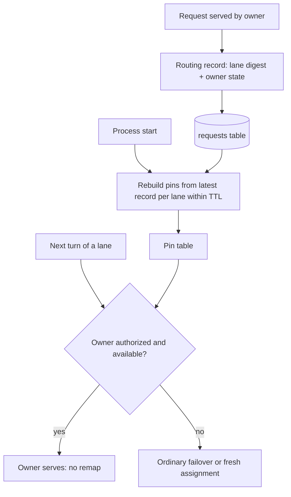
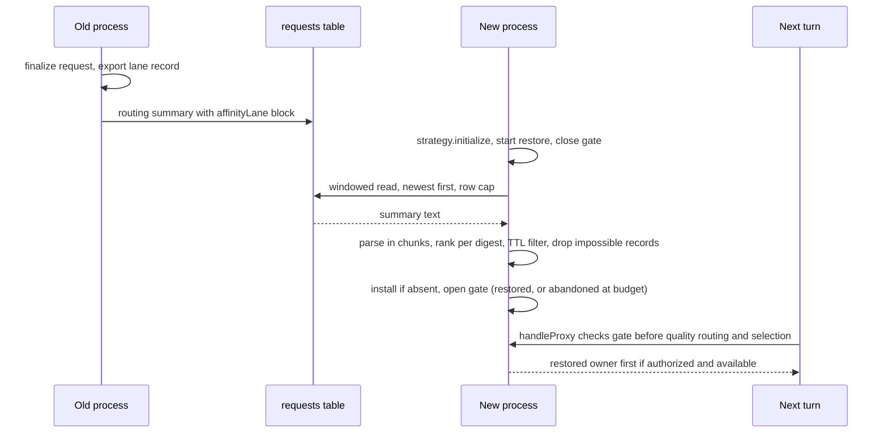
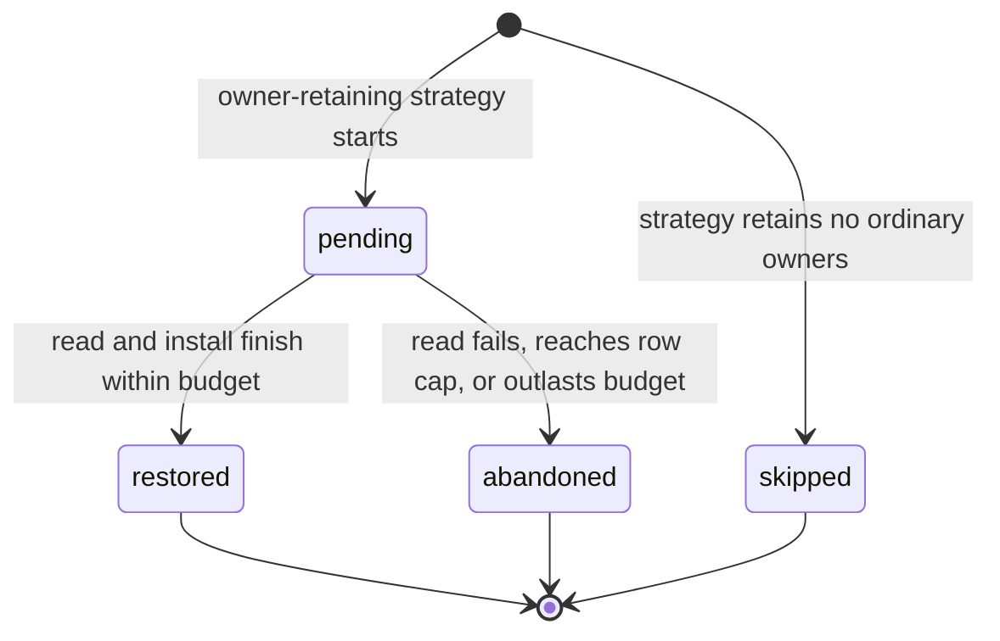

# Restart Affinity Continuity - Plan

## Goal Capsule

- **Objective:** A proxy start no longer moves returning sessions to another account. After a deploy, memory recycle, service stop/start or crash, the next turn of a session whose previous turn finished before the start goes to the account it would have used had the process kept running.
- **Means:** each restart-stable lane's routing record carries its owner state, and the sticky strategy rebuilds its pins from those records at start while routing waits, within a budget, for the rebuild (KTD2, KTD5, KTD6).
- **Product authority:** the operator's 2026-10-30 go to brainstorm restart-affinity continuity with the #516 numbers and the predeclared metric and countermetric. The mechanism is this brainstorm's recommendation, made unattended with no human available to confirm it. Refs #516.
- **Execution profile:** test-first, per AGENTS.md. One PR, shipped as a backend-only deploy.
- **Stop conditions:** stop and report instead of working around it if a restart-stable lane key or candidate id turns out to differ between processes, if any unit needs a guard, runner, deployment-transaction or schema-migration change (R9), or if the R3 round trip fails on either database without a schema change.
- **Finishing:** `ce-work` implements the units and merges the PR under AGENTS.md. Deploying is a separate backend-only run of `scripts/deploy-ccflare.sh`, and the Success Criteria are read at least 14 days after it.
- **Open blockers:** none.
- **Status (2026-10-31):** shipped in #661 (9193caf7) and deployed backend-only on 2026-10-30. The first restored start, at 23:40 UTC, rebuilt 30 pins in 328 ms. The Success Criteria read is #664, due no earlier than 2026-11-13 23:06 UTC, and its query spec lives there. #663 tracks attributing the post-#510 remap rise.

---

## Product Contract

Product Contract preservation: requirement, flow and example text is unchanged. The one change is a Success Criteria sentence, approved by the operator on 2026-10-30, that starts the measurement window at the backend start of the deploy that ships this feature. Planning answered the four deferred questions in KTD3 and KTD5-KTD8, so Outstanding Questions is removed and the first-miss limitation now names that decision. Planning's readings of R1, R2 and R8 are recorded as assumptions AS1-AS3.

### Summary

Each request's routing record also notes which affinity lane it served and the owner state the strategy held afterwards. On start, the sticky strategy rebuilds its pin table from the latest record of each lane still inside the affinity TTL, and restored pins pass the same checks as live ones. The change ships as a backend-only deploy with no schema migration.

### Problem Frame

Production runs `session-drain-soonest` in sticky mode with a 5-hour session duration (`lb_strategy` in the live config, read 2026-10-30). Its pins, the record of which account owns each affinity lane, live only in process memory. Every backend start forgets them, and each lane's next request is routed as a new session.

The cost is measured. Turn pairs spanning an upstream start switched accounts 52% of the time (74 of 142) against about 3% otherwise, and restarts carried 12.15M of the 47.36M real same-or-lower-band remap excess in #516's 14-day window. In the 3.14 days after the warm-owner hold shipped (#510), straddling pairs switched 59-62% of the time against about 4%: roughly 2.6M cache-write tokens a day, about 2.6% of Anthropic cache writes. Each switch rewrites a prefix of about 200k tokens and slows that turn. Codex loss is unmeasured, though restarts drove 29% of Codex switches at 30 minutes.

Starts are frequent and come from several paths. #516's 14-day baseline had 56: 23 deploys, 18 memory recycles, 12 service stop/starts and 3 supervisor restarts. Since 2026-10-26 the journal shows 18 backend starts, only 9 through the guard's overlap handoff; memory recycles and unit starts bypass it. The loss is modest, so it competes with simply restarting less, which is separate work.

### Key Decisions

- **Rebuild pins from request history, not from a shutdown snapshot.** History covers every start kind including crashes and records the owner decisions #516 needs to explain its remaining remaps; a snapshot written at quiesce or stop is the fallback design, faithful but blind to crashes. Governs R1, R2, R4.
- **Record each request's lane identity rather than reconstruct it later.** The requests table stores no `anthropic-beta` signature, so it cannot rebuild the lane key. Governs R1.
- **Restore the whole pin table, not only pins whose cache is still warm.** Pins past the warm window still carry quota-spreading continuity. Governs R4.
- **Rejected: carrying pins in memory across the overlap handoff only.** It covers deploys alone, 9 of 18 starts since 2026-10-26.
- **Rejected: a dedicated durable bindings table.** Its SQLite and PostgreSQL migrations force a full-restart deploy, and it duplicates what the requests table already carries. Governs R9.
- **Rejected: a deterministic owner hashed over the eligible pool.** It contradicts drain-soonest's pace-band assignment of fresh sessions.

### Requirements

**Recording**

- R1. Every request served under an owner-retaining strategy records which affinity lane it belonged to, as a digest that carries no session content.
- R2. The same record carries the owner state the strategy holds once the request is done: preferred owner, temporary fallback if any, when the strategy last selected the owner for the lane, whether the owner was installed at home, and the start of any warm-owner hold episode.
- R3. The added fields survive every write and read path of the routing summary, proven by a persistence round trip in the shape PR #657 used for `processStartedAt`.

**Restoring**

- R4. On start, an owner-retaining strategy rebuilds its pins from the latest record of each lane whose owner was last selected within the affinity TTL, reproducing what the previous process would still have held.
- R5. A restored pin is only a preference over the request's currently authorized and available candidates: it can put its owner first among them, never add a candidate.
- R6. A restored pin keeps the live idle clock: owner idle time runs from when the strategy last selected the owner for the lane, as it does in a running process, so a restart makes no owner look warmer or colder than it would have.
- R7. A warm-owner hold episode under way before the restart keeps its original start, so a restart never extends a hold past its 30-minute cap.
- R8. Restoring never holds up readiness: a history read that fails, comes back partial or would outlast the current handoff fence of about 3 seconds is abandoned, and the strategy starts with an empty pin table, as it does today.

**Deployment and compatibility**

- R9. The change stays deployable backend-only: it touches no guard, runner, deployment-transaction or schema-migration file.
- R10. A restart restores only what the running strategy would itself have kept; strategies and modes that order every turn afresh still do so.

### Key Flows

- F1. Recording a turn
  - **Trigger:** a request finishes under an owner-retaining strategy.
  - **Steps:** the strategy has chosen or kept an owner; the request is served; its routing record is written with the lane digest and the resulting owner state.
  - **Covered by:** R1, R2, R3
- F2. Start-up rebuild
  - **Trigger:** a backend process starts, by deploy handoff, memory recycle, unit start or crash recovery.
  - **Steps:** the strategy reads the latest record per lane inside the TTL, rebuilds its pins, and becomes ready; on a read failure it becomes ready with an empty table.
  - **Covered by:** R4, R8
- F3. First turn after the start
  - **Trigger:** a lane's next request arrives at the new process.
  - **Steps:** the restored pin is checked exactly like a live one; an authorized, available owner serves, including under a still-valid warm-owner hold; otherwise ordinary failover or fresh assignment runs.
  - **Covered by:** R5, R6, R7

### Acceptance Examples

- AE1. **Covers R4, R5.** **Given** a lane owned by account X that was last selected 3 minutes before a deploy, **when** its next turn reaches the new process and X is available, **then** X serves it and no remap occurs.
- AE2. **Covers R5.** **Given** the same restored pin, **when** X is rate-limited or paused at the next turn, **then** the turn fails over exactly as a live pin with an unavailable owner would.
- AE3. **Covers R5.** **Given** a restored pin to an account the deploy removed or the request's route profile no longer authorizes, **when** the next turn arrives, **then** the pin is ignored and the request is routed fresh.
- AE4. **Covers R6, R7.** **Given** an owner outclassed by a higher pace band, held since 25 minutes before a restart and last selected 2 minutes before it, **when** the next turn arrives less than 5 minutes after that selection, **then** the owner is held, and the hold ends no later than 30 minutes after its original start.
- AE5. **Covers R6.** **Given** an owner last selected for a 6-minute stream that started 8 minutes before the restart, **when** the hold judges the owner at the next turn, **then** it counts as idle for 8 minutes plus the time since the restart, exactly as a running process would count it, and no warm-owner hold applies.
- AE6. **Covers R8.** **Given** the database cannot be read at start, **when** the process starts, **then** it becomes ready with no restored pins and routes as it does today.
- AE7. **Covers R4.** **Given** a lane whose owner was last selected 6 hours before the restart, **when** the process starts, **then** that lane is not restored.

### Success Criteria

- Population, for the evidence floor and every rate below: successful Anthropic requests matched to their conversation parent by steps 1-5 of `docs/solutions/observability/measure-session-remap-cache-cost-from-the-requests-table.md`, keeping pairs whose idle gap is under 5 minutes as that doc's step 8 splits it. A pair straddles a start when its two records carry different `processStartedAt`, and switches when its two turns were served by different accounts. The window begins at the backend start of the deploy that ships this feature: pairs that straddle that start have no earlier lane record to restore from, so they are the before-state and are excluded.
- Evidence floor: at least 14 days after deploy and at least 100 straddling non-failover pairs in that population; missing either reads as insufficient evidence, not success.
- Success: excluding pairs where either turn is a failover, the straddling switch rate is at most 2x the non-straddling rate in the same window. The 52% against about 3% before-figure comes from that doc's partition-order pairs, a different population, so it is context, not the comparison.
- Countermetric: over the same pairs with failovers kept, the later turn's failover rate and upstream 429 rate are no higher for straddling pairs than for non-straddling ones.

### Scope Boundaries

Deferred for later:

- Lowering the restart rate itself, such as memory-recycle frequency or deploy batching.
- Restoring new-session spreading timestamps and per-lane route-failure circuits; both rebuild within minutes of normal traffic.
- Re-seeding pins when an `lb_strategy` config change rebuilds the strategy at runtime.
- Measuring Codex cache loss; Codex lanes are restored like any other, but the success criteria do not gate on them.
- Anthropic degraded-mode owner overlays.

Accepted limitations:

- A lane whose first-ever request was still in flight at the restart has no record yet and is routed fresh; planning adds no first-miss lookup (KTD7).
- A deploy that changes how lane keys are derived restores no pins recorded before it.

### Dependencies / Assumptions

- Production keeps an owner-retaining strategy; `session-drain-soonest` in sticky mode was confirmed in the live config on 2026-10-30.
- Account availability state is persisted on the accounts table (`rate_limited_until`, `paused`) and reloaded at start, so restored pins are validated against current state.
- The routing summary has room for the added fields: its largest value over 7 days was 3,145 characters against a 16,384-character cap.
- The quiesced old process keeps its database connection and writes its in-flight requests' records after the new process starts.

### Sources / Research

- Issue #516 (attribution of the 1,575 remaps; restart class 12.15M).
- `docs/solutions/observability/measure-session-remap-cache-cost-from-the-requests-table.md`: restart effect and measurement method.
- `packages/load-balancer/src/strategies/session-affinity.ts`: in-process pin map, entry fields, pin validation, warm-hold hook.
- `packages/load-balancer/src/strategies/session-drain-soonest.ts`: warm-hold limits.
- `packages/proxy/src/handlers/account-selector.ts` (`deriveAffinityLaneKey`): lane composition.
- `packages/proxy/src/handlers/routing-attempt-ledger.ts` and `packages/types/src/request.ts`: routing summary producer and sanitizer.
- `scripts/run-ccflare-stack.sh` (memory recycle), `scripts/ccflare-deployment-transaction.mjs` (overlap handoff phases), `scripts/deploy-ccflare-lib.sh` (backend-only eligibility).
- `CONCEPTS.md`: Affinity lane, Warm-owner hold, Session remap, Child route home, Quiesced backend.

---

## Planning Contract

### Key Technical Decisions

- KTD1. **Key the strategy's tables by a one-way digest of the lane.** `affinityKey()` (`packages/load-balancer/src/strategies/session-affinity.ts:312-317`) returns a hex SHA-256 of a domain-tagged form of today's `lane:` or `client:` key. The pin map, the route-failure circuits, the recorded identity and the restore key are then one value, and restore uses the ordinary lookup. The digest is unkeyed. `packages/proxy/src/opaque-runtime-id.ts` keys its digests with a per-process secret so low-entropy session ids cannot be recovered offline, but this digest is stored in a `requests` row that already holds `client_session_id` raw, so a key would protect nothing and would rotate on every start. Hash on every call with no memo: a request computes roughly 6-10 digests of a short string (`session-affinity.ts:312-321` and its hook call sites), a few microseconds each. No code reads the key's text. The route-failure map iterates keys only for expiry and counts, and diagnostic logs print the raw `meta.affinityLaneKey`. The one exception is a test that reads the private map's keys (U1). Rejected: raw keys plus a separate digest table consulted on a miss, which adds a second lookup path with its own expiry.
- KTD2. **Record at request finalization, through the routing summary.** `RequestLifecycleCoordinator.commitFinalization` (`packages/proxy/src/routing-terminal-recorder.ts:127-170`) calls a lane-record closure bound with the ledger at `packages/proxy/src/proxy.ts:1042` and passes its result to `terminalSummary` as an optional `affinityLane` block, the way `webSearchHelper` is passed today. The closure applies the restart-stable lane check (AS1) and reads `ctx.strategy` when called, so a hot strategy swap records the current strategy. Finalization runs after any owner commit that waits for success (`docs/solutions/architecture-patterns/commit-bound-routing.md`), so the record holds the state the lane's next turn would meet. Each request's summary is written exactly once, at the end (`packages/proxy/src/usage-collector.ts:2095-2098` makes no preliminary insert), so the first-writer-wins `COALESCE` on `routing_attempt_summary` (`request.repository.ts:355`) cannot hide a block-bearing summary behind an earlier one.
- KTD3. **A record mirrors the live entry, including its absence.** The block is `{digest, observedAt, owner}`. `owner` is null, a tombstone, when the strategy holds no unexpired entry for the lane. Otherwise it carries the entry's `candidateId`, `accountId`, `fallbackCandidateId`, `assignedAt`, `upgradedAt`, `suppressUpgradesUntil`, `installedBelowBestConfiguredTier` and `pressureHoldSince` (AS2), with null fields omitted. `observedAt` orders exports; `assignedAt` records the last selection, which any select refreshes, including one whose request later fails. For each digest the winning record has the latest summary `processStartedAt`, then the latest `observedAt`, then the larger `owner.assignedAt`, and a tombstone ranks lowest. Within one process, every record is read from the live map at finalize, so the latest observation is the freshest state even when one lane's requests finish out of order. Across processes, a quiesced old process can finish an in-flight request after the new process has served and recorded the same lane, and its record would carry the old process's stale map with a later `observedAt`. The quiesced process admits nothing new, so wherever both processes recorded a lane the newer one is authoritative, and ranking `processStartedAt` first says exactly that. `requests.timestamp` does not order records.
- KTD4. **One validator owns the block.** `packages/types/src/request.ts` gains the block's type, its sanitizer and a parser for restore. `sanitizeRequestRoutingAttemptSummary` calls the sanitizer and restore calls the parser, so writing and reading accept the same shapes. The oversize ladder (`request.ts:618-648`) never drops the block. The block adds an estimated 300-450 characters, and about 700 when both owner and fallback are managed-combo members, which U2 measures, against a 16,384-character cap and a largest observed summary of 3,145. A summary still over the cap after the ladder is rejected whole, as today, and loses its block with it. The summary is sanitized again in the usage collector (`usage-collector.ts:1417-1420`), on save (`request.repository.ts:258`) and in the row mapper (`request.ts:935`), so all three must carry the block. Candidate ids need their own validator because `routingIdentity` (`request.ts:431-437`) rejects `%` and `#` and caps ids at 128 characters, and real owner ids break both rules. `capacity-deferred:` and `profile:` ids are built with `encodeURIComponent`, and a repeated account gets a `#n` suffix (`packages/load-balancer/src/strategies/routing-metadata.ts:42-46`). Combo candidates reach the strategy with their member id as the candidate id (`account-selector.ts:4241` and `:4472`). A managed member's id, `combo:<combo>:managed:<family>:rule:<rule>:account:<account>` (`packages/core/src/combo-membership-resolver.ts:40-47`), is 185 characters with production's 77-character rule ids. The validator accepts the routing-identity characters plus `%` and `#`, up to 512 characters. Production served no combo candidates in the 7 days to 2026-10-30, so the storage estimate under System-Wide Impact is unaffected. An owner that fails validation is written as a tombstone, and the rest of the summary is kept. The summary keeps its current version; a row without the key reads as having no record.
- KTD5. **Read history once, windowed and capped.** A new request-repository method returns the `routing_attempt_summary` text of rows with `timestamp >= now - ttl` whose text contains `"affinityLane"`, newest first, up to a 20,000-row cap, and reports whether the cap was reached. It reads through `queryOffThread` (`packages/database/src/repositories/base.repository.ts:6-17`), which uses the reader worker on SQLite and an ordinary async query on PostgreSQL. Parsing happens in JavaScript rather than with `json_extract` or `::jsonb`, because the column is TEXT on both databases and test fixtures hold malformed JSON. The window is exact. The upsert sets `timestamp = EXCLUDED.timestamp` and binds `Date.now()` at save (`packages/database/src/repositories/request.repository.ts:296` and `:361`), not the request's start time, so a row is saved at or after its record's `observedAt`, which is at or after `owner.assignedAt`. The TTL is the strategy's own affinity TTL. Request retention is at least one day (`packages/config/src/index.ts:1650-1672`), longer than the 5-hour TTL. Production holds about 6,000 rows per 5-hour window (2026-10-30), so a reached cap means something abnormal; it counts as a partial read and is abandoned under R8, even though a newest-first read would still hold the latest record of most lanes. On SQLite the reader worker spawns lazily on its first read, and that spawn counts against the budget. When the worker is unavailable, `queryOffThread` silently falls back to a synchronous main-thread read (`packages/database/src/adapters/bun-sql-adapter.ts:149-158`), which the budget timer cannot interrupt. That fallback is accepted (operator decision, 2026-10-30). Production never disables the worker, so at start it happens only on a reader fault. The row cap bounds it: the newest 20,001 summaries (16.7 MB) took 10-40 ms in the sqlite3 CLI on the production database, an estimated 40-150 ms with JavaScript string construction, against the 3-second budget. Refusing the fallback would do more harm, because the reader reports a busy database the same way as a missing worker (`packages/database/src/off-thread-reader.ts:231-233`), so a no-fallback read would abandon restore on ordinary starts where the worker is slow to spawn or the database is briefly locked. A fallback read shows only as a long `durationMs`; a read that throws abandons the restore (AE6). Parsing runs in chunks of a few hundred rows into a staging map, yielding between chunks and checking the budget at each, so the budget can stop a slow parse. Records are installed only once parsing completes.
- KTD6. **Hold routing, not readiness, until the restore settles.** Restore starts right after `strategy.initialize` (`apps/server/src/server.ts:2087`). Startup does not await it, and the listener binds as today (`server.ts:2625`). `handleProxy` checks the strategy's restore gate once, just before quality routing (`packages/proxy/src/proxy.ts:1419`). That point precedes every account selection on the request path: quality routing selects directly (`packages/proxy/src/quality-route-candidates.ts:623`) before the ordinary selector (`proxy.ts:2163`), and the degraded overlay's owner snapshot (`captureAffinityOwnerSnapshot`, `account-selector.ts:2029`) runs inside the selector. Neither function has a caller outside `handleProxy`.
  - **Gate behavior:** the gate is open by default and closes only when a restore starts. The hot strategy rebuild (`server.ts:2373-2387`) starts no restore, so it never waits. Once open, the check is a synchronous flag with no await, and request handling is unchanged after a restore settles. The gate opens when the restore finishes, or `AFFINITY_RESTORE_BUDGET_MS` after the restore began, whichever comes first; a read that finishes later is discarded, not cancelled. The restore installs into the strategy instance it was given, so a strategy replaced mid-restore discards it harmlessly.
  - **Necessity:** the overlap handoff quiesces the old backend before the new one starts (`old_quiesced` precedes `candidate_started`, `scripts/ccflare-deployment-transaction.mjs:166-169`). The turns the guard holds are exactly the turns that straddle the start, and they reach the new backend once it binds. The restore starts before the long stretch of startup that ends in the bind, so it usually settles first. The gate turns that likely order into a guarantee.
  - **Budget:** `AFFINITY_RESTORE_BUDGET_MS` is 3,000 ms, R8's figure. No existing handoff timer of that length was found in the code; the nearest is the deployment-transaction client's 3,000 ms socket timeout (`scripts/ccflare-deployment-transaction.mjs:366`), which is unrelated, so the figure comes from the requirement rather than a measured fence. It fits the existing timeouts: the guard's 120 s idle and 600 s total deadlines (`scripts/ccflare-guard.mjs:57-86`), the 60 s deploy health wait (`scripts/deploy-ccflare.sh`), and the 20 s account-selection deadline (`packages/proxy/src/pre-transport-deadline.ts:11`), which starts after the gate. `/health` is not routed and never waits.
  - **Accepted exception:** the dashboard's primary-account peek (`packages/http-api/src/handlers/accounts.ts:422`) is not gated and can show a pre-restore owner for up to the budget.
  - **Rejected:** a restore that no request waits for, which can lose the race to the first held turn; a gate in `selectAccountsForRequest`, which misses quality routing; a gate inside `strategy.select`, which misses the synchronous owner snapshot; awaiting the restore before `Bun.serve`, which holds readiness, contrary to R8.
- KTD7. **No first-miss lookup and no catch-up pass.** `select()` keeps no database read. A turn that finished on the quiesced process after the restore read is picked up at the next start. A lane with a turn in flight at the read is restored with its idle time overstated by that turn. A per-miss read would put database latency in front of every fresh session to recover a gap that only lanes straddling the read can fall into.
- KTD8. **Leave missing usage at start alone.** Until a fresh usage snapshot exists, `getWeeklyQuotaPressure` returns null, and `compareStrategyCandidates` and `isSameStrategyCandidateClass` treat a comparison as in class when either side lacks pressure or a comparison key, or the two keys differ (`routing-metadata.ts:193-209` and `:283-294`). So no restored owner looks outclassed by pace band while usage polling catches up, which it does at a 5-second stagger per account (`server.ts:2751`). That undecided verdict must not end a hold episode, though. Today every in-class turn clears `pressureHoldSince` (`session-affinity.ts:1413-1417`), so a restored lane whose first turn lands in the usage gap would lose its recorded hold start, and its next outclassed turn would begin a fresh 30-minute episode, contrary to R7. An undecided comparison therefore leaves an existing hold start unchanged, while a decided in-class comparison, with both sides' pressure under one comparison key and in one band, still ends the episode. (Codex owners keep class through `preservesAffinityAcrossQuotaPressure`, `session-drain-soonest.ts:80-91`, but the warm hold applies only to Anthropic owners, so they never carry a hold start.) The rule applies to live entries too, where it changes only an episode that spans a stale usage snapshot: that episode keeps its original start instead of starting over. A hold that begins once usage arrives starts its own episode, and a recorded hold keeps its start (R7).
- KTD9. **Install restored entries directly, live entries first.** A synchronous strategy method installs parsed records. It drops a record when `now - assignedAt >= ttl`, clamps any timestamp later than `now` to `now` except `suppressUpgradesUntil`, which is legitimately in the future, and installs newest `assignedAt` first up to `maxAffinityEntries` minus the live entry count. It never replaces a live entry and sets `crossTierProtectionLogged` to false. After clamping, it drops rather than repairs any record no live path could produce:
  - a fallback equal to the owner;
  - `upgradedAt` or `pressureHoldSince` later than `assignedAt`, since every select sets `assignedAt` at or after them (`session-affinity.ts:1407-1416`, `:1527-1528`);
  - `suppressUpgradesUntil` later than `assignedAt` plus the anti-thrash window, since it is set from an earlier `upgradedAt` (`:1609-1625`).

  A fallback owner with a hold start is a live state (`:925` sets the fallback and leaves the hold), so such a record installs as recorded. Install does not go through `commitAffinityOwner`, whose compare-and-set and transition counters describe routing decisions, and a restore is not one.
- KTD10. **One hook decides which strategies take part.** `SessionAffinityStrategy` gains a protected `retainsOrdinaryOwners()` that returns true, and `SessionDrainSoonestStrategy` overrides it to return `mode === "sticky"`. Export and restore do nothing when it returns false; `LeastUsedStrategy` and `SessionStrategy` implement neither (R10).
- KTD11. **Report the restore on `/health`.** `RoutingHealth` (`packages/types/src/stats.ts`) gains an optional `affinityRestore` with the state (`pending`, `restored`, `abandoned` or `skipped`), records read, pins restored, duration and abandon reason. The health handler already returns routing health whole (`packages/http-api/src/handlers/health.ts:228` and `:267`). The outcome is also logged once, at warn when abandoned and at info when restored; production logs at warn, so `/health` is where to check it.

### High-Level Technical Design

These sketches show direction; the units own the detail.

| `lb_strategy` | Records lane state | Restores at start |
|---|---|---|
| `session-drain-soonest` (sticky) | yes | yes |
| `session-affinity` | yes | yes |
| `session-drain-soonest-strict` | no | no, reports `skipped` |
| `least-used`, `session` | no | no |

### Assumptions

These are planning bets made with no human available to confirm them. Check them in review.

- AS1. Only lanes a new process re-derives identically record and restore: `routing-lane-v1`, `routing-lane-profile-v1` and the `client:` fallback. This narrows R1's "every request". Lanes keyed for child route homes (`routing-lane-profile-child-v1`), web-search helpers and quality routing embed per-process HMAC ids, so their records could never match after a restart. The sources are `packages/proxy/src/opaque-runtime-id.ts:42-47`, `packages/proxy/src/claude-code-request.ts:107-131` and `packages/proxy/src/quality-route-candidates.ts:596-603`. In the 7 days to 2026-10-30, 210 of 98,441 successful Anthropic requests carried a route profile, the only kind that can use a child-home lane. All 75,342 successful Codex requests carried one, so Codex subagent lanes stay unrestored.
- AS2. R2's owner state also carries `accountId`, `upgradedAt` and `suppressUpgradesUntil`, so a restored entry matches the live one in every field routing reads (R4, R6).
- AS3. R8 limits readiness, not first-turn latency. A turn that arrives before the restore settles waits for it, at most until the budget runs out (KTD6).
- AS4. A request that ran several fallback rungs records only its final rung's lane. Each rung re-derives the lane key from its own model (`account-selector.ts:1741`, `:3137`, `:3428`), so an earlier rung's lane keeps its previous record. The closure applies no special case for internal requests. A request that writes no request row records nothing, such as an internal auto-refresh on the local-terminal path (`proxy.ts:1061` passes `skip`). In both cases the stored record can lag the live entry until that lane's next recorded turn rewrites it.
- AS5. With `BETTER_CCFLARE_MULTI_INSTANCE` in its default warn mode, two processes sharing one database restore each other's pins. Because KTD3 ranks `processStartedAt` first, the later-started process's records always win, even when they are hours staler than the other's. Restored pins are preferences only (R5), so this is accepted.
- AS6. Switching `lb_strategy` from sticky to a non-retaining strategy and back, then restarting, can restore pins recorded before the first switch. Production does not switch strategies.

### System-Wide Impact

- **Storage:** each request row's `routing_attempt_summary` grows by an estimated 300-450 characters on an average of about 900. At the 7-day volume to 2026-10-30 of 186,596 successful requests, 300 characters comes to roughly 8 MB a day before retention. No table, column or index is added.
- **Summary consumers:** the sanitizer and its three re-sanitizing callers (KTD4); `worker-messages.ts` (type only); and the row mappers `toRequest`/`toRequestResponse` (`request.ts:935`, `:977`), which have no non-test caller. The request-list handlers select explicit columns without the summary (`packages/http-api/src/handlers/requests.ts:80`, `:147`), so no API response carries the block. The dashboard's `RoutingAttemptSummary` (`packages/types/src/routing-attempt.ts:54`) is an unrelated aggregate. `docs/routing-architecture.md:114` documents the summary's fields.
- **Request path:** 6-10 SHA-256 digests of a short string per request (KTD1), and one synchronous gate check per request once the restore settles (KTD6).
- **Privacy:** the digest is one-way but unkeyed. It sits next to the raw `client_session_id` it is derived from, so it reveals nothing the row did not already hold.
- **Interfaces:** `LoadBalancingStrategy` (`packages/types/src/context.ts:214`) gains optional export, restore and gate methods; custom strategies without them behave as today. `/health` gains one field, and the guard reads no routing health.
- **Databases:** SQLite and PostgreSQL both store the summary as TEXT, so neither `migrations.ts` nor `migrations-pg.ts` changes (R9).

### Risks

| Risk | Effect | Mitigation |
|---|---|---|
| A lane key or candidate id differs between processes | Restore runs but every restored pin misses | U1 pins the id formats, U5's parity harness uses the real candidate builders, and the Success Criteria show whether straddling turns stay put |
| The database stalls at start, or the reader worker spawns slowly | First turns wait up to 3 s, then route fresh | The budget (KTD6); `/health` shows the duration and abandon reason. A budget abandon with few or no records read points at worker spawn time, not query time |
| The reader worker is unavailable on SQLite | The restore read runs on the main thread and blocks it until it returns | Accepted: the 20,000-row cap bounds the read to an estimated 40-150 ms, and it shows as a long `durationMs` (KTD5) |
| The async writer has not flushed, or has dropped, a turn's row (`packages/database/src/async-writer.ts:44-60`, a 2,000-job metadata cap) | The newest turns, which are the ones most likely to straddle a start, restore from an older record or not at all | Accepted, because restore is best-effort and R5 revalidates every pin. The lane's next turn rewrites the record. The Success Criteria and the post-deploy check understate the restored share by this tail |
| The validator rejects a real id form | Owners are written as tombstones and nothing restores | U1 pins the literal id of every form, including manual and managed combo members, and U2's sanitizer keeps ids with `%` and `#` and a 185-character managed-combo id (KTD4) |
| Summary growth adds disk use | About 8 MB a day more on the requests table | Null fields omitted (KTD3); watch database size after deploy |
| A restored pin keeps an account a fresh start would have moved off | The lane stays on its old owner | Same as a live pin in that state (R5); outclass and hold rules apply unchanged |

### Documentation / Operational Notes

- The deploy that ships this change restores nothing, because no earlier row carries the block. Check the next backend start instead: `routing.affinityRestore` on `/health` should read `restored` with `pinsRestored` above zero.
- The Success Criteria measurement uses `processStartedAt`, which every routing summary has carried since #657.
- `CONCEPTS.md`: the Affinity lane entry notes which lanes survive a restart (U5).
- A configured affinity TTL longer than request retention restores only what retention still holds. Retention is at least one day, so the 5-hour production TTL is unaffected.

---

## Implementation Units

### U1. Lane digest and restart-stable identities

- **Goal:** the strategy keys its tables by a lane digest, and the proxy can tell which lanes a new process derives identically.
- **Requirements:** R1; KTD1; AS1.
- **Dependencies:** none.
- **Files:**
  - `packages/load-balancer/src/strategies/session-affinity.ts` (`affinityKey`)
  - `packages/load-balancer/src/strategies/affinity-lane-digest.ts` (new)
  - `packages/proxy/src/handlers/account-selector.ts` (restart-stable check beside `deriveAffinityLaneKey`)
  - Tests: `packages/load-balancer/src/strategies/__tests__/session-affinity.test.ts`, `packages/proxy/src/handlers/__tests__/account-selector.test.ts`, `packages/proxy/src/handlers/__tests__/websearch-helper-admission.test.ts`
- **Approach:** the digest uses `createHash` from `node:crypto`. The check takes the request's lane key and client session id. `deriveAffinityLaneKey` and the check read the lane tags from one shared definition, so they cannot drift apart.
- **Patterns:** clock-injected strategy construction at `session-affinity.test.ts:811-817`. `opaque-runtime-id.ts` is the keyed per-process HMAC that this digest deliberately does not reuse (KTD1).
- **Execution note:** write the digest and check tests first.
- **Test scenarios:**
  - Two strategy instances produce the same digest for one lane key. A `lane:` key and a `client:` key built from the same string produce different digests, and no digest contains the session id.
  - The existing `session-affinity.test.ts` suite passes unchanged, so digest keying changes no routing behavior.
  - `websearch-helper-admission.test.ts:937-939` reads the private map's raw keys and asserts they omit `helper-session`, which a digest satisfies vacuously. It is rewritten to assert that the digest of `client:helper-session` is not among the keys, and its entry-count assertions still hold.
  - The check returns true for `routing-lane-v1` and `routing-lane-profile-v1` keys and for a null lane with a session id. It returns false for `routing-lane-profile-child-v1`, web-search helper and quality-routing keys, and for a null lane without a session id.
  - For a fixed account, profile and combo configuration, the selector yields literal expected ids for `account:` (including a repeated account's `#1`), `capacity-deferred:`, `profile:`, and manual and managed combo members (`combo:<combo>:slot:<slot>` and the managed form in KTD4), so a per-process component added later fails the test.
- **Verification:** `bun test` on both test files.

### U2. Lane record export and summary block

- **Goal:** the strategy exports a lane record for a request, and the routing summary carries it through sanitizing and both databases.
- **Requirements:** R1, R2, R3, R10; KTD3, KTD4, KTD10; AS2.
- **Dependencies:** U1.
- **Files:**
  - `packages/types/src/request.ts` (block type, field on `RequestRoutingAttemptSummary`, sanitizer, restore parser)
  - `packages/types/src/context.ts` (optional export method on `LoadBalancingStrategy`)
  - `packages/load-balancer/src/strategies/session-affinity.ts` (export method, `retainsOrdinaryOwners`)
  - `packages/load-balancer/src/strategies/session-drain-soonest.ts` (`retainsOrdinaryOwners` override)
  - `packages/proxy/src/handlers/routing-attempt-ledger.ts` (`terminalSummary` option)
  - `docs/routing-architecture.md` (summary fields, near `:114`)
  - Tests: `session-affinity.test.ts`, `packages/load-balancer/src/strategies/__tests__/session-drain-soonest.test.ts`, `packages/proxy/src/handlers/__tests__/routing-attempt-ledger.test.ts`, `packages/database/src/repositories/__tests__/request-attempt-summary.test.ts`
- **Approach:** the export reads the lane's entry without touching TTLs or recency, as `snapshotAffinityOwner` does (`session-affinity.ts:401-412`), and stamps `observedAt` from the strategy clock. The ledger adds the block next to `processStartedAt` (`routing-attempt-ledger.ts:334`).
- **Patterns:** #657's `processStartedAt` round trip in `routing-attempt-ledger.test.ts:678-732` and in `request-attempt-summary.test.ts` with `route-provenance.fixture.ts`.
- **Execution note:** extend the #657 round trip with the block before adding the field.
- **Test scenarios:**
  - After a sticky select, the export carries every owner field with the entry's values. For a lane never selected, or after the TTL passes, it returns a tombstone.
  - A drain-soonest strategy in strict mode exports nothing, and so does a request with neither a lane nor a session id.
  - The sanitizer keeps a block whose candidate ids contain `%` and `#`, and one whose owner is a 185-character managed-combo member id. It writes an owner with a non-finite `assignedAt` or an id over 512 characters as a tombstone and keeps the rest of the summary.
  - The serialized block, built with the longest real candidate ids (a managed-combo member id with a 77-character rule id as both owner and fallback; a `profile:` id with an encoded model; an `account:` id with `#1`) and every owner field set, stays under a stated character bound.
  - A summary over the size cap drops `decision` and `streamEvidence` and keeps `affinityLane`, and the length the ladder measures includes the block. A summary still over the cap after the ladder sanitizes to null, as today.
  - Written and read back through SQLite and the fake PostgreSQL adapter, and through the row mapper at `request.ts:935`, the block is unchanged; a row written before this change reads back with no block.
- **Verification:** `bun test` on each file; PostgreSQL-gated cases run with `DATABASE_URL` set or are reported as skipped.

### U3. Record at finalization

- **Goal:** every finalized request on a restart-stable lane writes its lane record.
- **Requirements:** R1, R2; KTD2; AS1, AS4.
- **Dependencies:** U2.
- **Files:**
  - `packages/proxy/src/routing-terminal-recorder.ts` (`bindRoutingObservation` accepts the closure; `commitFinalization` calls it)
  - `packages/proxy/src/proxy.ts` (closure at `:1041-1046`)
  - Tests: `packages/proxy/src/__tests__/routing-decision-persistence.test.ts`, `packages/proxy/src/__tests__/proxy-cancellation-history.test.ts`, `packages/proxy/src/__tests__/usage-collector-stream-terminal-state.test.ts`
- **Approach:** the closure runs inside the existing `try` in `commitFinalization`, so a failure goes to `reportRecorderFailure` and the summary is still written, without the block.
- **Test scenarios:**
  - A successful request's summary carries the state at finalize: a change to the entry between bind and finalize appears in the record.
  - Through `UsageCollector.handleEnd`, the block survives the success, failure and client-cancel branches (`usage-collector.ts:1417-1445`) into the saved request.
  - A request that ran two fallback rungs records the final rung's lane only, and the first rung's lane keeps its earlier record.
  - A deferred finalization records at release, not at the first `finalize` call.
  - A local routing terminal (`recordRoutingTerminalRequest`) records the lane's current state.
  - A closure that throws leaves a summary without the block and reports the error.
  - A request on a child-home lane writes no block.
  - Replacing `ctx.strategy` between bind and finalize records the replacement's state.
- **Verification:** `bun test` on each file.

### U4. Windowed history read

- **Goal:** the database returns, in one bounded read, the recent summaries that carry a lane record.
- **Requirements:** R4, R8; KTD5.
- **Dependencies:** none. The read matches the literal key `"affinityLane"`, and its fixtures are raw JSON text, so it can run beside U2.
- **Files:**
  - `packages/database/src/repositories/request.repository.ts` (new read method)
  - `packages/database/src/database-operations.ts` (facade method)
  - Tests: `packages/database/src/repositories/__tests__/request-attempt-summary.test.ts`, or a sibling file if the cases outgrow that file's theme
- **Approach:** fetch one row past the cap to detect a reached cap without a count query.
- **Patterns:** `queryOffThread` in `packages/database/src/repositories/external-usage.repository.ts:357`; live-PostgreSQL gating in `usage-windows.repository.test.ts:447-552`.
- **Test scenarios:**
  - Rows inside the window with the block come back newest first. Rows older than the window and rows without the block do not.
  - With more matching rows than the cap, the method returns exactly the cap and reports it reached.
  - A malformed summary that contains the key comes back as text for the parser to reject.
  - A row saved through `RequestRepository.save` is returned even when the request it records started more than the TTL ago, because the row's timestamp is save time (KTD5).
  - On SQLite, the query plan for the read uses `idx_requests_timestamp`.
  - The same cases pass against live PostgreSQL when `DATABASE_URL` is set. Without it they are reported as skipped, and the fake-adapter round trip in U2 is the only PostgreSQL evidence.
- **Verification:** `bun test` on the file; PostgreSQL cases run or are reported as skipped.

### U5. Restore, gate and outcome

- **Goal:** a starting owner-retaining strategy rebuilds its pins from the records within the budget, and reports how it went.
- **Requirements:** R4, R5, R6, R7, R8, R10; KTD6, KTD8, KTD9, KTD10, KTD11; AS3.
- **Dependencies:** U1, U2, U4.
- **Files:**
  - `packages/load-balancer/src/strategies/affinity-restore.ts` (new: read, chunked parse, ranking per digest, budget race, outcome)
  - `packages/load-balancer/src/strategies/index.ts` and `packages/load-balancer/src/index.ts` (export the orchestrator; both barrels list exports by name)
  - `packages/load-balancer/src/strategies/session-affinity.ts` (install method with the KTD9 normalizer, gate, outcome in `getRoutingHealth`, TTL accessor, and the KTD8 rule that an undecided comparison keeps the hold start)
  - `packages/types/src/context.ts` (optional restore and gate methods)
  - `packages/types/src/stats.ts` (`RoutingHealth.affinityRestore`)
  - `CONCEPTS.md` (the Affinity lane entry notes which lanes survive a restart)
  - Tests: `packages/load-balancer/src/strategies/__tests__/affinity-restore.test.ts` (new), `session-affinity.test.ts`, `session-drain-soonest.test.ts`
- **Approach:** the orchestrator takes the reader, the strategy and a clock as arguments, so tests drive it without a database. `AFFINITY_RESTORE_BUDGET_MS` lives beside it.
- **Patterns:** the injected clock at `session-affinity.test.ts:811-817`; `spyOn(Date, "now")` before construction for drain-soonest at `session-drain-soonest.test.ts:718-725`; the warm-hold cases at `:694-800`.
- **Execution note:** build the parity harness first. Strategy A serves turn 1 through the real `select()` on account rows and exports the record. Strategy B, a fresh instance given the same account rows, restores it. Both strategies are constructed after the clock mock is in place. Both then serve turn 2 at the same clock time, and the test compares the order each returns and the record each exports afterwards.
- **Test scenarios:**
  - AE1: owner X was last selected 3 minutes before the start and is available; both strategies put X first.
  - AE2: X is rate-limited at turn 2; both fail over to the same account and leave the same entry.
  - AE3: X is missing from turn 2's accounts; both produce the same order and entry.
  - AE4: a drain-soonest Anthropic owner outclassed by a higher pace band, with its hold started 25 minutes and its last selection 2 minutes before the start. A turn within 5 minutes of that selection is held; a turn more than 30 minutes after the hold's start is not.
  - AE4 with no usage at the first turn after the start, driven through drain-soonest: the owner stays first and its restored hold start is unchanged. Once usage arrives showing the higher pace band, the hold still ends no later than 30 minutes after its original start.
  - On a live entry, a hold episode that spans a turn without usage keeps its start, and a decided same-band turn still ends it. The existing warm-hold cases (`session-drain-soonest.test.ts:731-844`) still pass; the cap-restart case at `:809` ends its episode with a decided same-band turn.
  - AE5: the owner was last selected 8 minutes before the start; the hold measures idle time from that selection and does not hold.
  - AE6: the reader throws; the strategy has no entries, the gate opens, and health reads `abandoned` with the reason.
  - AE7: a record whose `assignedAt` is 6 hours old is not installed.
  - Out-of-order records for one digest from one process restore the latest `observedAt`, a tie restores the larger `assignedAt`, and a tombstone as the latest record restores nothing.
  - Two requests on one lane that overlap, finishing in the opposite order to their start, and a request that fails after selection, each leave the latest record holding the live map's state at the last finalize.
  - Cross-process: an old process's record with a later `observedAt` loses to the newer process's record for the same digest, because `processStartedAt` ranks first.
  - Normalizer: a record whose fallback equals its owner, whose `upgradedAt` or `pressureHoldSince` is later than `assignedAt`, or whose `suppressUpgradesUntil` exceeds `assignedAt` plus the anti-thrash window is dropped. A record with a fallback owner and a hold start installs as recorded.
  - A reader that resolves after the budget: the gate opens at the budget, health reads `abandoned`, and the late records are never installed.
  - A reader that never resolves: the gate opens at the budget and nothing is installed.
  - A budget that runs out mid-parse installs nothing, including records already staged.
  - A reached row cap is abandoned without installing anything.
  - A live entry for a digest survives a restored record for the same digest.
  - With the table near `maxAffinityEntries`, only as many records as fit are installed, newest `assignedAt` first.
  - A record stamped later than `now` is clamped, while a future `suppressUpgradesUntil` is kept.
  - A restored entry with a temporary fallback owner keeps it, and the hold treats it as it treats the live entry.
  - In strict mode the restore reads nothing and health reads `skipped`.
- **Verification:** `bun test` on each file.

### U6. Start wiring and routing gate

- **Goal:** production starts the restore at boot, and request handling waits for the gate before quality routing and account selection.
- **Requirements:** R4, R8, R9; KTD6, KTD11.
- **Dependencies:** U5.
- **Files:**
  - `apps/server/src/server.ts` (start the restore right after `strategy.initialize?.(strategyStore)` at `:2087`)
  - `packages/proxy/src/proxy.ts` (check the gate in `handleProxy` just before `routeQualityRequest` at `:1419`)
  - Tests: a suite that drives `handleProxy`, such as `packages/proxy/src/__tests__/proxy-cancellation-history.test.ts`; `packages/http-api/src/handlers/__tests__/health-runtime.test.ts`; `apps/server/src/server.test.ts` (the hot-reload routing-health case at `:1447-1482`)
- **Approach:** the server hands the orchestrator the facade read method from U4, the strategy and the system clock, and does not await the result. A strategy without a gate is not awaited. The hot strategy rebuild at `server.ts:2373-2387` starts no restore.
- **Test scenarios:**
  - A request that arrives while the gate is pending is not selected until the gate opens, and then sees the restored entry.
  - A quality-routed request that arrives while the gate is pending also waits, because the check precedes `routeQualityRequest`.
  - A request after the gate opens is selected without waiting on the reader.
  - A strategy that never started a restore has an open gate, so its requests do not wait.
  - The hot strategy rebuild produces a strategy whose requests do not wait, and the existing hot-reload case passes.
  - A strategy without restore support selects as it does today.
  - `/health` includes `routing.affinityRestore` when the strategy reports it.
- **Verification:** `bun test` on each file; `bun run build:cli` succeeds.

---

## Verification Contract

| Check | Command or method | Covers |
|---|---|---|
| Inline workers built once in a fresh worktree | `bun run build:cli` | before any `bun test` |
| Unit suites, one file at a time | `bun test <file>` for every test file named in U1-U6 | U1-U6 |
| PostgreSQL round trip and read | the U2 and U4 suites with `DATABASE_URL` set; when it is absent, report them as skipped and name the fake-adapter round trip in U2 as the only PostgreSQL evidence | R3, U2, U4 |
| SQLite read uses the timestamp index | `EXPLAIN QUERY PLAN` on the U4 read names `idx_requests_timestamp` | U4, KTD5 |
| Lint, types, format | `bun run lint && bun run typecheck && bun run format` | all units |
| Test call sites of changed signatures | find callers of `terminalSummary`, `bindRoutingObservation` and `RoutingHealth` with `grep -a` and run their suites, since typecheck skips test files | U2, U3, U5 |
| Backend-only file fence | `git diff --name-only origin/main...HEAD` lists nothing under `scripts/` and no `packages/database/src/migrations*.ts` | R9 |
| Restore after deploy | at the backend start after the deploy, `/health` on `:8788` shows `routing.affinityRestore.state` as `restored` with `pinsRestored` above zero | R4 in production |
| Success Criteria | the Product Contract measurement, at least 14 days after deploy | Objective |

No check sends Anthropic inference. Every scenario runs against strategies, the recorder, repositories and the selector with test accounts, per the AGENTS.md testing restriction.

---

## Definition of Done

- Every unit's row below holds, and every Verification Contract check before "Restore after deploy" passes, with PostgreSQL suites either run or reported as skipped.
- The diff holds no code from abandoned attempts, no generated inline-worker file, and no change to guard, runner, deployment-transaction or migration files.
- The PR body says `Refs #516`.
- AS1-AS6 still describe the merged code, or the plan is updated to match it.

| Unit | Done when |
|---|---|
| U1 | Pin and circuit maps are keyed by digest, the restart-stable check classifies every lane kind, and the candidate-id format test passes |
| U2 | Export, sanitizer and both database round trips pass, including tombstones and encoded ids |
| U3 | Finalized requests on restart-stable lanes carry the block, and a recorder failure never drops the summary |
| U4 | The windowed read returns the right rows on SQLite, and on PostgreSQL when available, and reports a reached cap |
| U5 | AE1-AE7 pass in the parity harness, and the ordering (including cross-process), normalizer, budget, cap, clamp and skip cases pass |
| U6 | Request handling waits for a pending gate before quality routing and selection, the hot rebuild does not wait, `/health` shows the outcome, and `bun run build:cli` succeeds |
