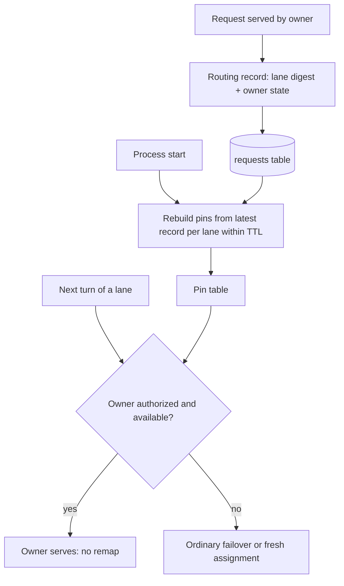

# Restart Affinity Continuity - Plan

## Goal Capsule

- **Objective:** A proxy start no longer moves returning sessions to another account. After a deploy, memory recycle, service stop/start or crash, the next turn of a session whose previous turn finished before the start goes to the account it would have used had the process kept running.
- **Means:** rebuild the sticky strategy's pins at start from each affinity lane's latest request record.
- **Product authority:** the operator's 2026-10-30 go to brainstorm restart-affinity continuity with the #516 numbers and the predeclared metric and countermetric. The mechanism is this brainstorm's recommendation, made unattended with no human available to confirm it. Refs #516.
- **Open blockers:** none.

---

## Product Contract

### Summary

Each request's routing record also notes which affinity lane it served and the owner state the strategy held afterwards. On start, the sticky strategy rebuilds its pin table from the latest record of each lane still inside the affinity TTL, and restored pins pass the same checks as live ones. The change ships as a backend-only deploy with no schema migration.

### Problem Frame

Production runs `session-drain-soonest` in sticky mode with a 5-hour session duration (`lb_strategy` in the live config, read 2026-10-30). Its pins, the record of which account owns each affinity lane, live only in process memory. Every backend start forgets them, and each lane's next request is routed as a new session.

The cost is measured. Turn pairs spanning an upstream start switched accounts 52% of the time (74 of 142) against about 3% otherwise, and restarts carried 12.15M of the 47.36M real same-or-lower-band remap excess in #516's 14-day window. In the 3.14 days after the warm-owner hold shipped (#510), straddling pairs switched 59-62% of the time against about 4%: roughly 2.6M cache-write tokens a day, about 2.6% of Anthropic cache writes. Each switch rewrites a prefix of about 200k tokens and slows that turn. Codex loss is unmeasured, though restarts drove 29% of Codex switches at 30 minutes.

Starts are frequent and come from several paths. #516's 14-day baseline had 56: 23 deploys, 18 memory recycles, 12 service stop/starts and 3 supervisor restarts. Since 2026-10-26 the journal shows 18 backend starts, only 9 through the guard's overlap handoff; memory recycles and unit starts bypass it. The loss is modest, so it competes with simply restarting less, which is separate work.

### Key Decisions

- **Rebuild pins from request history, not from a shutdown snapshot.** History covers every start kind including crashes and records the owner decisions #516 needs to explain its remaining remaps; a snapshot written at quiesce or stop is the fallback design, faithful but blind to crashes. Governs R1, R2, R4.
- **Record each request's lane identity rather than reconstruct it later.** The requests table stores no `anthropic-beta` signature, so it cannot rebuild the lane key. Governs R1.
- **Restore the whole pin table, not only pins whose cache is still warm.** Pins past the warm window still carry quota-spreading continuity. Governs R4.
- **Rejected: carrying pins in memory across the overlap handoff only.** It covers deploys alone, 9 of 18 starts since 2026-10-26.
- **Rejected: a dedicated durable bindings table.** Its SQLite and PostgreSQL migrations force a full-restart deploy, and it duplicates what the requests table already carries. Governs R9.
- **Rejected: a deterministic owner hashed over the eligible pool.** It contradicts drain-soonest's pace-band assignment of fresh sessions.

### Requirements

**Recording**

- R1. Every request served under an owner-retaining strategy records which affinity lane it belonged to, as a digest that carries no session content.
- R2. The same record carries the owner state the strategy holds once the request is done: preferred owner, temporary fallback if any, when the strategy last selected the owner for the lane, whether the owner was installed at home, and the start of any warm-owner hold episode.
- R3. The added fields survive every write and read path of the routing summary, proven by a persistence round trip in the shape PR #657 used for `processStartedAt`.

**Restoring**

- R4. On start, an owner-retaining strategy rebuilds its pins from the latest record of each lane whose owner was last selected within the affinity TTL, reproducing what the previous process would still have held.
- R5. A restored pin is only a preference over the request's currently authorized and available candidates: it can put its owner first among them, never add a candidate.
- R6. A restored pin keeps the live idle clock: owner idle time runs from when the strategy last selected the owner for the lane, as it does in a running process, so a restart makes no owner look warmer or colder than it would have.
- R7. A warm-owner hold episode under way before the restart keeps its original start, so a restart never extends a hold past its 30-minute cap.
- R8. Restoring never holds up readiness: a history read that fails, comes back partial or would outlast the current handoff fence of about 3 seconds is abandoned, and the strategy starts with an empty pin table, as it does today.

**Deployment and compatibility**

- R9. The change stays deployable backend-only: it touches no guard, runner, deployment-transaction or schema-migration file.
- R10. A restart restores only what the running strategy would itself have kept; strategies and modes that order every turn afresh still do so.

### Key Flows

- F1. Recording a turn
  - **Trigger:** a request finishes under an owner-retaining strategy.
  - **Steps:** the strategy has chosen or kept an owner; the request is served; its routing record is written with the lane digest and the resulting owner state.
  - **Covered by:** R1, R2, R3
- F2. Start-up rebuild
  - **Trigger:** a backend process starts, by deploy handoff, memory recycle, unit start or crash recovery.
  - **Steps:** the strategy reads the latest record per lane inside the TTL, rebuilds its pins, and becomes ready; on a read failure it becomes ready with an empty table.
  - **Covered by:** R4, R8
- F3. First turn after the start
  - **Trigger:** a lane's next request arrives at the new process.
  - **Steps:** the restored pin is checked exactly like a live one; an authorized, available owner serves, including under a still-valid warm-owner hold; otherwise ordinary failover or fresh assignment runs.
  - **Covered by:** R5, R6, R7

### Acceptance Examples

- AE1. **Covers R4, R5.** **Given** a lane owned by account X that was last selected 3 minutes before a deploy, **when** its next turn reaches the new process and X is available, **then** X serves it and no remap occurs.
- AE2. **Covers R5.** **Given** the same restored pin, **when** X is rate-limited or paused at the next turn, **then** the turn fails over exactly as a live pin with an unavailable owner would.
- AE3. **Covers R5.** **Given** a restored pin to an account the deploy removed or the request's route profile no longer authorizes, **when** the next turn arrives, **then** the pin is ignored and the request is routed fresh.
- AE4. **Covers R6, R7.** **Given** an owner outclassed by a higher pace band, held since 25 minutes before a restart and last selected 2 minutes before it, **when** the next turn arrives less than 5 minutes after that selection, **then** the owner is held, and the hold ends no later than 30 minutes after its original start.
- AE5. **Covers R6.** **Given** an owner last selected for a 6-minute stream that started 8 minutes before the restart, **when** the hold judges the owner at the next turn, **then** it counts as idle for 8 minutes plus the time since the restart, exactly as a running process would count it, and no warm-owner hold applies.
- AE6. **Covers R8.** **Given** the database cannot be read at start, **when** the process starts, **then** it becomes ready with no restored pins and routes as it does today.
- AE7. **Covers R4.** **Given** a lane whose owner was last selected 6 hours before the restart, **when** the process starts, **then** that lane is not restored.

### Success Criteria

- Population, for the evidence floor and every rate below: successful Anthropic requests matched to their conversation parent by steps 1-5 of `docs/solutions/observability/measure-session-remap-cache-cost-from-the-requests-table.md`, keeping pairs whose idle gap is under 5 minutes as that doc's step 8 splits it. A pair straddles a start when its two records carry different `processStartedAt`, and switches when its two turns were served by different accounts.
- Evidence floor: at least 14 days after deploy and at least 100 straddling non-failover pairs in that population; missing either reads as insufficient evidence, not success.
- Success: excluding pairs where either turn is a failover, the straddling switch rate is at most 2x the non-straddling rate in the same window. The 52% against about 3% before-figure comes from that doc's partition-order pairs, a different population, so it is context, not the comparison.
- Countermetric: over the same pairs with failovers kept, the later turn's failover rate and upstream 429 rate are no higher for straddling pairs than for non-straddling ones.

### Scope Boundaries

Deferred for later:

- Lowering the restart rate itself, such as memory-recycle frequency or deploy batching.
- Restoring new-session spreading timestamps and per-lane route-failure circuits; both rebuild within minutes of normal traffic.
- Re-seeding pins when an `lb_strategy` config change rebuilds the strategy at runtime.
- Measuring Codex cache loss; Codex lanes are restored like any other, but the success criteria do not gate on them.
- Anthropic degraded-mode owner overlays.

Accepted limitations:

- A lane whose first-ever request was still in flight at the restart has no record yet and is routed fresh, unless planning adds a first-miss lookup.
- A deploy that changes how lane keys are derived restores no pins recorded before it.

### Dependencies / Assumptions

- Production keeps an owner-retaining strategy; `session-drain-soonest` in sticky mode was confirmed in the live config on 2026-10-30.
- Account availability state is persisted on the accounts table (`rate_limited_until`, `paused`) and reloaded at start, so restored pins are validated against current state.
- The routing summary has room for the added fields: its largest value over 7 days was 3,145 characters against a 16,384-character cap.
- The quiesced old process keeps its database connection and writes its in-flight requests' records after the new process starts.

### Outstanding Questions

Deferred to Planning:

- Whether to also look up a lane's history on its first miss after start, recovering lanes whose latest turn finished on the quiesced process after the rebuild ran, and mid-stream failovers.
- How the rebuild reads history without blocking the request path, on both SQLite and PostgreSQL.
- Whether usage data missing just after start can make a restored owner look outclassed by pace band, and how the hold or ranking should treat that.
- Which record wins when two requests of one lane finish out of order.

### Sources / Research

- Issue #516 (attribution of the 1,575 remaps; restart class 12.15M).
- `docs/solutions/observability/measure-session-remap-cache-cost-from-the-requests-table.md`: restart effect and measurement method.
- `packages/load-balancer/src/strategies/session-affinity.ts`: in-process pin map, entry fields, pin validation, warm-hold hook.
- `packages/load-balancer/src/strategies/session-drain-soonest.ts`: warm-hold limits.
- `packages/proxy/src/handlers/account-selector.ts` (`deriveAffinityLaneKey`): lane composition.
- `packages/proxy/src/handlers/routing-attempt-ledger.ts` and `packages/types/src/request.ts`: routing summary producer and sanitizer.
- `scripts/run-ccflare-stack.sh` (memory recycle), `scripts/ccflare-deployment-transaction.mjs` (overlap handoff phases), `scripts/deploy-ccflare-lib.sh` (backend-only eligibility).
- `CONCEPTS.md`: Affinity lane, Warm-owner hold, Session remap, Child route home, Quiesced backend.
