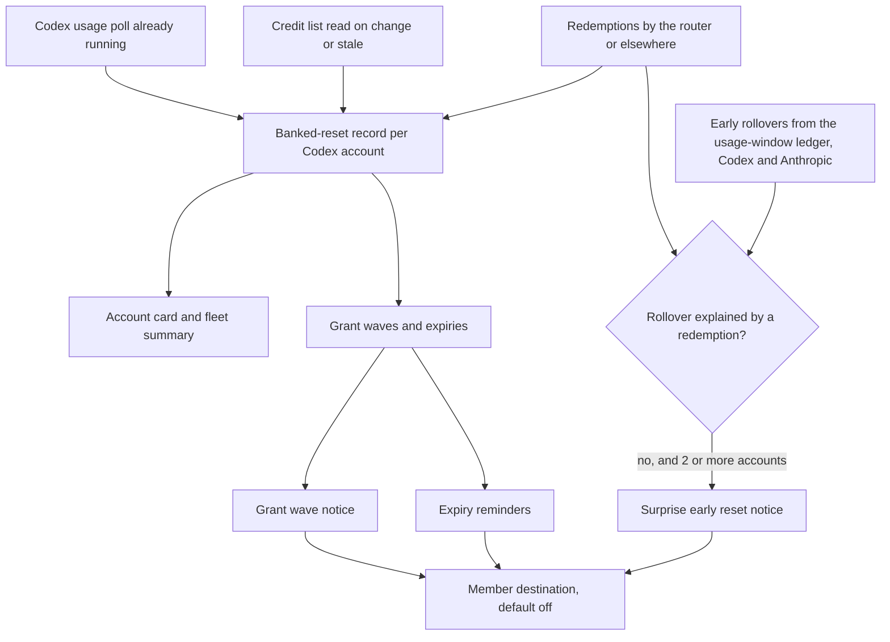

# Banked Resets - Plan

## Goal Capsule

- **Objective:** An operator can see every Codex account's banked resets on the router dashboard and spend one with a confirmed click, without signing in to each ChatGPT account. House of Vibe members get account-free Discord notices when resets are granted, before they expire, and when a provider resets limits early.
- **Product authority:** The operator's choices in the 2026-11-02 brainstorm, recorded under Key Decisions. Requirements bind planning; Outstanding Questions do not.
- **Open blockers:** None block planning. The largest unverified dependency is whether OpenAI accepts the router's stored credentials for the redeem call (see Dependencies / Assumptions).

---

## Product Contract

### Summary

The router keeps the banked-reset credits that its Codex usage poll already receives and shows them on each Codex account card and in a fleet summary.
A "Use reset" action spends one credit after the operator confirms its effect; the router never spends one by itself.
A separate, default-off member destination posts account-free notices to the House of Vibe Discord when OpenAI grants a wave of resets, before a wave expires, and when a provider resets limits early.

### Problem Frame

OpenAI grants Codex subscribers free rate limit reset credits, called banked resets here.
Redeeming one resets the account's 5-hour window and, on Pro, its weekly window, and moves the weekly reset date to about 7 days after the redemption.
Each credit expires 30 days after its grant.
The only places to see or redeem them are the Codex CLI `/usage` screen and ChatGPT itself, one account at a time.

The router operator runs several Codex accounts and could not tell whether any held resets without signing in to each one.
A read-only check on 2026-11-02 of the router's three Codex Pro accounts found six unredeemed credits from two grant waves (2026-10-31 and 2026-11-01), expiring 2026-11-30 and 2026-12-01.
All three weekly windows sat at 100%, and two accounts were blocked until 2026-11-04 while OpenAI reported resets that applied to them right now.
The router's usage poll receives the credit counts in the same response it already reads, then discards them, so the dashboard showed two blocked accounts with no hint that their capacity could be restored.

House of Vibe members run the same tools on their own accounts and miss grants for the same reason; an unredeemed credit expires without notice.
Anthropic offered a similar one-off "Reset for free" on claude.ai (granted 2026-09-22, expired 2026-10-22), and no source the router can read exposes it.

### Actors

- A1. Operator: runs the router and its dashboard, holds the provider accounts, and decides each redemption.
- A2. HoV members: read the House of Vibe Discord ai-alerts channel and hold their own Codex and Claude accounts, which the router never sees.
- A3. Router: polls account usage, keeps the banked-reset record, performs a redemption the operator confirmed, and posts member notices.
- A4. OpenAI Codex service: grants, reports and redeems credits, and decides whether a credit applies to an account right now.

### Key Decisions

- **See and redeem with one confirmed click; no automatic spending.** (session-settled: user-directed — chosen over "redeem plus opt-in auto-use" and "see only": each irreversible spend stays a person's decision, while the router still removes the need to sign in to each account.) Governs R8, R9, R10, R11, R12.
- **Alerts serve HoV members and stay account-agnostic.** (session-settled: user-directed — chosen over "router operators" and "both, separated": the posts are a community heads-up about provider events, not fleet monitoring.) Governs R16, R18.
- **Member events are new grant wave, expiry reminders, and surprise early reset.** (session-settled: user-directed — chosen over any narrower set of these three events: members need to hear when resets arrive, before they lapse, and when limits come back early.) Governs R19, R20, R21.
- **Member notices get their own destination, never the existing alert webhook.** The production webhook already posts operational alerts whose text names router accounts, so sharing it would put account names in front of members. Governs R16, R17.
- **Extend the existing usage poll, account card, account actions and alert service, plus a small persisted record of Codex credits.** This was chosen over a provider-agnostic banked-capacity ledger and over a full grant, redeem and lapse event history with need-led dashboard surfaces, both of which add more concepts than the request needs. The persisted record exists because live traffic overwrites the usage extras the card reads between polls, while the notices need credit data that survives polls and restarts. Governs R1, R2, R4, R13.
- **Codex only; Anthropic appears only in the surprise early reset notice.** No readable source for Anthropic banked resets is known, and the router already detects early window rollovers on Anthropic accounts. Governs R1, R21.
- **"Applies now" is OpenAI's judgment, shown as given.** Live data has an account allowed at 100% weekly use with two credits and zero applying now, so a router heuristic would contradict the provider. Governs R6, R8.
- **Expiry reminders are provider facts about a wave.** They fire whether or not the router has spent its own credits from that wave, because members hold their own. Governs R20.

### Requirements

**Detection and inventory**

- R1. For each Codex account, the router keeps the number of banked resets, the number OpenAI says applies right now, and each credit's grant and expiry time.
- R2. Detection adds no provider call to a normal usage poll; the router reads the per-credit list only when the counts change or its stored list is stale.
- R3. Every read stays passive as Codex defines a passive usage reader, so reading credits never reserves or spends anything.
- R4. A failed read, or a response without the credit fields, marks the account's last known resets as stale and never reads as zero.
- R5. The first read after rollout records credits the accounts already hold as known, not as newly granted.

**Visibility**

- R6. Each Codex account card shows its banked resets: count, soonest expiry, and whether one applies now, or "stale" with the last known values.
- R7. A fleet summary shows the total banked resets across Codex accounts, the soonest expiry, and which accounts have a reset that applies now.

**Redeem**

- R8. A Codex account offers "Use reset" only when OpenAI says a reset applies now; otherwise the action is unavailable and says why.
- R9. "Use reset" first shows a confirmation that states the effect and the cost: the 5-hour window resets, the weekly window resets on Pro, the weekly reset date moves to about 7 days after redemption, the soonest-expiring credit is spent, when the account would otherwise reset, and that this cannot be undone.
- R10. Nothing is redeemed without the operator confirming, and the router never redeems on a schedule, a usage threshold, or a routing condition.
- R11. One confirmation spends at most one credit, including on a double click, a retry, or a lost response.
- R12. The result says what happened in plain words: reset; nothing to reset, so no credit was spent; no credit left; already redeemed by an earlier attempt; or OpenAI refused the router's request, with a pointer to `/usage` and Redeem reset in the Codex CLI.
- R13. After a successful redemption the router refreshes the account's usage at once, so routing and the dashboard see the restored capacity without waiting for the next poll.
- R14. The redeem action requires the same dashboard API authorization as the other account actions.
- R15. The router records each redemption it performs, and records a credit that disappears before its expiry as redeemed elsewhere, such as from the Codex CLI.

**Member notices**

- R16. Member notices go only to a dedicated member destination that stays off until the operator configures it.
- R17. The router never logs the member destination's address.
- R18. A member notice never contains an account name, email, account id, per-account count, or fleet total.
- R19. New grant wave: when OpenAI grants credits to the router's Codex accounts, members get one notice per wave, grouped by OpenAI's grant time, saying resets may be available, how to redeem one in the Codex CLI, and when the wave expires.
- R20. Expiry reminders: members get one reminder 3 days and another 1 day before a wave's credits expire, whether or not the router has redeemed its own credits from that wave.
- R21. Surprise early reset: members get one notice, naming the provider, when at least two accounts of that provider roll their usage windows over early within a short interval and no recorded redemption explains either rollover.
- R22. No member notice repeats after a router restart, a repeated poll, or a dashboard reload.

### Key Flows

- F1. Seeing banked resets
  - **Trigger:** An account's Codex usage poll returns.
  - **Actors:** A3, A4, A1
  - **Steps:** The router stores the counts from the poll; when they changed or the stored list is stale, it reads the credit list; the account card and fleet summary update; a failed read marks that account's resets stale.
  - **Covered by:** R1, R2, R3, R4, R5, R6, R7
- F2. Redeeming a reset
  - **Trigger:** The operator selects "Use reset" on an account where a reset applies now.
  - **Actors:** A1, A3, A4
  - **Steps:** The confirmation shows effect and cost; the operator confirms; the router asks OpenAI once to redeem the soonest-expiring credit; the router records the redemption, refreshes the account's usage, and shows the result.
  - **Covered by:** R8, R9, R10, R11, R12, R13, R14, R15
- F3. Grant wave notice
  - **Trigger:** A credit read shows credits the router has not seen before.
  - **Actors:** A4, A3, A2
  - **Steps:** The router groups new credits across accounts by OpenAI's grant time; once the wave stops growing, it posts one notice; the wave is recorded so it never posts again.
  - **Covered by:** R16, R17, R18, R19, R22
- F4. Expiry reminder
  - **Trigger:** A recorded wave reaches 3 days, then 1 day, before its expiry.
  - **Actors:** A3, A2
  - **Steps:** The router posts the reminder for that wave and lead time and records it as sent.
  - **Covered by:** R16, R17, R18, R20, R22
- F5. Surprise early reset notice
  - **Trigger:** The usage-window ledger classifies a new window as an early reset.
  - **Actors:** A3, A2
  - **Steps:** The router drops rollovers that a recorded redemption explains; when at least two accounts of one provider remain within the interval, it posts one notice naming the provider and records it.
  - **Covered by:** R15, R16, R17, R18, R21, R22

### Acceptance Examples

- AE1. **Covers R6, R8.** Given an account blocked until 2026-11-04 that holds 2 credits OpenAI says apply now, when the operator opens the dashboard, then its card shows 2 banked resets, the soonest expiry of 2026-11-30, "applies now", and an available "Use reset".
- AE2. **Covers R6, R8.** Given an account allowed at 100% weekly use that holds 2 credits with none applying now, then its card shows 2 banked resets and "Use reset" is unavailable, saying OpenAI does not apply a reset to this account right now.
- AE3. **Covers R4, R6.** Given the account's last credit read failed, then its card shows the last known resets marked stale, not zero.
- AE4. **Covers R5, R19.** Given the first read after rollout finds the six credits granted on 2026-10-31 and 2026-11-01, then the dashboard shows them and no grant wave notice posts.
- AE5. **Covers R11, R12.** Given the operator confirms and the router loses OpenAI's response, when the request is retried, then at most one credit is spent and the result shows reset or already redeemed.
- AE6. **Covers R12.** Given OpenAI answers nothing to reset, then the result says no credit was spent. Given OpenAI refuses the router's request, then the result says so and points to `/usage` in the Codex CLI.
- AE7. **Covers R19, R22.** Given OpenAI grants credits to three Codex accounts over 17 minutes, then members get exactly one grant wave notice, and a router restart during or after the wave produces no second notice.
- AE8. **Covers R20.** Given a wave whose credits expire on 2026-11-30, then members get one reminder 3 days before and one 1 day before, whether or not the router redeemed its own credits from that wave.
- AE9. **Covers R15, R21.** Given a reset is redeemed on one Codex account, from the router or from the Codex CLI, then the early rollover it causes posts no surprise early reset notice.
- AE10. **Covers R21.** Given the weekly windows of two Anthropic accounts roll over early within the interval with no recorded redemption, then members get one notice that Claude limits appear to have reset early. Given only one account rolls over early, no notice posts.
- AE11. **Covers R18.** Every notice in AE7 through AE10 contains no account name, email, account id, per-account count, or fleet total.

### Success Criteria

- With today's three accounts, the operator can tell from the dashboard alone which accounts hold resets, how many, when they expire, and which would apply now, without signing in to ChatGPT.
- Every member notice in the first 30 days after the member destination is turned on traces to a real grant wave, a scheduled reminder, or a corroborated early rollover; none traces to a redemption, a single account, or a repeated post.
- The operator's first real redemption either succeeds or reports OpenAI's refusal, and never leaves the operator unsure whether a credit was spent.

### Scope Boundaries

**Deferred for later**

- Anthropic banked-reset inventory and redemption, until a readable source exists; Anthropic early rollovers still feed R21.
- Operator-facing alerts that name accounts, such as "this account has a reset that applies now"; the dashboard covers the operator.
- Telling redeemed windows apart from provider bonus resets in the window-value views; a redemption reads there as "bonus reset" until this lands, though R15 records the facts needed.
- Routing awareness of redeemable resets, such as a banner when requests start failing for lack of capacity or ranking accounts by how much a reset would recover.
- A preview, shadow mode or rate limit for member notices.
- Per-user permission to redeem, and a record of which person confirmed each redemption.
- Buying an immediate reset, which OpenAI offers to some accounts.
- A provider-agnostic banked-capacity model.

**Outside this product's identity**

- Automatic redemption of any kind, including mirroring Codex's own option to use resets when remaining usage drops to 10% or less (per R10).

### Dependencies / Assumptions

- Verified on 2026-11-02 by read-only requests made with the router's stored credentials and client identity: the Codex usage response carries `rate_limit_reset_credits` counts, and the credit list returns each credit's grant time, expiry, title and description. OpenAI accepted both reads.
- The redeem call and its four outcomes (reset, nothing to reset, no credit, already redeemed) are taken from OpenAI's open-source Codex client; the redeem call is idempotent by a request id the caller supplies.
- Unverified: whether OpenAI accepts the router's stored credentials for the redeem call. Nothing has been redeemed. If OpenAI refuses, R12 covers the result and visibility still ships.
- Unverified: the exact meaning of "applies now". Two blocked accounts reported 2 applying credits, while an account allowed at 100% reported 0.
- Unverified: whether OpenAI grants every subscriber the same resets. The router's accounts are a sample, so the grant wave notice says resets "may be available".
- The member destination is the House of Vibe Discord ai-alerts channel, and the operator supplies its address. Posting there is an external effect that the operator turns on.
- Dashboard API authorization (R14) applies only when API keys are configured. With none configured, anyone who can reach the dashboard can redeem, just as they can pause an account today.
- The surprise early reset notice needs at least two accounts of a provider, so a router with one account of a provider never posts it for that provider.
- Any change to persisted state ships for both SQLite and PostgreSQL, per `AGENTS.md`.

### Outstanding Questions

**Resolve Before Planning**

None.

**Deferred to Planning**

- How to prove that the redeem call accepts the router's credentials before the operator relies on the button. The operator's first deliberate redemption is the acceptance test. It is unverified whether a redeem request on an account with no applicable reset returns "nothing to reset" without spending, so planning must not assume it.
- How long a wave stays open before its notice posts. The two observed waves spanned 14 to 17 minutes across accounts and arrived about 26 hours apart.
- The credit list's staleness window and read cadence.
- The interval within which two early rollovers count as one event, and how far back a redemption explains a rollover.
- The notice wording, with display names taken from the product-name constants.
- Whether each member notice type can be turned on separately, as the existing alert-type allowlist allows for operational alerts.

### Sources / Research

**Repository**

- `packages/providers/src/providers/codex/api-usage.ts:58` — the Codex usage response type has no reset-credit field, so the poll drops it.
- `packages/providers/src/usage-fetcher.ts:1480` — the Codex usage poll uses a free introspection endpoint with no quota consumed.
- `packages/http-api/src/services/usage-window-ledger.ts:308` — a new window with more than 120 seconds of runway left on the old one is classified `early_reset`; `packages/dashboard-web/src/components/window-value/WindowValueTimeline.tsx:67` labels it "bonus reset".
- `packages/http-api/src/services/alerts.ts:1208` — the single alert webhook gets a Discord-shaped body and its URL is never logged; usage-window alert messages begin with the account name (`alerts.ts:1924`).
- `packages/config/src/index.ts:984` — `alert_webhook_url` and the `alert_webhook_types` allowlist; no per-audience routing exists.
- `packages/http-api/src/handlers/accounts.ts:3649` — the force-reset action refreshes usage at once and returns `usagePollTriggered`, the pattern R13 follows.
- `packages/dashboard-web/src/components/ui/dialog.tsx` — a generic dialog exists but no confirmation component does; the Codex "Drain credits" switch applies without confirmation (`packages/dashboard-web/src/components/accounts/AccountListItem.tsx:133`).
- `packages/http-api/src/router.ts:699` and `packages/http-api/src/services/auth-service.ts:556` — API authorization, which allows every request when no API keys are configured.
- `CONCEPTS.md` — Credit drain, Drain-soonest, Weekly pace band, Canonical usage window, Banked reset.
- `docs/solutions/workflow-issues/verify-codex-credit-drain-by-balance-delta.md` — verifying Codex credit behavior from poll evidence.

**External**

- OpenAI Codex client source: `codex-rs/backend-client/src/types.rs` (reset-credit types) and `codex-rs/tui/src/chatwidget/usage.rs` (the `/usage` Redeem reset flow and its confirmation), github.com/openai/codex.
- OpenAI Help Center, "How resets work in Codex": https://help.openai.com/en/articles/20001498-how-resets-work-in-codex
- OpenAI community thread on automatic resets moving weekly limits: https://community.openai.com/t/openais-automatic-usage-resets-are-quietly-pushing-back-weekly-limits-and-making-banked-resets-harder-to-use-how-is-this-acceptable/1408897
- Third-party guide to Anthropic's one-off reset: https://blog.6yuwei.com/en/2026/10/19/claude-banked-reset-guide/
