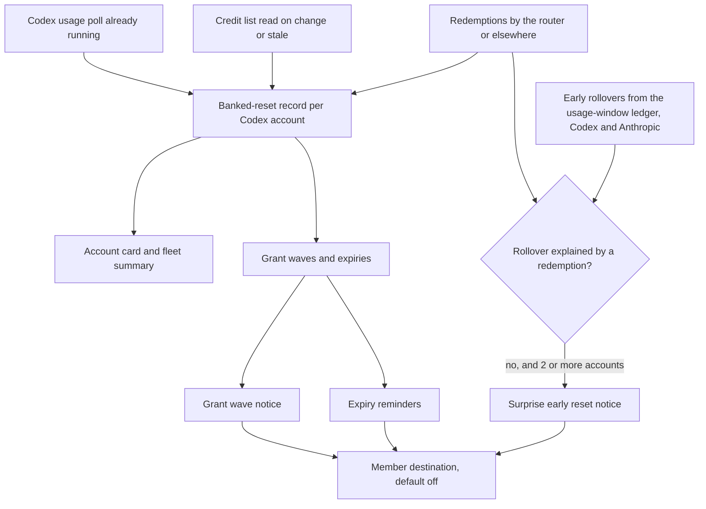
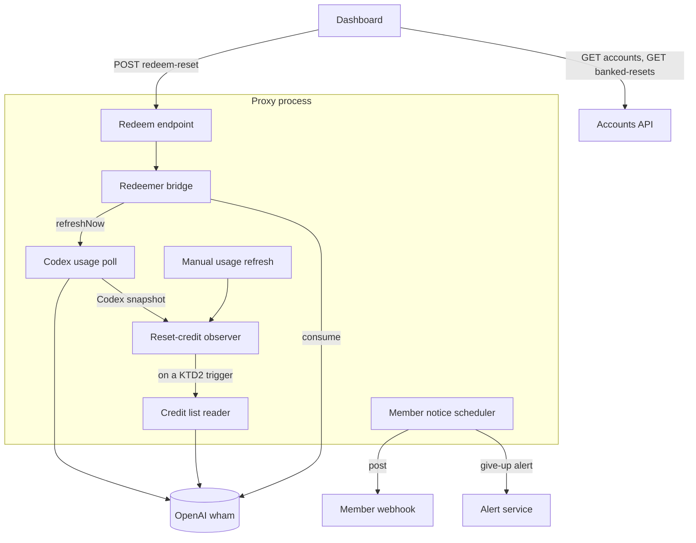
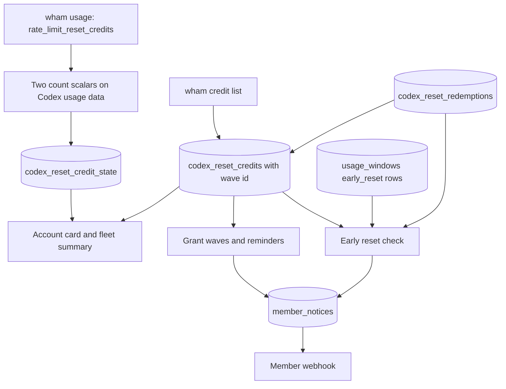
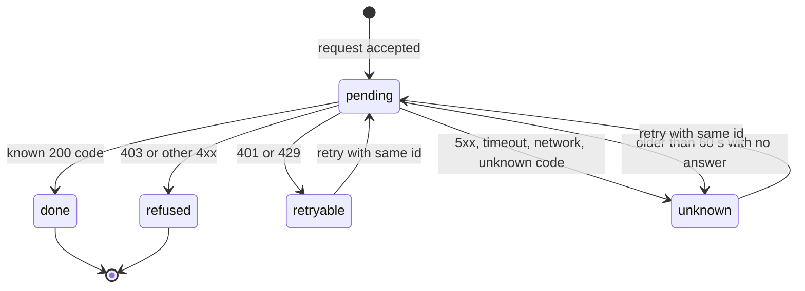
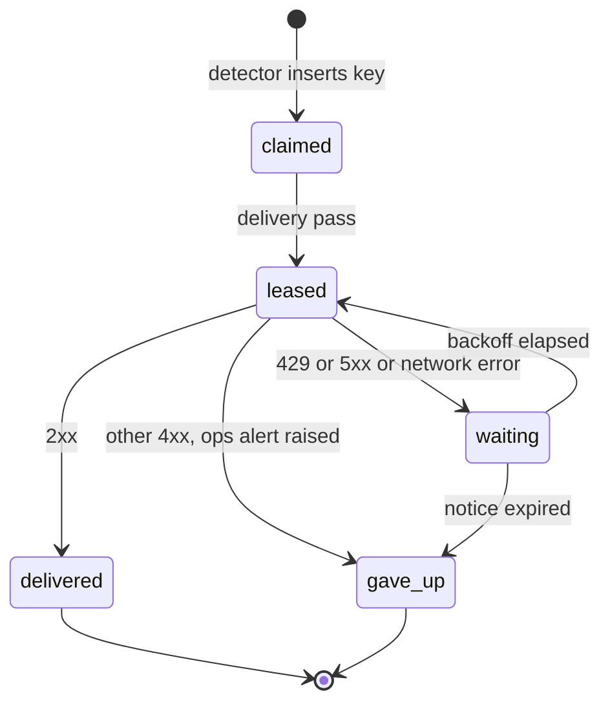

# Banked Resets - Plan

## Goal Capsule

- **Objective:** An operator can see every Codex account's banked resets on the router dashboard and spend one with a confirmed click, without signing in to each ChatGPT account. House of Vibe members get account-free Discord notices when resets are granted, before they expire, and when a provider resets limits early.
- **Means:** Extend the existing Codex usage poll, account card, account actions and alert service, with a small persisted record of Codex credits (Key Decision "Extend the existing usage poll…", KTD1, KTD3).
- **Product authority:** The operator's choices in the 2026-11-02 brainstorm, recorded under Key Decisions. Requirements win on product behavior; Key Technical Decisions win on mechanism within them; a unit overrides neither. Outstanding Questions do not bind.
- **Stop conditions:** Stop and ask the operator before redeeming a real credit or sending to a real webhook; both are the operator's actions, never the implementer's. Stop before any scripted Anthropic request, which `AGENTS.md` prohibits. Stop if OpenAI's credit list or redeem payload contradicts KTD2 or KTD10 in a way the stored-shape tests cannot absorb.
- **Execution profile:** Three PRs in order: PR1 See, PR2 Redeem, PR3 Member notices. Each is safe to merge and deploy on its own. Tests come first, per `AGENTS.md`. Every schema change ships for SQLite and PostgreSQL.
- **Finishing:** The implementing session merges each PR after CI passes. Deploying is the operator's separate step through `scripts/deploy-ccflare.sh`; merging never deploys.
- **Open blockers:** None. The largest unverified dependency is whether OpenAI accepts the router's stored credentials for the redeem call; the operator's first deliberate redemption is the acceptance test (Verification Contract).

---

## Product Contract

### Summary

The router keeps the banked-reset credits that its Codex usage poll already receives and shows them on each Codex account card and in a fleet summary.
A "Use reset" action spends one credit after the operator confirms its effect; the router never spends one by itself.
A separate, default-off member destination posts account-free notices to the House of Vibe Discord when OpenAI grants a wave of resets, before a wave expires, and when a provider resets limits early.

### Problem Frame

OpenAI grants Codex subscribers free rate limit reset credits, called banked resets here.
Redeeming one resets the account's 5-hour window and, on Pro, its weekly window, and moves the weekly reset date to about 7 days after the redemption.
Each credit expires 30 days after its grant.
The only places to see or redeem them are the Codex CLI `/usage` screen and ChatGPT itself, one account at a time.

The router operator runs several Codex accounts and could not tell whether any held resets without signing in to each one.
A read-only check on 2026-11-02 of the router's three Codex Pro accounts found six unredeemed credits from two grant waves (2026-10-31 and 2026-11-01), expiring 2026-11-30 and 2026-12-01.
All three weekly windows sat at 100%, and two accounts were blocked until 2026-11-04 while OpenAI reported resets that applied to them right now.
The router's usage poll receives the credit counts in the same response it already reads, then discards them, so the dashboard showed two blocked accounts with no hint that their capacity could be restored.

House of Vibe members run the same tools on their own accounts and miss grants for the same reason; an unredeemed credit expires without notice.
Anthropic offered a similar one-off "Reset for free" on claude.ai (granted 2026-09-22, expired 2026-10-22), and no source the router can read exposes it.

### Actors

- A1. Operator: runs the router and its dashboard, holds the provider accounts, and decides each redemption.
- A2. HoV members: read the House of Vibe Discord ai-alerts channel and hold their own Codex and Claude accounts, which the router never sees.
- A3. Router: polls account usage, keeps the banked-reset record, performs a redemption the operator confirmed, and posts member notices.
- A4. OpenAI Codex service: grants, reports and redeems credits, and decides whether a credit applies to an account right now.

### Key Decisions

- **See and redeem with one confirmed click; no automatic spending.** (session-settled: user-directed — chosen over "redeem plus opt-in auto-use" and "see only": each irreversible spend stays a person's decision, while the router still removes the need to sign in to each account.) Governs R8, R9, R10, R11, R12.
- **Alerts serve HoV members and stay account-agnostic.** (session-settled: user-directed — chosen over "router operators" and "both, separated": the posts are a community heads-up about provider events, not fleet monitoring.) Governs R16, R18.
- **Member events are new grant wave, expiry reminders, and surprise early reset.** (session-settled: user-directed — chosen over any narrower set of these three events: members need to hear when resets arrive, before they lapse, and when limits come back early.) Governs R19, R20, R21.
- **Member notices get their own destination, never the existing alert webhook.** The production webhook already posts operational alerts whose text names router accounts, so sharing it would put account names in front of members. Governs R16, R17.
- **Extend the existing usage poll, account card, account actions and alert service, plus a small persisted record of Codex credits.** This was chosen over a provider-agnostic banked-capacity ledger and over a full grant, redeem and lapse event history with need-led dashboard surfaces, both of which add more concepts than the request needs. The persisted record exists because live traffic overwrites the usage extras the card reads between polls, while the notices need credit data that survives polls and restarts. Governs R1, R2, R4, R13.
- **Codex only; Anthropic appears only in the surprise early reset notice.** No readable source for Anthropic banked resets is known, and the router already detects early window rollovers on Anthropic accounts. Governs R1, R21.
- **"Applies now" is OpenAI's judgment, shown as given.** Live data has an account allowed at 100% weekly use with two credits and zero applying now, so a router heuristic would contradict the provider. Governs R6, R8.
- **Expiry reminders are provider facts about a wave.** They fire whether or not the router has spent its own credits from that wave, because members hold their own. Governs R20.

### Requirements

**Detection and inventory**

- R1. For each Codex account, the router keeps the number of banked resets, the number OpenAI says applies right now, and each credit's grant and expiry time.
- R2. Detection adds no provider call to a normal usage poll; the router reads the per-credit list only when the counts change or its stored list is stale.
- R3. Every read stays passive as Codex defines a passive usage reader, so reading credits never reserves or spends anything.
- R4. A failed read, or a response without the credit fields, marks the account's last known resets as stale and never reads as zero.
- R5. The first read after rollout records credits the accounts already hold as known, not as newly granted.

**Visibility**

- R6. Each Codex account card shows its banked resets: count, soonest expiry, and whether one applies now, or "stale" with the last known values.
- R7. A fleet summary shows the total banked resets across Codex accounts, the soonest expiry, and which accounts have a reset that applies now.

**Redeem**

- R8. A Codex account offers "Use reset" only when OpenAI says a reset applies now; otherwise the action is unavailable and says why.
- R9. "Use reset" first shows a confirmation that states the effect and the cost: the 5-hour window resets, the weekly window resets on Pro, the weekly reset date moves to about 7 days after redemption, the soonest-expiring credit is spent, when the account would otherwise reset, and that this cannot be undone.
- R10. Nothing is redeemed without the operator confirming, and the router never redeems on a schedule, a usage threshold, or a routing condition.
- R11. One confirmation spends at most one credit, including on a double click, a retry, or a lost response.
- R12. The result says what happened in plain words: reset; nothing to reset, so no credit was spent; no credit left; already redeemed by an earlier attempt; or OpenAI refused the router's request, with a pointer to `/usage` and Redeem reset in the Codex CLI.
- R13. After a successful redemption the router refreshes the account's usage at once, so routing and the dashboard see the restored capacity without waiting for the next poll.
- R14. The redeem action requires the same dashboard API authorization as the other account actions.
- R15. The router records each redemption it performs, and records a credit that disappears before its expiry as redeemed elsewhere, such as from the Codex CLI.

**Member notices**

- R16. Member notices go only to a dedicated member destination that stays off until the operator configures it.
- R17. The router never logs the member destination's address.
- R18. A member notice never contains an account name, email, account id, per-account count, or fleet total.
- R19. New grant wave: when OpenAI grants credits to the router's Codex accounts, members get one notice per wave, grouped by OpenAI's grant time, saying resets may be available, how to redeem one in the Codex CLI, and when the wave expires.
- R20. Expiry reminders: members get one reminder 3 days and another 1 day before a wave's credits expire, whether or not the router has redeemed its own credits from that wave.
- R21. Surprise early reset: members get one notice, naming the provider, when at least two accounts of that provider roll their usage windows over early within a short interval and no recorded redemption explains either rollover.
- R22. No member notice repeats after a router restart, a repeated poll, or a dashboard reload.



### Key Flows

- F1. Seeing banked resets
  - **Trigger:** An account's Codex usage poll returns.
  - **Actors:** A3, A4, A1
  - **Steps:** The router stores the counts from the poll; when they changed or the stored list is stale, it reads the credit list; the account card and fleet summary update; a failed read marks that account's resets stale.
  - **Covered by:** R1, R2, R3, R4, R5, R6, R7
- F2. Redeeming a reset
  - **Trigger:** The operator selects "Use reset" on an account where a reset applies now.
  - **Actors:** A1, A3, A4
  - **Steps:** The confirmation shows effect and cost; the operator confirms; the router asks OpenAI once to redeem the soonest-expiring credit; the router records the redemption, refreshes the account's usage, and shows the result.
  - **Covered by:** R8, R9, R10, R11, R12, R13, R14, R15
- F3. Grant wave notice
  - **Trigger:** A credit read shows credits the router has not seen before.
  - **Actors:** A4, A3, A2
  - **Steps:** The router groups new credits across accounts by OpenAI's grant time; once the wave stops growing, it posts one notice; the wave is recorded so it never posts again.
  - **Covered by:** R16, R17, R18, R19, R22
- F4. Expiry reminder
  - **Trigger:** A recorded wave reaches 3 days, then 1 day, before its expiry.
  - **Actors:** A3, A2
  - **Steps:** The router posts the reminder for that wave and lead time and records it as sent.
  - **Covered by:** R16, R17, R18, R20, R22
- F5. Surprise early reset notice
  - **Trigger:** The usage-window ledger classifies a new window as an early reset.
  - **Actors:** A3, A2
  - **Steps:** The router drops rollovers that a recorded redemption explains; when at least two accounts of one provider remain within the interval, it posts one notice naming the provider and records it.
  - **Covered by:** R15, R16, R17, R18, R21, R22

### Acceptance Examples

- AE1. **Covers R6, R8.** Given an account blocked until 2026-11-04 that holds 2 credits OpenAI says apply now, when the operator opens the dashboard, then its card shows 2 banked resets, the soonest expiry of 2026-11-30, "applies now", and an available "Use reset".
- AE2. **Covers R6, R8.** Given an account allowed at 100% weekly use that holds 2 credits with none applying now, then its card shows 2 banked resets and "Use reset" is unavailable, saying OpenAI does not apply a reset to this account right now.
- AE3. **Covers R4, R6.** Given the account's last credit read failed, then its card shows the last known resets marked stale, not zero.
- AE4. **Covers R5, R19.** Given the first read after rollout finds the six credits granted on 2026-10-31 and 2026-11-01, then the dashboard shows them and no grant wave notice posts.
- AE5. **Covers R11, R12.** Given the operator confirms and the router loses OpenAI's response, when the request is retried, then at most one credit is spent and the result shows reset or already redeemed.
- AE6. **Covers R12.** Given OpenAI answers nothing to reset, then the result says no credit was spent. Given OpenAI refuses the router's request, then the result says so and points to `/usage` in the Codex CLI.
- AE7. **Covers R19, R22.** Given OpenAI grants credits to three Codex accounts over 17 minutes, then members get exactly one grant wave notice, and a router restart during or after the wave produces no second notice.
- AE8. **Covers R20.** Given a wave whose credits expire on 2026-11-30, then members get one reminder 3 days before and one 1 day before, whether or not the router redeemed its own credits from that wave.
- AE9. **Covers R15, R21.** Given a reset is redeemed on one Codex account, from the router or from the Codex CLI, then the early rollover it causes posts no surprise early reset notice.
- AE10. **Covers R21.** Given the weekly windows of two Anthropic accounts roll over early within the interval with no recorded redemption, then members get one notice that Claude limits appear to have reset early. Given only one account rolls over early, no notice posts.
- AE11. **Covers R18.** Every notice in AE7 through AE10 contains no account name, email, account id, per-account count, or fleet total.

### Success Criteria

- With today's three accounts, the operator can tell from the dashboard alone which accounts hold resets, how many, when they expire, and which would apply now, without signing in to ChatGPT.
- Every member notice in the first 30 days after the member destination is turned on traces to a real grant wave, a scheduled reminder, or a corroborated early rollover; none traces to a redemption, a single account, or a repeated post.
- The operator's first real redemption either succeeds or reports OpenAI's refusal, and never leaves the operator unsure whether a credit was spent.

### Scope Boundaries

**Deferred for later**

- Anthropic banked-reset inventory and redemption, until a readable source exists; Anthropic early rollovers still feed R21.
- Operator-facing alerts that name accounts, such as "this account has a reset that applies now"; the dashboard covers the operator.
- Telling redeemed windows apart from provider bonus resets in the window-value views; a redemption reads there as "bonus reset" until this lands, though R15 records the facts needed.
- Routing awareness of redeemable resets, such as a banner when requests start failing for lack of capacity or ranking accounts by how much a reset would recover.
- A preview, shadow mode or rate limit for member notices.
- Per-user permission to redeem, and a record of which person confirmed each redemption.
- Buying an immediate reset, which OpenAI offers to some accounts.
- A provider-agnostic banked-capacity model.

**Outside this product's identity**

- Automatic redemption of any kind, including mirroring Codex's own option to use resets when remaining usage drops to 10% or less (per R10).

**Not built by this plan**

- A dashboard setting for the member destination, or a switch per notice type (KTD13).
- A "send test notice" action; the operator's first real notice is the check.
- Pruning of stored credits, redemptions or notices; the tables grow by a few rows per wave.
- Any change to the existing alert webhook, its allowlist, or its message text.
- Detecting early resets on idle accounts or resets of only the 5-hour window (KTD19).

### Dependencies / Assumptions

- Verified on 2026-11-02 by read-only requests made with the router's stored credentials and client identity: the Codex usage response carries `rate_limit_reset_credits` counts, and the credit list returns each credit's grant time, expiry, title and description. OpenAI accepted both reads.
- The redeem call and its four outcomes (reset, nothing to reset, no credit, already redeemed) are taken from OpenAI's open-source Codex client; the redeem call is idempotent by a request id the caller supplies.
- Unverified: whether OpenAI accepts the router's stored credentials for the redeem call. Nothing has been redeemed. If OpenAI refuses, R12 covers the result and visibility still ships.
- Unverified: the exact meaning of "applies now". Two blocked accounts reported 2 applying credits, while an account allowed at 100% reported 0.
- Unverified: whether OpenAI grants every subscriber the same resets. The router's accounts are a sample, so the grant wave notice says resets "may be available".
- The member destination is the House of Vibe Discord ai-alerts channel, and the operator supplies its address. Posting there is an external effect that the operator turns on.
- Dashboard API authorization (R14) applies only when API keys are configured. With none configured, anyone who can reach the dashboard can redeem, just as they can pause an account today.
- The surprise early reset notice needs at least two accounts of a provider, so a router with one account of a provider never posts it for that provider.
- Any change to persisted state ships for both SQLite and PostgreSQL, per `AGENTS.md`.

### Outstanding Questions

**Resolve Before Planning**

None.

**Deferred to Implementation**

- The exact words of each member notice, written within KTD15's template inputs and checked by the U12 leak test.

### Sources / Research

**Repository**

- `packages/providers/src/providers/codex/api-usage.ts:58` — the Codex usage response type has no reset-credit field, so the poll drops it.
- `packages/providers/src/usage-fetcher.ts:1480` — the Codex usage poll uses a free introspection endpoint with no quota consumed.
- `packages/http-api/src/services/usage-window-ledger.ts:308` — a new window with more than 120 seconds of runway left on the old one is classified `early_reset`; `packages/dashboard-web/src/components/window-value/WindowValueTimeline.tsx:67` labels it "bonus reset".
- `packages/http-api/src/services/alerts.ts:1208` — the single alert webhook gets a Discord-shaped body and its URL is never logged; usage-window alert messages begin with the account name (`alerts.ts:1924`).
- `packages/config/src/index.ts:984` — `alert_webhook_url` and the `alert_webhook_types` allowlist; no per-audience routing exists.
- `packages/http-api/src/handlers/accounts.ts:3649` — the force-reset action refreshes usage at once and returns `usagePollTriggered`, the pattern R13 follows.
- `packages/dashboard-web/src/components/ui/dialog.tsx` — a generic dialog exists but no confirmation component does; the Codex "Drain credits" switch applies without confirmation (`packages/dashboard-web/src/components/accounts/AccountListItem.tsx:133`).
- `packages/http-api/src/router.ts:699` and `packages/http-api/src/services/auth-service.ts:556` — API authorization, which allows every request when no API keys are configured.
- `CONCEPTS.md` — Credit drain, Drain-soonest, Weekly pace band, Canonical usage window, Banked reset.
- `docs/solutions/workflow-issues/verify-codex-credit-drain-by-balance-delta.md` — verifying Codex credit behavior from poll evidence.

**External**

- OpenAI Codex client source: `codex-rs/backend-client/src/types.rs` (reset-credit types) and `codex-rs/tui/src/chatwidget/usage.rs` (the `/usage` Redeem reset flow and its confirmation), github.com/openai/codex.
- OpenAI Help Center, "How resets work in Codex": https://help.openai.com/en/articles/20001498-how-resets-work-in-codex
- OpenAI community thread on automatic resets moving weekly limits: https://community.openai.com/t/openais-automatic-usage-resets-are-quietly-pushing-back-weekly-limits-and-making-banked-resets-harder-to-use-how-is-this-acceptable/1408897
- Third-party guide to Anthropic's one-off reset: https://blog.6yuwei.com/en/2026/10/19/claude-banked-reset-guide/

---

## Planning Contract

Product Contract preservation: unchanged except that the six Deferred-to-Planning questions are resolved in place (owners: KTD2, KTD4, KTD11, KTD13, KTD15, KTD17, KTD19 and the Verification Contract), one wording question remains deferred to implementation, and Scope Boundaries gains "Not built by this plan". No R, A, F or AE changed.

### Research That Shapes the Plan

- OpenAI's Codex client, `openai/codex` at `adca20357620101686ebf633577d1d7e989e75b3`, `codex-rs/backend-client/src/types.rs:22-62`: the usage response carries `rate_limit_reset_credits: {available_count}`. The credit list returns `credits[]` with `id`, `reset_type`, `status`, `granted_at`, `expires_at` (nullable), `title` and `description`, plus `available_count`. Each credit has a string `id` (`types.rs:35`), the key KTD1 stores.
- The same client's TUI mints a UUID v4 each time the confirmation opens (`codex-rs/tui/src/chatwidget/usage.rs:236-237`) and reuses it and the credit id on "Try again". Its picker sorts available credits by soonest expiry with no-expiry credits last (`codex-rs/tui/src/chatwidget/reset_credits.rs:22-33`). It treats `reset` and `already_redeemed` as success. The consume response is `{code, windows_reset}` with codes `reset`, `nothing_to_reset`, `no_credit` and `already_redeemed`.
- The router's 2026-11-02 read-only capture of three Pro accounts:
  - The usage poll reported `rate_limit_reset_credits: {"available_count": 2, "applicable_available_count": 2}` on the two accounts at their limit and `applicable_available_count: 0` on the account below it.
  - Timestamps look like `2026-10-31T20:04:05.410479Z`, and each `expires_at` is exactly 30 days after its `granted_at`.
  - The list also returned `history_enabled`, `immediate_reset_purchase_eligible` and `total_earned_count`. `total_earned_count` was 0 on all three accounts, each holding 2 credits.
  - Each account reported one 604800-second window and no second window.
- Codex snapshots reach the server as `{accountId, data, provider, windows}` (`packages/providers/src/usage-fetcher.ts:869`, sent at `:1095`), after the cache is set.
- SQLite runs with `PRAGMA foreign_keys = ON` (`packages/database/src/database-operations.ts:330`), so `ON DELETE CASCADE` works on both databases.

### Key Technical Decisions

**Detection and inventory**

- KTD1. **Persist credit state in two new tables, not in the usage cache.** `codex_reset_credit_state` holds one row per Codex account. Its fields are the two counts, when they were observed, whether the latest poll carried the credit fields, list-read bookkeeping, the baseline time, and a hash of the ChatGPT account id. The row is removed with its account by `ON DELETE CASCADE`. `codex_reset_credits` holds one row per account and credit id. Its fields are OpenAI's credit fields plus first-seen time, a baseline flag, a wave id, and the vanish time and reason. It has no foreign key, so wave history outlives a removed account. The usage cache cannot hold this: `setCodexPassiveUsage` rebuilds the Codex entry on every proxied response and keeps only listed keys (`packages/providers/src/usage-fetcher.ts:1886`), and a restart empties it. Implements R1, R4, R5, R15.
- KTD2. **Counts ride the existing poll; the credit list is read only on a trigger.** `mapWhamUsageResponse` (`packages/providers/src/providers/codex/api-usage.ts:360`) copies `available_count` and `applicable_available_count` into two flat scalar fields, as it already does for the code-review fields, plus a flag that the object was present. The observer reads `GET {base}/wham/rate-limit-reset-credits` only on a trigger below. A failed list read is retried no sooner than 15 minutes later unless the counts change again. Both reads use one header builder shared with `requestWhamUsage` (`api-usage.ts:419`) and never send `x-openai-codex-luna-reserve`, which Codex's passive usage reader omits. The list's `total_earned_count`, `history_enabled` and `immediate_reset_purchase_eligible` are ignored. Implements R2, R3.

  | List-read trigger | What it catches |
  |---|---|
  | Either count differs from the stored count | A grant, expiry or redemption |
  | No successful list read yet for the account | The baseline (KTD5) |
  | Last successful list read is older than 6 hours | One credit expiring as another is granted, leaving the count equal |
  | The soonest stored expiry has passed | Expired credits, without waiting 6 hours |
  | The account has a redemption in `unknown` state (PR2) | A lost redeem response |

- KTD3. **One observer, called from both usage paths, diffs against the database.** A new service records counts, decides whether to read the list, upserts credits, assigns waves (KTD17) and classifies vanished credits. The server calls it for Codex snapshots in the usage poll's snapshot callback, before alert evaluation (`apps/server/src/server.ts:1186`). It also calls it from `refreshCodexUsageFromMetadata` (`server.ts:296`), which bypasses that callback and takes only `(account, accessToken, dbOps, db, log)` today; the observer joins as an optional injected parameter, so the function stays testable with fakes. Calls are single-flight per account; a call that arrives during a list read records counts only. The observer lives in `packages/http-api/src/services/`, takes the database facade and an injected list reader, and imports nothing from the proxy package. The server builds the list reader, which gets its token the way the Codex usage refresher does (`getValidAccessToken`, `server.ts:2197`). Custom-endpoint Codex accounts are never polled and show "not tracked". Implements R1, R2, R15.
- KTD4. **Stale is decided at read time and never reads as zero.** An account's banked resets are stale when any of these holds:
  - its counts were observed more than 10 minutes ago, the usage cache's own maximum age;
  - its latest poll lacked the credit fields;
  - its list reads have failed for more than 12 hours.

  A stale account keeps its last known values with the stale flag. Implements R4.
- KTD5. **Each account is baselined at its first successful list read.** Credits found then carry the baseline flag and never start a grant notice. When the ChatGPT account id behind a router account changes, the observer marks that account's stored credits vanished with reason `account_changed` and baselines again, silently. Implements R5.
- KTD6. **The count shown is OpenAI's; the list supplies expiry and waves.** Cards use `available_count`, never the list length. The soonest expiry comes from listed credits with status `available`. A credit with a null expiry shows "does not expire" and gets no reminder. The fleet total sums `available_count` once per ChatGPT account hash, so two router accounts signed in to one ChatGPT account count once. A credit that leaves the list before its expiry is recorded as redeemed elsewhere unless a router redemption explains it (PR2); one that leaves at or after expiry is recorded as expired. Unknown statuses are stored and not counted as available. Implements R6, R7, R15.
- KTD7. **"Applies now" means `applicable_available_count` is above zero.** This instantiates the Key Decision "'Applies now' is OpenAI's judgment". The meaning is inferred from the three accounts in the 2026-11-02 capture. Implements R6, R8.

**Redeem**

- KTD8. **One redemption per dialog, enforced by a stored request id.** (session-settled: user-directed — chosen over "redeem plus opt-in auto-use" and "see only": each irreversible spend stays a person's decision; inherited from the Key Decision that governs R8–R12.) The dialog mints a UUID v4 when it opens and sends it with every attempt, as the Codex TUI does. The server stores a `codex_reset_redemptions` row keyed by that id before it calls OpenAI, then answers by this table. A partial unique index on `account_id`, limited to rows in `pending`, `unknown` or `retryable`, makes the open-row check atomic. The insert ignores conflicts and its affected-row count picks the winner, so two dialogs or two processes cannot both pass. The loser reads the open row and answers 409. A request id reused with a different account or credit id is a conflict. Both rules follow `packages/database/src/repositories/device-setup-job.repository.ts:432-455`. State changes are conditional on the stored state. The endpoint accepts only `Content-Type: application/json` and answers 415 otherwise. A cross-site page can then send it only after a CORS preflight, which this server never answers because it sets no `Access-Control-*` headers. The dashboard already sends that header (`packages/dashboard-web/src/api.ts:289`). Implements R8, R10, R11.

  The server checks these rows in order, and the first match answers. A retry of a stored id is therefore never refused by the R8 gate. On a single-credit account whose answer was lost, the refreshed applicable count may already read 0, and the retry must still resend so it can record the outcome.

  | The server finds | It answers |
  |---|---|
  | A row for the id in `done` or `refused` | The stored outcome; nothing sent |
  | A row for the id in `pending`, younger than 60 seconds | 409, redemption in progress |
  | A row for the id in `pending` older than 60 seconds, `unknown` or `retryable` | Resends the same id and credit id, whatever the counts now say |
  | A different id while the account has a `pending`, `unknown` or `retryable` row | 409 naming the open id, which the dialog adopts |
  | No row for the id and no open row, with counts stale or applicable count 0 | 409 with the R8 reason; nothing sent |
  | No row for the id and no open row, with fresh counts and applicable count above 0 | Inserts `pending`, then calls OpenAI |

- KTD9. **Redemption goes through one registered redeemer that owns token access.** A valid token needs the server's `proxyContext` (`getValidAccessToken`, `server.ts:2197-2220`), which http-api handlers never receive. The force-reset handler falls back to the token stored in the database (`packages/http-api/src/handlers/accounts.ts:3652-3664`); redemption never does, because a stale token on an irreversible spend is wrong. `registerCodexResetRedeemer` sits beside `registerCodexUsageRefresher` (`packages/proxy/src/handlers/token-manager.ts:1261`), but the redeemer registry holds one entry. Dispatch calls exactly that redeemer and never falls through to another, unlike `refreshCodexUsageForAccount`, which tries each registered server in turn (`token-manager.ts:1282-1300`). The server registers it where it registers the usage refresher (`server.ts:2197`) and unregisters it in `stopPeriodicWork` (`server.ts:3277`). With no redeemer registered, as during a backend handoff, the endpoint answers 503 "nothing was sent; try again". After `reset` or `already_redeemed`, the bridge records the outcome first, then awaits `usageCache.refreshNow`, as the force-reset handler does (`packages/http-api/src/handlers/accounts.ts:3649`). It tolerates `refreshNow` returning false. Implements R13, R14.
- KTD10. **The consume call mirrors the Codex client.** The bridge sends `POST {base}/wham/rate-limit-reset-credits/consume` with `{redeem_request_id, credit_id}`. The credit id is the soonest-expiring available credit from the stored list, with no-expiry credits last, and is stored on the row so a retry reuses it. When the list is empty the key is omitted rather than sent as null. Headers come from KTD2's builder; there is no idempotency header; the timeout is 10 seconds. The body of a non-2xx answer is never logged or shown. The row stores no headers or bodies, and the endpoint builds its answer from the row's fields, never from OpenAI's JSON. Implements R11, R12.

  | OpenAI answers | Row state | The result says (R12) |
  |---|---|---|
  | 200 `reset` | `done` | Reset |
  | 200 `already_redeemed` | `done` | Already redeemed by an earlier attempt |
  | 200 `nothing_to_reset` | `done` | Nothing to reset, with spend per KTD11 |
  | 200 `no_credit` | `done` | No credit left; refresh to see current resets |
  | 200 with any other code | `unknown` | Outcome unclear; retrying is safe |
  | 401 or 429 | `retryable` | Try again; the next attempt gets a fresh token or waits |
  | 403 or another 4xx | `refused` | OpenAI refused the router's request; use `/usage` and Redeem reset in the Codex CLI |
  | 5xx, timeout or network error | `unknown` | Outcome unclear; retrying is safe |

- KTD11. **Whether a credit was spent comes from the count, not the reply.** (session-settled: user-approved — chosen over trusting OpenAI's reply code alone: nobody has verified that "nothing to reset" leaves the credit unspent.) The bridge stores `available_count` before the call and reads it again after the refresh. The result says a credit was spent when the count fell, none when it held, and "not confirmed yet" when no fresh count arrived. The passive-usage rebuild keeps both count fields (add them to the preserved keys in `setCodexPassiveUsage`), so a proxied response cannot erase them between the refresh and the read. When `refreshNow` returns false, the bridge reads usage once through the manual refresh path (KTD3). Implements R12, R13.
- KTD12. **The confirmation states R9's effects as OpenAI describes them, then shows this account's windows.** Each account in the 2026-11-02 capture reported only a weekly window, so the dialog attributes the 5-hour and weekly effects to OpenAI and lists the windows this account actually reports, with their current reset times. The default button is "No, go back", as in the Codex TUI. Implements R9.

**Member notices**

- KTD13. **The member destination is set only by environment or config file.** (session-settled: user-approved — chosen over a dashboard setting and per-type switches: the destination is set once, and all three brainstorm events go to members.) `MEMBER_NOTICE_WEBHOOK_URL` wins over the config key `member_notice_webhook_url`, mirroring `getAlertWebhookUrl` (`packages/config/src/index.ts:2669`). There is no HTTP setter. `getAllSettings` spreads every raw config key (`index.ts:2746-2750`), so it removes `member_notice_webhook_url` explicitly, as it already does for `quality_routing_policy`. `GET /api/alerts/config` gains only `memberNotices: { state }`, where state is `off`, `on` or `blocked_same_as_alert_webhook`. Implements R16, R17.
- KTD14. **An address equal to the alert webhook keeps member notices off, visibly.** (session-settled: user-approved — chosen over allowing one shared address: the Key Decision "Member notices get their own destination" rules out the alert webhook because operational alerts name accounts.) Discord addresses compare by webhook id and token; other addresses compare as trimmed URLs. The blocked state shows in the alerts config payload and in one fixed-text startup warning that names neither address. Implements R16, R17.
- KTD15. **Notice text comes from fixed, account-free templates.** (session-settled: user-directed — chosen over "router operators" and "both, separated": the posts are a community heads-up; inherited from the Key Decision that governs R16 and R18.) A template takes only these inputs:
  - the provider's display name;
  - the wave's expiry date;
  - the reminder lead time;
  - `PRODUCT_NAME` from `packages/core/src/product-identity.ts`.

  The member path has its own body builder. Discord hosts get `{content, allowed_mentions: {parse: []}}`; other hosts get a small JSON object. It never calls `buildDiscordAlertContent` or `persistAndEmit` (`packages/http-api/src/services/alerts.ts:946`, `:2416`), whose operational messages add account names. Implements R18, R19, R20, R21.
- KTD16. **Each notice is a claimed row with a deterministic key.** `member_notices` is keyed by one of these notice keys:
  - `grant:codex:<wave id>`
  - `remind:<wave id>:3d`
  - `remind:<wave id>:1d`
  - `early:<provider>:<anchor minute>`

  A claim is an insert that ignores conflicts, and its affected-row count says whether this pass won, as in `device-setup-job.repository.ts:432-455`. A restart, a repeated pass or a second process during a handoff therefore cannot post twice. Claims happen only while the destination state is `on`. Implements R16, R22.
- KTD17. **Grant waves group by OpenAI's grant time, with a 30-minute quiet period.** (session-settled: user-directed — chosen over a narrower event set: members need to hear when resets arrive; inherited from the Key Decision that governs R19–R21.)
  - **Joining:** a new credit joins a Codex wave whose credits were granted within 1 hour of its own grant time. Otherwise it starts wave `codex:<grant minute in UTC>`. The observed waves spanned 14 to 17 minutes and arrived about 26 hours apart.
  - **Claiming:** a grant notice is claimed once no credit has joined the wave for 30 minutes.
  - **Eligibility:** the wave must hold at least one non-baseline credit, and its newest credit must have been first seen less than 24 hours ago, so turning the destination on late never announces old waves.

  Implements R19.
- KTD18. **Reminders cover every wave, including waves held at rollout.** (session-settled: user-approved — chosen over reminding only for announced waves: AE8 applies to the waves already held, and members hold their own credits.) A wave's expiry is the earliest `expires_at` among its credits, whatever their status. Each reminder is claimed only within 6 hours after its lead point: the 3-day reminder from expiry minus 3 days, the 1-day reminder from expiry minus 1 day. A reminder whose claim window passed while the router was down, or before the destination was turned on, is not sent late, so a "3 days" notice never posts with a day and a half left. Implements R20.
- KTD19. **Early resets come from the usage-window ledger's `early_reset` rows.** (session-settled: user-approved — chosen over a new detector: the ledger already classifies rollovers for Codex and Anthropic accounts; idle accounts and 5-hour-only resets go undetected.) Each pass:
  1. Reads `usage_windows` rows with `grant_type = 'early_reset'` that opened in the last 60 minutes and are at least 10 minutes old, joined to `accounts` for the provider. `codex` maps to Codex; `anthropic` and `claude-oauth` map to Claude (`packages/types/src/account.ts:435`).
  2. Drops a row explained by either of these on the same account, at any time from the start of that account's previous `usage_windows` row until this pass: a router redemption in any state except `refused`, or a credit that vanished as redeemed. A fixed lookback would miss the cause. The ledger skips a freshly reset account until its first use (`usage-window-ledger.ts:270-284`) and dates the new row from that use (`:340`), so the row can open a day or more after the redemption that caused it. The cost is one blind spot: a genuine early reset in the same window as a redemption that reset nothing goes unannounced.
  3. When two or more distinct accounts remain for a provider, claims `early:<provider>:<earliest remaining row's start minute>`, unless an early notice for that provider was claimed in the prior 6 hours.

  The ledger itself is unchanged (`packages/http-api/src/services/usage-window-ledger.ts:308`). Rather than add an index to an existing table, the query bounds `started_at` and accepts a once-a-minute scan of the window ledger, which holds one row per account window. Implements R21.
- KTD20. **Delivery retries until the notice stops mattering.** A pass leases undelivered notices with a conditional update that stores an owner token and lease expiry, then posts them. Renewal and the result write are conditional on that owner, following `packages/database/src/repositories/external-usage.repository.ts:77-122`. A late result from an expired lease therefore cannot overwrite a row another process now holds. The stored last status is an HTTP status code or a fixed reason, never an error message.
  - 2xx: delivered.
  - 429: retry after the `Retry-After` value.
  - 5xx or a network error: back off exponentially from 1 minute, capped at 30 minutes.
  - Any other status: give up and raise one operational alert of a new type, `member_notice_delivery_failed`, through the existing alert service, with no address in its text.

  A notice also gives up when it expires: a grant notice 24 hours after its claim, a reminder when its KTD18 claim window closes, an early notice 1 hour after its claim. Response bodies are never logged. The member sender is its own small function, because `deliverAlertWebhook` (`packages/http-api/src/services/alerts.ts:1211`) is fire-and-forget and returns no status. It reuses `isDiscordWebhookUrl` (`alerts.ts:902`) and the alert User-Agent, and follows the alert path's redaction rule. That rule never puts a URL-parse or fetch error message into a log, since both embed the full address (`alerts.ts:1220-1226`, `:1253`). The alert path itself is unchanged. Implements R17, R22.
- KTD21. **One scheduler pass per minute, started and stopped with the server's periodic work.** It follows the pattern of `startExternalCodexScheduler` (`packages/proxy/src/external-codex-scheduler.ts:3`): single-flight, interval timer, stop function. The pass function lives in `packages/http-api/src/services/member-notices.ts`; only the timer, start and stop sit in `server.ts`, and nothing is imported from the proxy package for the pattern. The server starts it with its other periodic jobs and stops it in `stopPeriodicWork` (`server.ts:3277`). Each pass detects grant waves, reminders and early resets, then delivers. Implements R19, R20, R21, R22.

**Storage**

- KTD22. **A write that gates an external effect is committed before the effect.** The three new repositories (reset credits with their state rows, redemptions, member notices) write only through methods that return an affected-row count: `runWithChanges`, `runReturningOne` and `runBatchWithChanges` (`packages/database/src/repositories/base.repository.ts:35-46`, `packages/database/src/adapters/bun-sql-adapter.ts:449-512`). Two other write paths are excluded:
  - the async writer, which queues writes on a timer and drops them when its queue is full;
  - `adapter.transaction()`, which on SQLite runs its body outside any transaction (`bun-sql-adapter.ts:518-536`).

  A step that needs several statements uses `runBatchWithChanges`, a real transaction on both databases. The schema follows these rules:
  - Epoch columns are `INTEGER` on SQLite and `BIGINT` on PostgreSQL, as in `usage_windows`.
  - Indexes: `codex_reset_credits(account_id, status)`, `codex_reset_credits(wave_id)`, KTD8's partial unique index, and `member_notices(delivered_at, next_attempt_at)`.
  - The startup migration that merges duplicate accounts repoints rows in tables without foreign keys (`packages/database/src/migrations.ts:1046`, `packages/database/src/migrations-pg.ts:1119`). It gains `codex_reset_credits` and `codex_reset_redemptions`; the merged-away account's state row goes with its cascade.

  Implements R11, R15, R22.

### High-Level Technical Design

These sketches show the intended shape for review. They are directional, not code, and the KTDs above govern any detail they leave out. The decision tables live with their KTDs: list-read triggers (KTD2), request handling (KTD8) and outcome mapping (KTD10).

**Components.** Who calls whom, across the proxy process and its stores.



**Data flow.** Where each credit fact comes from and what reads it.



**Redeem protocol.** One confirmed attempt, including the spend check.

```mermaid
sequenceDiagram
  participant O as Operator
  participant D as Use reset dialog
  participant E as Redeem endpoint
  participant B as Redeemer bridge
  participant X as OpenAI
  O->>D: Open dialog
  D->>D: Mint request id
  O->>D: Confirm
  D->>E: POST redeem-reset with request id
  E->>E: Check fresh counts and applies now
  E->>E: Insert pending row with credit id and count before
  E->>B: Redeem
  B->>X: consume with request id and credit id
  X-->>B: code
  B->>B: Record outcome
  B->>B: refreshNow, read count after
  B-->>E: Outcome and spend
  E-->>D: Result in plain words
  D-->>O: Shows result; retry reuses the same id
```

**Redemption states.** One row per request id.



**Notice lifecycle.** One row per notice key.



### Risks & Dependencies

| Risk | Mitigation |
|---|---|
| OpenAI rejects the router's credentials for the consume call | The R12 refusal path covers it, and visibility and notices ship regardless. The operator's first redemption is the acceptance test. |
| "Applies now" is inferred from three accounts | The gate shows OpenAI's number as given (KTD7). A surprising `nothing_to_reset` still reports spend from the count (KTD11). |
| OpenAI changes the count or list shape | Missing fields mark the account stale (KTD4). Unknown statuses are stored but not counted (KTD6). Unknown consume codes record `unknown` (KTD10). |
| Two processes overlap during a backend handoff | Notice claims, delivery leases and redemption rows are database-level (KTD8, KTD16, KTD20). The redeemer and scheduler stop in `stopPeriodicWork`. |
| The production alert webhook may already post to ai-alerts | Resolved 2026-11-04: it posts to the team-only #agent-ops channel, and ai-alerts has no webhooks. Before that check: if it does, operational alerts already show account names to members, outside this plan, and KTD14 keeps member notices off until the addresses differ. |
| `GET /api/alerts/config` already returns the alert webhook address in full (`packages/http-api/src/handlers/alerts.ts:36`, `packages/http-api/src/services/alerts.ts:198`) | Pre-existing; flagged, not fixed here. The member address never enters that payload (KTD13). |
| Early resets on idle accounts or of only the 5-hour window go unnoticed | Accepted in KTD19 and stated in `docs/configuration.md`. |
| With no API keys configured, any process or page that reaches the router passes API authorization (`packages/http-api/src/services/auth-service.ts:562-567`) | KTD8's JSON-only rule stops cross-site form and no-cors posts. DNS rebinding and local processes remain, as for every existing account action; configuring an API key closes them. Pre-existing, not fixed here. |

### System-Wide Impact

- **Schema:** four new tables on SQLite and PostgreSQL; no existing table changes. The account-merge migration learns two of the new tables (KTD22).
- **Rollback:** the change only adds tables, so an older build ignores them and rollback is deploying the previous build.
- **Account removal:** credit state cascades with the account. Credits, redemptions and notices stay as history, and display queries join `accounts`, so a removed account leaves the dashboard.
- **Usage poll:** one database write per Codex poll and an occasional list read; no added provider call on a normal poll (R2).
- **Auth:** the two new routes sit behind the same API authorization as the other account routes (`packages/http-api/src/router.ts:699`).
- **Config:** one environment variable and one config key, both kept out of `getAllSettings`.
- **Handoff:** the redeemer bridge and the notice scheduler stop with the other periodic work.

---

## Implementation Units

Write each unit's tests before its code, per `AGENTS.md`. Run test suites one file at a time.

| U-ID | Title | Key files | Depends on |
|---|---|---|---|
| U1 | Reset-credit tables | `packages/database/src/migrations.ts`, `migrations-pg.ts`, new credits repository | none |
| U2 | Count fields from the usage poll | `packages/providers/src/providers/codex/api-usage.ts`, `packages/providers/src/usage-fetcher.ts` | none |
| U3 | Credit list reader | new `packages/providers/src/providers/codex/reset-credits.ts` | U2 |
| U4 | Reset-credit observer | new `packages/http-api/src/services/codex-reset-credits.ts`, `apps/server/src/server.ts` | U1, U2, U3 |
| U5 | Accounts API fields and fleet summary | `packages/http-api/src/handlers/accounts.ts`, `packages/http-api/src/router.ts`, `packages/types/src/account.ts` | U4 |
| U6 | Dashboard card and fleet summary | `packages/dashboard-web/src/components/accounts/AccountListItem.tsx`, new `BankedResetsSummary.tsx` | U5 |
| U7 | Redemptions table | `migrations.ts`, `migrations-pg.ts`, new redemptions repository | U1 |
| U8 | Consume call and redeemer bridge | `reset-credits.ts`, `packages/proxy/src/handlers/token-manager.ts`, `server.ts` | U3, U4, U7 |
| U9 | Redeem endpoint | `accounts.ts`, `router.ts` | U8 |
| U10 | Use reset dialog | new `packages/dashboard-web/src/components/accounts/UseResetDialog.tsx` | U6, U9 |
| U11 | Member notice table and destination config | `migrations.ts`, `migrations-pg.ts`, `packages/config/src/index.ts`, `packages/http-api/src/services/alerts.ts` | U1 |
| U12 | Notice detection | new `packages/http-api/src/services/member-notices.ts` | U4, U7, U11 |
| U13 | Delivery, scheduler and operational alert | `member-notices.ts`, `packages/types/src/alerts.ts`, `server.ts` | U12 |

### PR1: See banked resets

Waits on: nothing. No deployment must be live first.

### U1. Reset-credit tables

- **Goal:** Store per-account counts and per-credit rows on both databases.
- **Requirements:** R1, R4, R5, R15; KTD1, KTD5, KTD6, KTD22.
- **Dependencies:** none.
- **Files:** `packages/database/src/migrations.ts`, `packages/database/src/migrations-pg.ts`, `packages/database/src/repositories/codex-reset-credits.repository.ts` (new), `packages/database/src/database-operations.ts`, `packages/database/src/__tests__/codex-reset-credits-migrations.test.ts` (new), `packages/database/src/migrations-pg.test.ts`.
- **Approach:** Add `codex_reset_credit_state` and `codex_reset_credits` to `ensureSchema()` and `runMigrations()`, and to `ensureSchemaPg()` and `runMigrationsPg()` with `CREATE TABLE IF NOT EXISTS`, per `AGENTS.md`. Add KTD22's indexes and extend the account-merge repoint to `codex_reset_credits` in both files. Wire the repository through the facade the way `ServerToolReplayIssuance` is wired (`database-operations.ts:102`, `:465`, `:675`, `:1297`).
- **Patterns:** `server_tool_replay_issuance` (`migrations.ts:380`, `migrations-pg.ts:268`); the `combo_slots` cascade (`migrations.ts:742`, `migrations-pg.ts:355`).
- **Test scenarios:**
  - A fresh SQLite schema and a fresh PostgreSQL schema each contain both tables with KTD1's keys.
  - An existing database upgrades in place and keeps its rows.
  - Deleting an account removes its state row and keeps its credit rows.
  - Upserting the same credit twice leaves one row with the newer status.
  - Merging two duplicate accounts repoints the merged-away account's credits to the survivor.
- **Verification:** both migration suites pass; the PostgreSQL suite passes with `DATABASE_URL` set, or the result says PostgreSQL parity was not independently verified.

### U2. Count fields from the usage poll

- **Goal:** Carry OpenAI's two counts from the existing poll into Codex usage data.
- **Requirements:** R1, R2, R3, R4; KTD2, KTD11.
- **Dependencies:** none.
- **Files:** `packages/providers/src/providers/codex/api-usage.ts`, `packages/providers/src/providers/codex/api-usage.test.ts`, `packages/providers/src/usage-fetcher.ts`, `packages/providers/src/__tests__/usage-cache-codex-credit-evidence.test.ts`.
- **Approach:** Add `rate_limit_reset_credits` to `WhamUsageResponse` (`api-usage.ts:58`). Map it to two flat scalars and a presence flag in `mapWhamUsageResponse` (`:360`), next to the code-review scalars. Add the three keys to the preserved list in `setCodexPassiveUsage` (`usage-fetcher.ts:1886`).
- **Patterns:** the flat code-review fields in `mapWhamUsageResponse`.
- **Test scenarios:**
  - A body shaped like the 2026-11-02 capture, `{"available_count": 2, "applicable_available_count": 2}`, maps to 2 and 2 with the presence flag set.
  - A body without `applicable_available_count` maps the applicable count to unknown, not 0.
  - A body without `rate_limit_reset_credits` maps to no counts and an unset presence flag.
  - Non-integer or negative values are rejected.
  - A passive update after a poll keeps both counts.
- **Verification:** both test files pass; the mapped data still holds only flat scalars.

### U3. Credit list reader

- **Goal:** Read and parse OpenAI's credit list passively.
- **Requirements:** R1, R3; KTD2.
- **Dependencies:** U2.
- **Files:** `packages/providers/src/providers/codex/reset-credits.ts` (new), `packages/providers/src/providers/codex/reset-credits.test.ts` (new), `packages/providers/src/providers/codex/api-usage.ts`, `packages/providers/src/providers/codex/index.ts`.
- **Approach:** Extract the header builder from `requestWhamUsage` (`api-usage.ts:419`) and use it for the list read. Resolve the base URL the way the usage endpoint is resolved (`api-usage.ts:27`). Use a 5-second timeout and an injectable fetch. Return a typed failure for any non-2xx answer without its body.
- **Patterns:** `requestWhamUsage` and its test's fetch swap (`api-usage.test.ts:79`).
- **Test scenarios:**
  - A list shaped like the capture parses, including `2026-10-31T20:04:05.410479Z` timestamps.
  - A credit with `expires_at: null` parses as no expiry.
  - An unrecognized status is kept as its raw string.
  - A 500 answer returns a typed failure that carries no body text.
  - A timeout returns a typed failure.
  - Request headers include the bearer token, `chatgpt-account-id` and the user agent, and never `x-openai-codex-luna-reserve`.
  - Every test restores the original global fetch.
- **Verification:** both provider test files pass in separate runs.

### U4. Reset-credit observer

- **Goal:** Turn each Codex usage observation into stored counts, credits, waves and vanish reasons.
- **Requirements:** R1, R2, R4, R5, R15; KTD3, KTD4, KTD5, KTD6, KTD17.
- **Dependencies:** U1, U2, U3.
- **Files:** `packages/http-api/src/services/codex-reset-credits.ts` (new), `packages/http-api/src/services/__tests__/codex-reset-credits.test.ts` (new), `apps/server/src/server.ts`, `apps/server/src/codex-usage-refresh.test.ts`.
- **Approach:** The server calls the observer in the snapshot callback for `provider === "codex"`, before `evaluateUsageSnapshot` (`server.ts:1186`) and behind the same `isCurrent()` check. It also calls it from `refreshCodexUsageFromMetadata` (`server.ts:296`). The server injects the list reader with the token pattern at `server.ts:2197`. Wave assignment happens when a credit is inserted.
- **Patterns:** `UsageWindowLedger` (`packages/http-api/src/services/usage-window-ledger.ts:135`) for a service that the server constructs and calls from the snapshot callback.
- **Test scenarios:**
  - The first successful read stores the capture's six credits as baseline credits in two waves (AE4).
  - Changed counts trigger a list read; unchanged counts inside 6 hours do not (R2).
  - Unchanged counts after 6 hours trigger a read, and a swapped credit is recorded.
  - A credit that leaves the list before its expiry is recorded as redeemed elsewhere; one that leaves after its expiry is recorded as expired.
  - A failed list read keeps the last known values and flags them stale after 12 hours (AE3).
  - A changed ChatGPT account id marks the old credits `account_changed` and baselines again without a grant.
  - Two concurrent observations of one account make one list read.
  - Credits granted 17 minutes apart on three accounts share one wave; credits granted 26 hours apart get two waves (AE7).
  - A snapshot from a non-Codex provider is ignored.
  - `refreshCodexUsageFromMetadata` given a fake observer passes it the account and the fresh counts; given none, it behaves as today.
- **Verification:** the new suite, `apps/server/src/codex-usage-refresh.test.ts` and `packages/http-api/src/services/__tests__/usage-window-ledger.test.ts` pass in separate runs.

### U5. Accounts API fields and fleet summary

- **Goal:** Expose each Codex account's banked resets and a fleet summary to the dashboard.
- **Requirements:** R6, R7, R14; KTD4, KTD6, KTD7.
- **Dependencies:** U4.
- **Files:** `packages/types/src/account.ts`, `packages/http-api/src/handlers/accounts.ts`, `packages/http-api/src/router.ts`, `packages/http-api/src/handlers/__tests__/banked-resets.test.ts` (new), `docs/api-http.md`.
- **Approach:** The accounts list builder (`accounts.ts:313`) adds `bankedResets` to Codex accounts. Its fields are the available and applicable counts, the soonest expiry, a stale flag, the observed time, and a tracked flag. Add `GET /api/banked-resets` returning the fleet total, the soonest expiry, the accounts where a reset applies now, and whether any account is stale. Document both next to the Codex credit drain entry (`docs/api-http.md:491`).
- **Patterns:** the `codexCreditDrain` fields (`packages/types/src/account.ts:230`, `accounts.ts:790`).
- **Test scenarios:**
  - An account like AE1 returns 2 available, 2 applicable and an expiry of 2026-11-30.
  - An account like AE2 returns 2 available and 0 applicable.
  - An account like AE3 returns its last values with the stale flag.
  - Non-Codex accounts carry no `bankedResets` field, and a custom-endpoint Codex account returns tracked false.
  - Two router accounts with one ChatGPT account hash count once in the fleet total.
  - No response carries the ChatGPT account id or its hash.
  - With API keys configured, both routes reject a request without a key.
- **Verification:** the new handler suite and `packages/http-api/src/handlers/__tests__/codex-credit-drain.test.ts` pass in separate runs.

### U6. Dashboard card and fleet summary

- **Goal:** Show banked resets on each Codex card and in a fleet summary on the Accounts tab.
- **Requirements:** R6, R7; KTD6, KTD7.
- **Dependencies:** U5.
- **Files:** `packages/dashboard-web/src/api.ts`, `packages/dashboard-web/src/components/accounts/AccountListItem.tsx`, `packages/dashboard-web/src/components/accounts/AccountListItem.test.tsx`, `packages/dashboard-web/src/components/accounts/BankedResetsSummary.tsx` (new), `packages/dashboard-web/src/components/accounts/BankedResetsSummary.test.tsx` (new), `packages/dashboard-web/src/components/AccountsTab.tsx`.
- **Approach:** The card shows count, soonest expiry and "applies now", or "stale" with the last values. The summary card sits above the account list.
- **Patterns:** the Codex credit drain row in `AccountListItem.tsx` and its existing test.
- **Test scenarios:**
  - A card renders AE1's values with "applies now".
  - A card renders AE2's values without "applies now".
  - A card renders AE3 as stale with the last values, not zero.
  - A credit with no expiry renders "does not expire".
  - A custom-endpoint Codex card renders "not tracked", not a count of 0.
  - The summary lists the accounts where a reset applies now.
  - The summary marks its total as including stale values when any account is stale.
- **Verification:** both component suites pass, and the dashboard builds.

### PR2: Redeem a banked reset

Waits on: PR1 merged first (merge order only). No deployment must be live first.

### U7. Redemptions table

- **Goal:** Store one row per redemption request id on both databases.
- **Requirements:** R11, R15; KTD8, KTD22.
- **Dependencies:** U1.
- **Files:** `packages/database/src/migrations.ts`, `packages/database/src/migrations-pg.ts`, `packages/database/src/repositories/codex-reset-redemptions.repository.ts` (new), `packages/database/src/database-operations.ts`, `packages/database/src/__tests__/codex-reset-redemptions-migrations.test.ts` (new), `packages/database/src/migrations-pg.test.ts`.
- **Approach:** The row is keyed by request id, with no foreign key. It holds the account id, credit id, state, code, `windows_reset`, HTTP status, counts before and after, the request time and the completion time. State changes are conditional updates, so two processes cannot both move one row. Add KTD8's partial unique index and extend the account-merge repoint to this table in both migration files.
- **Patterns:** U1; `device-setup-job.repository.ts:432-455` for insert-ignore with an affected-row count.
- **Test scenarios:**
  - Both databases create the table on fresh and existing schemas.
  - Inserting an existing request id returns the existing row.
  - The same request id with a different account or credit id is reported as a conflict.
  - Two inserts for one account with different ids leave one open row, and the second reports that it lost.
  - The account's open row is found when it is `pending`, `unknown` or `retryable`.
  - Moving a row out of `done` is refused.
  - Merging two duplicate accounts repoints the merged-away account's redemptions to the survivor.
- **Verification:** as U1.

### U8. Consume call and redeemer bridge

- **Goal:** Redeem one credit in the proxy process and report the outcome and spend.
- **Requirements:** R11, R12, R13, R15; KTD9, KTD10, KTD11.
- **Dependencies:** U3, U4, U7.
- **Files:** `packages/providers/src/providers/codex/reset-credits.ts`, `packages/providers/src/providers/codex/reset-credits.test.ts`, `packages/proxy/src/handlers/token-manager.ts`, `packages/proxy/src/handlers/__tests__/codex-reset-redeemer.test.ts` (new), `apps/server/src/server.ts`, `packages/http-api/src/services/codex-reset-credits.ts`, `packages/http-api/src/services/__tests__/codex-reset-credits.test.ts`.
- **Approach:** Add the consume call to the U3 module. Add the register, unregister and dispatch functions beside the usage refresher's (`token-manager.ts:1261`, `:1284`). The server registers the redeemer at `server.ts:2197` and unregisters it in `stopPeriodicWork`. The observer classifies a vanished credit that matches a router redemption as redeemed by the router.
- **Patterns:** `registerCodexUsageRefresher` and `refreshCodexUsageForAccount`.
- **Test scenarios:**
  - The consume body carries the request id and credit id, and omits the credit id key when the list is empty.
  - Each answer in KTD10's table produces its row state.
  - A non-2xx body never appears in a log line or the result.
  - A consume fetch that rejects with an error whose message contains the token and the ChatGPT account id leaves both out of every log line, the stored row and the result.
  - A failed outcome write after a 200 leaves the row `pending`, never `refused`.
  - With no redeemer registered, dispatch reports that nothing was sent.
  - After `reset`, the outcome is recorded before `refreshNow` runs.
  - When `refreshNow` returns false, the manual refresh path supplies the count after.
  - The count falling reports a spent credit; the count holding reports none; no fresh count reports "not confirmed yet".
  - A credit that vanishes after a router `reset` is recorded as redeemed by the router, not elsewhere.
  - The consume request never carries `x-openai-codex-luna-reserve`.
- **Verification:** the three suites pass in separate runs.

### U9. Redeem endpoint

- **Goal:** Accept a confirmed redemption request under KTD8's rules.
- **Requirements:** R8, R10, R11, R12, R14; KTD8.
- **Dependencies:** U8.
- **Files:** `packages/http-api/src/handlers/accounts.ts`, `packages/http-api/src/router.ts`, `packages/http-api/src/handlers/__tests__/account-redeem-reset.test.ts` (new), `docs/api-http.md`.
- **Approach:** Add `POST /api/accounts/:id/redeem-reset` beside the Codex credit drain route (`router.ts:886`). The handler applies KTD8's table, then calls the bridge. A paused account may redeem.
- **Patterns:** `createAccountForceResetRateLimitHandler` (`accounts.ts:3618`) and its test.
- **Test scenarios:**
  - Two requests with one id while the first is in flight cause one consume call (AE5).
  - A lost answer followed by a retry resends the same id and credit id, and at most one credit is spent (AE5).
  - A different id while the account has an open row gets 409 naming the open id.
  - A `pending` row left by a crash between the insert and the outcome is retried with the same request id and credit id, and the spend is reported from the count.
  - On a single-credit account whose answer was lost, a retry with the same id after the refreshed applicable count reached 0 calls OpenAI once, records the outcome and reports the spend from the count.
  - A retry with the same id while the counts are stale resends instead of answering 409.
  - After a `done` redemption and a refreshed applicable count of 0, a new id gets 409 and no call.
  - A request with `Content-Type: text/plain` gets 415 and no call.
  - An account with applicable count 0 gets 409 with the R8 reason and no call (AE2).
  - An account with stale counts gets 409 and no call.
  - `nothing_to_reset` with an unchanged count reports that no credit was spent (AE6).
  - A 403 reports the refusal and the `/usage` pointer (AE6).
  - A non-Codex account gets 400.
  - With API keys configured, a request without a key is rejected.
- **Verification:** the new suite and `account-force-reset-rate-limit.test.ts` pass in separate runs.

### U10. Use reset dialog

- **Goal:** Let the operator redeem one credit from a card after a confirmation.
- **Requirements:** R8, R9, R10, R11, R12; KTD8, KTD12.
- **Dependencies:** U6, U9.
- **Files:** `packages/dashboard-web/src/api.ts`, `packages/dashboard-web/src/components/accounts/UseResetDialog.tsx` (new), `packages/dashboard-web/src/components/accounts/UseResetDialog.test.tsx` (new), `packages/dashboard-web/src/components/accounts/AccountListItem.tsx`, `packages/dashboard-web/src/components/accounts/AccountListItem.test.tsx`.
- **Approach:** Build the dialog on `components/ui/dialog.tsx`. The request id is minted on open and held until close.
- **Patterns:** `PublicValueDialog.tsx` and its test.
- **Test scenarios:**
  - "Use reset" is disabled with OpenAI's reason when no reset applies now (AE2).
  - The dialog states each R9 item and lists this account's windows with their reset times.
  - "No, go back" has the initial focus.
  - A retry sends the same id; closing and reopening mints a new one.
  - Each outcome in KTD10's table renders its R12 sentence, and the refusal shows the `/usage` pointer.
  - A 409 naming an open id makes the next retry use that id.
  - A 409 "redemption in progress" and a 503 "nothing was sent; try again" each render their message and keep the same id for the retry.
  - The result renders "a credit was spent", "no credit was spent" or "not confirmed yet" from the response's spend field (KTD11).
- **Verification:** both component suites pass, and the dashboard builds.

### PR3: Member notices

> **Delivery superseded 2026-11-03.** PR3 shipped as #708. Its last hop, a Discord webhook into the members' channel, is replaced by a signed event to a separate receiver, which publishes after review (#720). Detection, the claim ledger and retries below stay. KTD13's destination now means the receiver's intake URL. KTD14 and the Discord body in KTD15 and U13 are replaced.

Waits on: PR1 and PR2 merged first (merge order only; PR3 reads credits, waves and redemptions). No deployment must be live first.

### U11. Member notice table and destination config

- **Goal:** Store notice claims and resolve the member destination without exposing it.
- **Requirements:** R16, R17, R22; KTD13, KTD14, KTD16, KTD20, KTD22.
- **Dependencies:** U1.
- **Files:** `packages/database/src/migrations.ts`, `packages/database/src/migrations-pg.ts`, `packages/database/src/repositories/member-notices.repository.ts` (new), `packages/database/src/database-operations.ts`, `packages/database/src/__tests__/member-notices-migrations.test.ts` (new), `packages/database/src/migrations-pg.test.ts`, `packages/config/src/index.ts`, `packages/config/src/alerts-config.test.ts`, `packages/http-api/src/services/alerts.ts`, `packages/http-api/src/handlers/__tests__/alerts-cache-health-config.test.ts`, `apps/server/src/server.ts`.
- **Approach:** The table is keyed by notice key. It holds kind, provider, content, claim time, delivery time, attempts, next attempt time, lease expiry, last status and give-up time. Add the config getter next to `getAlertWebhookUrl` (`index.ts:2669`). `getAlertsConfig` (`alerts.ts:198`) adds the state only. At startup the server logs KTD14's fixed-text warning once when the state is `blocked_same_as_alert_webhook`.
- **Patterns:** U1; `getAlertWebhookUrl`.
- **Test scenarios:**
  - Both databases create the table on fresh and existing schemas.
  - Claiming one key twice leaves one row.
  - Two concurrent leases of one row succeed once.
  - The environment variable wins over the config key; neither set gives state `off`.
  - A Discord member address with the alert webhook's id and token, written with another host spelling, gives `blocked_same_as_alert_webhook`.
  - The alerts config payload serialized in full, `getAllSettings()` and the startup warning contain no part of the member address: not the URL, the webhook id or the token.
- **Verification:** the migration, config and alerts-config suites pass in separate runs.

### U12. Notice detection

- **Goal:** Claim grant, reminder and early-reset notices with account-free text.
- **Requirements:** R16, R18, R19, R20, R21, R22; KTD15, KTD16, KTD17, KTD18, KTD19.
- **Dependencies:** U4, U7, U11.
- **Files:** `packages/http-api/src/services/member-notices.ts` (new), `packages/http-api/src/services/__tests__/member-notices.test.ts` (new).
- **Approach:** Detection is a set of functions over stored rows and the current time, so tests drive it with a fixed clock.
- **Patterns:** `UsageWindowLedger` tests for clock-driven service tests.
- **Test scenarios:**
  - Credits arriving on three accounts over 17 minutes produce one grant claim after the quiet period, and a restart mid-wave produces no second claim (AE7).
  - Baseline waves produce no grant claim (AE4).
  - A wave expiring 2026-11-30 gets a 3-day and a 1-day claim, including when the router redeemed its own credits from it (AE8).
  - A credit with no expiry gets no reminder.
  - Turning the destination on 36 hours before a wave's expiry claims no 3-day reminder and claims the 1-day reminder at expiry minus 1 day.
  - A router down from expiry minus 3 days until 7 hours later sends no 3-day reminder when it comes back.
  - Turning the destination on after a wave's first sighting is 24 hours old claims no grant notice.
  - An early row explained by a router redemption or a credit redeemed from the Codex CLI produces no claim (AE9).
  - Two accounts redeemed, left idle 30 hours, then used open early rows that the redemptions still explain: no claim (AE9).
  - A credit that vanished as redeemed at the same poll that opens its account's early row explains that row.
  - Two Anthropic accounts with early rows within 60 minutes produce one Claude claim; one account produces none (AE10).
  - A second early event for a provider within 6 hours produces no claim.
  - With the destination `off` or blocked, nothing is claimed.
  - No rendered notice contains any account name, email, account id, per-account count or fleet total from the fixtures (AE11).
- **Verification:** the new suite passes.

### U13. Delivery, scheduler and operational alert

- **Goal:** Post claimed notices once, and tell the operator when the member webhook rejects them.
- **Requirements:** R16, R17, R22; KTD15, KTD20, KTD21.
- **Dependencies:** U12.
- **Files:** `packages/http-api/src/services/member-notices.ts`, `packages/http-api/src/services/__tests__/member-notices.test.ts`, `packages/types/src/alerts.ts`, `packages/http-api/src/services/alerts.ts`, `packages/http-api/src/services/__tests__/discord-alert-webhook.test.ts`, `apps/server/src/server.ts`, `docs/configuration.md`.
- **Approach:** Add `member_notice_delivery_failed` to the `AlertType` union and `ALERT_TYPES` (`packages/types/src/alerts.ts:13`, `:74`) as a default-delivered type. Start the scheduler with the server's periodic jobs and stop it in `stopPeriodicWork`. Document the destination, its blocked state and KTD19's blind spots beside the alert webhook section (`docs/configuration.md:898`).
- **Patterns:** `startExternalCodexScheduler`; `deliverAlertWebhook` (`alerts.ts:1211`) for request shape and host detection only.
- **Test scenarios:**
  - A 2xx answer marks the notice delivered, and later passes do not send it again.
  - A 429 with `Retry-After` delays the next attempt by that value.
  - A 503 backs off and a later 2xx delivers.
  - A 404 gives up and raises one operational alert whose text has no address.
  - An expired notice gives up without sending.
  - Two concurrent passes send one request.
  - A late result from an expired lease does not overwrite the row a newer lease holds.
  - A stored last status is a status code or fixed reason, never an error message.
  - A Discord body carries `allowed_mentions` with an empty `parse` list.
  - No captured log line contains the member address or a response body, including for a malformed address and for a fetch that throws.
  - Stopping periodic work stops the scheduler.
- **Verification:** the member-notices and Discord webhook suites pass in separate runs.

---

## Verification Contract

| Check | Command or action | Applies to |
|---|---|---|
| Inline workers exist in a fresh worktree | `bun run build:cli` once before the first `bun test` | Every PR |
| Unit suites | `bun test <file>` for each file a unit names, one file per run | Every unit |
| PostgreSQL parity | The PostgreSQL migration suites with `DATABASE_URL` set. Without it, the PR body says "PostgreSQL parity not independently verified". | U1, U7, U11 |
| Shared signature call sites | `grep -a -rn` for each changed facade method, the Codex usage data type and `AlertType`, then run the matching suites, since typecheck skips tests | U1, U2, U7, U11, U13 |
| Repo gates | `bun run lint && bun run typecheck && bun run format` | Every PR |
| Dashboard build | `bun run build` | U6, U10 |
| No live spend or send in tests | Every OpenAI and webhook call goes through an injected or swapped fetch; no test reaches a real host | Every unit |
| Visibility acceptance | After the operator deploys PR1, the dashboard shows the six credits from the 2026-11-02 capture, or the credits held then, with no grant notice possible | PR1 |
| Redeem acceptance | The operator's first deliberate redemption. The implementer never redeems. | PR2 |
| Member notice acceptance | The operator sets the member address, then checks the first real notice or the next reminder in ai-alerts. The implementer never sends. | PR3 |

Fixtures use the shapes in Research That Shapes the Plan, with ids, emails and account ids replaced.

---

## Definition of Done

- Every unit's test scenarios exist as tests and pass, one file per run.
- Lint, typecheck and format pass on each PR.
- Every new table exists in all four migration places, and PostgreSQL parity is either verified or stated as not independently verified.
- No log line, API response or notice contains the member address. No notice contains an account name, email, account id, per-account count or fleet total.
- Nothing in the diff redeems, purchases or sends on its own; redemption happens only through the confirmed dialog.
- `docs/api-http.md` documents both new routes, and `docs/configuration.md` documents the member destination, its blocked state and the early-reset blind spots.
- Code from abandoned attempts is removed, not left in the diff.
- Each PR body uses `Refs` and never closing keywords.

| PR | Done when |
|---|---|
| PR1 | U1–U6 pass; a Codex card and the fleet summary render real counts, expiry, "applies now" and stale states |
| PR2 | U7–U10 pass; a confirmed redemption against a mocked upstream spends at most one credit across retries and reports spend from the count |
| PR3 | U11–U13 pass; with the member address unset, no notice is claimed; with it set to a mocked webhook, each event posts once |

---

## Deferred / Open Questions

Entries here are review items left for the author. They do not block implementation.

### From 2026-11-02 review

- **Spend judged from the count alone can report the wrong result when a grant, an expiry or a Codex CLI redemption lands mid-check** — KTD11. Whether a credit was spent comes from the count, not the reply (P2, adversarial-document-reviewer, confidence 75)

  The operator can be told "no credit was spent" after a real spend, or "a credit was spent" after nothing happened, on an irreversible action. A grant wave arriving between the before and after count reads hides a spend; an expiry or a Codex CLI redemption in the same interval fakes one. The redemption row already stores the credit it targeted, so a credit-list read after the refresh could judge spend by whether that credit left `available`, falling back to the count only when the read fails. The operator approved judging spend from the count, so changing the method is the operator's decision.
