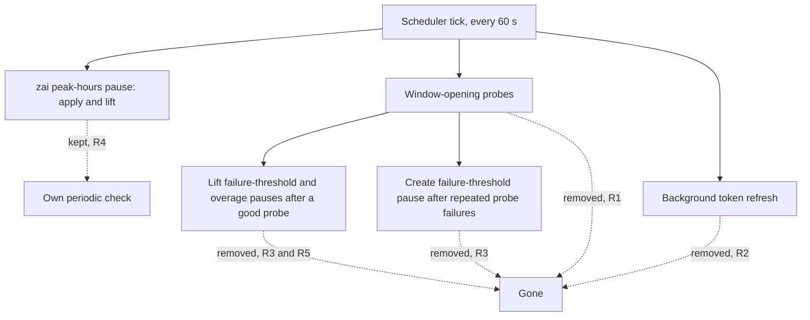

# Remove Auto-Refresh Probes - Plan

## Goal Capsule

- **Objective:** HoV Router no longer sends canned prompts on its own to open accounts' usage windows, which removes an inherited source of ban risk for automated use. Everything production relies on today keeps working.
- **Means:** Remove the inherited auto-refresh scheduler's window-opening probes and its background token refresh. Keep the zai peak-hours pause on its own periodic check, and keep the auto-refresh API for one release, able only to turn the setting off (Key Decisions).
- **Product authority:** On 2026-11-03 the operator told this session to "proceed as recommended", which took idea 1 of the upstream-teardown ideation forward. The remaining calls were resolved from code and production state without the operator. They are recorded under Key Decisions and Dependencies / Assumptions, and the operator may veto any of them. Requirements win on product behavior. Outstanding Questions do not bind.
- **Open blockers:** None.

---

## Product Contract

### Summary

The router stops sending the auto-refresh probes, the canned prompts it sends to open an account's next usage window. It also stops the background token refresh that runs alongside them.
The zai peak-hours pause keeps working on its own periodic check.
For one release the auto-refresh API, list field and stored column keep answering, and the API can only turn the setting off. A startup warning tells anyone who still has it on what no longer happens and how to turn it off.

### Problem Frame

HoV Router inherited an auto-refresh scheduler from upstream better-ccflare.
Every minute it looks for Anthropic, Codex and zai accounts that have auto-refresh switched on and whose usage window has reset. For each one it sends a canned prompt from a pool of about 500 to start the next window.
That is scripted inference against subscription accounts, the pattern `AGENTS.md` prohibits because it can get real accounts banned.

Production does not use it.
A read-only query of the production database on 2026-11-03 found 14 accounts with auto-refresh and the zai peak-hours pause off on every one, no failure-threshold or overage pauses, and no zai or qwen accounts.
The scheduler returns early when no account is due for a probe, and that return comes before its background token refresh. So that refresh has never run in production either; request-time refresh has carried every token.

The scheduler still starts on every boot, and its upkeep is large for something production never uses: 1,887 lines in the scheduler, a 684-line prompt pool, 16 test files that import it, a 568-line doc, a dashboard toggle, an API route, and an internal header handled in nine places across the proxy and API.
Any customer install that switched auto-refresh on is running the prohibited pattern today.

The scheduler also does three jobs that are easy to lose by accident.
It applies and lifts the zai peak-hours pause, which does not depend on the auto-refresh setting.
After a successful probe it lifts failure-threshold and overage pauses.
It is the only code that creates a failure-threshold pause.

### Requirements

The scheduler's jobs, and what happens to each:

**Probes and background refresh**

- R1. The router never sends a model request on an account's behalf to open, extend or test a usage window; the probe sender and its prompt pool are removed.
- R2. No background OAuth token refresh runs; tokens keep refreshing at request time for every provider that refreshes at request time today.

**Pauses**

- R3. Nothing creates a `failure_threshold` pause any more, and an account still carrying one from an older build stays paused until an operator resumes it.
- R4. An opted-in zai account is still paused when the zai peak window starts and resumed when it ends, checked at least once a minute as today; the peak-end resume never lifts a pause with any other reason.
- R5. Overage pauses keep their existing load-balancer auto-unpause path, which needs auto-fallback enabled; without it, an overage pause waits for an operator.

**Internal markers and cache keepalive**

- R6. A client-sent `x-better-ccflare-auto-refresh` header gains nothing: no trust, no routing to a paused or rate-limited account, no stats suppression and no authentication bypass.
- R7. Cache keepalive's routing, API-authentication exemption and internal-marker stripping are unchanged, and each keeps a test that runs after the removal.
- R8. Removing an account still clears that account's usage-polling tracking.

**Compatibility**

- R9. `POST /api/accounts/:id/auto-refresh` keeps answering success for one release and says in its response that auto-refresh was removed; turning the setting off still clears the stored value, and turning it on stores nothing.
- R10. Account API responses and `--list` output keep the `autoRefreshEnabled` field, which always reports false.
- R11. The `auto_refresh_enabled` column stays in the schema and this work adds no migration; stored values change only through R9's turn-off.
- R12. At startup the router logs one warning naming every account whose stored auto-refresh value is on. The warning says those accounts no longer get their usage windows opened ahead of use or their pauses lifted after a probe, and how to turn the setting off through R9.
- R13. The notes for the release that ships this name the removed behavior, so a customer who had auto-refresh on can learn about it before upgrading.

**Operator surfaces and docs**

- R14. The dashboard no longer offers an auto-refresh toggle; the zai peak-hours toggle stays.
- R15. No document describes auto-refresh probes as a current feature. `docs/auto-refresh.md` is removed and the other mentions are updated, while the zai peak-hours pause stays documented.

**Tests**

- R16. Tests for the behavior that survives exist and pass before the scheduler's own tests are deleted: the zai pause-and-resume cycle (not only the peak-hour calculation), cache keepalive's internal-probe authentication, request-time token refresh and its rotation races, and R6's header handling.

### Key Decisions

- **Remove the window-opening probes.** (session-settled: user-approved — chosen over keeping the feature behind its existing toggle: the probes are scripted inference that `AGENTS.md` prohibits, and production never uses them.) Governs R1.
- **Delete the code rather than disable it in place.** Disabling keeps the upkeep and leaves the prohibited path one revert away. Governs R1, R16.
- **Drop the background token refresh instead of moving it elsewhere.** It never ran in production. Request-time refresh, plus the 401 retry for anthropic, claude-oauth, codex and xai, already covers every token. Governs R2.
- **Keep the zai peak-hours pause.** It is a user-visible setting and the one scheduler job that does not depend on auto-refresh. Governs R4.
- **Warn instead of replacing the lost pause lifts.** No supported path besides the probe and the existing auto-fallback lifts these pauses, and building a new trigger is beyond the request. Governs R3, R5, R12.
- **Keep the API, field and column for one release, with turning off as the only write.** Scripts and clients that call the endpoint or read the field keep working, and with the dashboard toggle gone the endpoint is the warning's only exit. Stored values nobody turns off stay untouched, so rolling back to an older build restores the feature as it was. Governs R9, R10, R11, R12.
- **Report the field as false, not the stored value.** A stored true would claim behavior that no longer exists. Governs R10.
- **Remove the dashboard toggle now.** The dashboard ships inside the same binary, so no older dashboard depends on the toggle. Governs R14.

### Acceptance Examples

- AE1. **Covers R1, R12.**
  - **Given:** an Anthropic account with auto-refresh stored as on and a usage window that has reset.
  - **When:** the router starts and runs for an hour with no client traffic since startup.
  - **Then:** startup logs a warning naming that account, and no request is sent for it.
- AE2. **Covers R2.**
  - **Given:** a Codex account whose access token expired while the account sat idle.
  - **When:** a client request routes to it.
  - **Then:** the token refreshes before the request is sent upstream.
- AE3. **Covers R3.**
  - **Given:** an account paused with reason `failure_threshold` by an older build.
  - **When:** the router starts and runs.
  - **Then:** the account stays paused; once an operator resumes it, it is routable.
- AE4. **Covers R4.**
  - **Given:** a zai account with the peak-hours pause on and a second zai account paused manually.
  - **When:** the peak window starts, and later ends.
  - **Then:** the first account is paused within a minute of the start and resumed within a minute of the end, and the manually paused account stays paused throughout.
- AE5. **Covers R5.**
  - **Given:** an Anthropic account paused for overage, with auto-fallback off and auto-refresh stored as on.
  - **When:** its usage window resets.
  - **Then:** it stays paused until an operator resumes it. Before this change a successful probe would have lifted it.
- AE6. **Covers R6.**
  - **Given:** a client request carrying `x-better-ccflare-auto-refresh: true`, with or without a forged internal-probe secret.
  - **When:** it reaches the router.
  - **Then:** it is authenticated, routed and counted in stats like any other client request.
- AE7. **Covers R9, R10.**
  - **Given:** a client posts `{"enabled": true}` to the auto-refresh endpoint for an account.
  - **When:** it then reads the account.
  - **Then:** the post succeeded with a removal notice, the stored column is unchanged, and `autoRefreshEnabled` reads false.
- AE8. **Covers R9, R12.**
  - **Given:** an account with auto-refresh stored as on, which the startup warning names.
  - **When:** a client posts `{"enabled": false}` to the auto-refresh endpoint and the router restarts.
  - **Then:** the stored value is cleared and the startup warning no longer names that account.

### Scope Boundaries

**Deferred for later**

- Removing the endpoint, the `autoRefreshEnabled` field and the `auto_refresh_enabled` column, in a release after the one that ships this.
- A non-probe way to lift overage pauses at window reset for accounts without auto-fallback.
- Replacing the stored zai peak-hours pause with a rule applied when accounts are selected.
- A 401 retry for qwen accounts; production has none.

**Outside this work**

- Dropping PostgreSQL support, planned separately in `docs/plans/2026-11-03-2135-refactor-drop-postgresql-plan.md`.
- The other candidates in the upstream-teardown ideation.
- Renaming or reusing the `x-better-ccflare-auto-refresh` header name, which `AGENTS.md` protects.

### Dependencies / Assumptions

- Production behavior does not change. The 2026-11-03 production state (Problem Frame) has nothing that uses probes, the background refresh or the zai pause.
- How many customer installs use auto-refresh is not known. Any that do lose window opening and the probe's pause lifts, and R12 and R13 tell them.
- No account-creation path stores auto-refresh as on. The default is 0, and only the dashboard and API toggle set it, so a stored on is a deliberate opt-in.
- With no background refresh, an idle OAuth account whose refresh token lapses unused needs a re-login when next used. Production has always run this way.
- qwen refreshes only at request time and has no 401 retry. Its inherited refresh returns the refresh token as the access token, so the removed background refresh gave it nothing extra.
- Release classification is non-breaking (`refactor:`), because the API keeps answering. The operator may classify it as breaking instead.
- PR #717's plan (drop PostgreSQL) cites the scheduler file and `packages/proxy/src/__tests__/auto-refresh-proactive-requires-reauth.test.ts`. Whichever of the two implementations lands second rechecks the other's file references.
- Verification must not send scripted Anthropic requests (`AGENTS.md` testing restriction). Use unit tests or force-routed non-Anthropic accounts.

### Outstanding Questions

**Resolve Before Planning**

- None.

**Deferred to Planning**

- Where the zai peak-hours check runs once the scheduler goes: a slimmed scheduler, the usage poller, or its own heartbeat.
- Whether the code that reads the auto-refresh header is deleted or left in place, provided R6 holds.
- How the release note in R13 reaches the draft release, given that release-please builds notes from commit messages.
- What the multi-instance guard's list of protected in-process state says once the scheduler's refresh lock is gone.

### Sources

- `packages/proxy/src/auto-refresh-scheduler.ts`: 60-second tick (`:98`, `:152-167`), zai peak pause (`:82-89`, `:238`, `:1668-1708`), early return before the background refresh (`:305-307`, `:340-341`), probe header (`:570`), pause lift after a probe (`:806-831`), failure-threshold pause (`:997`), background refresh queries (`:1025`, `:1240`).
- `packages/proxy/src/auto-refresh-prompt-pool.ts`: the prompt pool.
- `apps/server/src/server.ts:2497-2500` (construction, start and tracking clearer) and `:3474-3476` (stop).
- `packages/proxy/src/handlers/token-manager.ts:98-130` (401-retry provider set and the qwen exclusion) and `:1594` (request-time refresh).
- Internal markers and keepalive: `packages/proxy/src/proxy.ts:900-912`, `packages/proxy/src/handlers/proxy-types.ts:116-123`, `packages/http-api/src/services/auth-service.ts:143-153`, `packages/proxy/src/handlers/request-handler.ts:31-34`, `packages/proxy/src/cache-keepalive-scheduler.ts:299-322`, `packages/proxy/src/handlers/account-selector.ts:3657-3678`, `packages/proxy/src/handlers/response-handler.ts:911-927`.
- Pauses: `packages/proxy/src/usage-collector.ts:1230-1243` (overage pause), `packages/load-balancer/src/strategies/index.ts:253-259` (auto-unpause gate), `packages/http-api/src/handlers/accounts.ts:3203-3248` (zai toggle and immediate resume).
- API and CLI contract: `packages/http-api/src/router.ts:941-948`, `packages/http-api/src/handlers/accounts.ts:818` and `:3334-3375`, `packages/cli-commands/src/commands/account.ts:2027`, `packages/types/src/account.ts`.
- Dashboard: `packages/dashboard-web/src/components/accounts/AccountListItem.tsx` (auto-refresh toggle near `:679-684`, zai toggle near `:735`).
- `packages/database/src/multi-instance-guard.ts:15-17` lists the scheduler's in-process state.
- Docs that mention auto-refresh or the zai pause: `docs/auto-refresh.md`, `docs/index.md`, `docs/reference.md`, `docs/configuration.md`, `docs/providers.md`, `docs/database.md`, `docs/routing-architecture.md`.
- Idea 1 of the 2026-11-03 upstream-teardown ideation (machine-local, best effort; this plan governs if they disagree): `/home/will/.claude/deliverables/ce-ideate/2026-11-03-1847-hov-router-upstream-teardown-ideation.html`.
