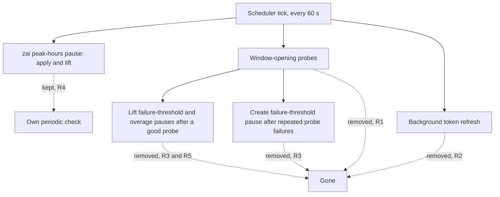
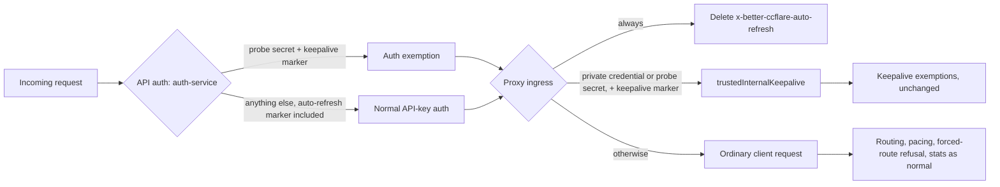
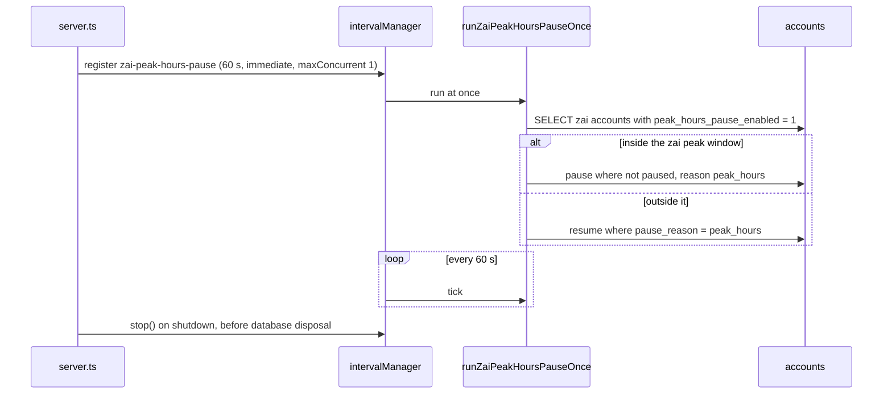

# Remove Auto-Refresh Probes - Plan

## Goal Capsule

- **Objective:** HoV Router no longer sends canned prompts on its own to open accounts' usage windows, which removes an inherited source of ban risk for automated use. Everything production relies on today keeps working.
- **Means:** Remove the inherited auto-refresh scheduler's window-opening probes and its background token refresh. Keep the zai peak-hours pause on its own periodic check, and keep the auto-refresh API for one release, able only to turn the setting off (Key Decisions).
- **Product authority:** On 2026-11-03 the operator told this session to "proceed as recommended", which took idea 1 of the upstream-teardown ideation forward. The remaining calls were resolved from code and production state without the operator. They are recorded under Key Decisions, Dependencies / Assumptions and the Planning Contract, and the operator may veto any of them. Requirements win on product behavior. Outstanding Questions do not bind.
- **Open blockers:** None.

---

## Product Contract

### Summary

The router stops sending the auto-refresh probes, the canned prompts it sends to open an account's next usage window. It also stops the background token refresh that runs alongside them.
The zai peak-hours pause keeps working on its own periodic check.
For one release the auto-refresh API, list field and stored column keep answering, and the API can only turn the setting off. A startup warning tells anyone who still has it on what no longer happens and how to turn it off.

### Problem Frame

HoV Router inherited an auto-refresh scheduler from upstream better-ccflare.
Every minute it looks for Anthropic, Codex and zai accounts that have auto-refresh switched on and whose usage window has reset. For each one it sends a canned prompt from a pool of about 500 to start the next window.
That is scripted inference against subscription accounts, the pattern `AGENTS.md` prohibits because it can get real accounts banned.

Production does not use it.
A read-only query of the production database on 2026-11-03 found 14 accounts with auto-refresh and the zai peak-hours pause off on every one, no failure-threshold or overage pauses, and no zai or qwen accounts.
The scheduler returns early when no account is due for a probe, and that return comes before its background token refresh. So that refresh has never run in production either; request-time refresh has carried every token.

The scheduler still starts on every boot, and its upkeep is large for something production never uses: 1,887 lines in the scheduler, a 684-line prompt pool, 16 test files that import it, a 568-line doc, a dashboard toggle, an API route, and an internal header handled in nine places across the proxy and API.
Any customer install that switched auto-refresh on is running the prohibited pattern today.

The scheduler also does three jobs that are easy to lose by accident.
It applies and lifts the zai peak-hours pause, which does not depend on the auto-refresh setting.
After a successful probe it lifts failure-threshold and overage pauses.
It is the only code that creates a failure-threshold pause.

### Requirements

The scheduler's jobs, and what happens to each:

**Probes and background refresh**

- R1. The router never sends a model request on an account's behalf to open, extend or test a usage window; the probe sender and its prompt pool are removed.
- R2. No background OAuth token refresh runs; tokens keep refreshing at request time for every provider that refreshes at request time today.

**Pauses**

- R3. Nothing creates a `failure_threshold` pause any more, and an account still carrying one from an older build stays paused until an operator resumes it.
- R4. An opted-in zai account is still paused when the zai peak window starts and resumed when it ends, checked at least once a minute as today; the peak-end resume never lifts a pause with any other reason.
- R5. Overage pauses keep their existing load-balancer auto-unpause path, which needs auto-fallback enabled; without it, an overage pause waits for an operator.

**Internal markers and cache keepalive**

- R6. A client-sent `x-better-ccflare-auto-refresh` header gains nothing: no trust, no routing to a paused or rate-limited account, no stats suppression and no authentication bypass.
- R7. Cache keepalive's routing, API-authentication exemption and internal-marker stripping are unchanged, and each keeps a test that runs after the removal.
- R8. Removing an account still clears that account's usage-polling tracking.

**Compatibility**

- R9. `POST /api/accounts/:id/auto-refresh` keeps answering success for one release and says in its response that auto-refresh was removed; turning the setting off still clears the stored value, and turning it on stores nothing.
- R10. Account API responses and `--list` output keep the `autoRefreshEnabled` field, which always reports false.
- R11. The `auto_refresh_enabled` column stays in the schema and this work adds no migration; stored values change only through R9's turn-off.
- R12. At startup the router logs one warning naming every account whose stored auto-refresh value is on. The warning says those accounts no longer get their usage windows opened ahead of use or their pauses lifted after a probe, and how to turn the setting off through R9.
- R13. The notes for the release that ships this name the removed behavior, so a customer who had auto-refresh on can learn about it before upgrading.

**Operator surfaces and docs**

- R14. The dashboard no longer offers an auto-refresh toggle; the zai peak-hours toggle stays.
- R15. No document describes auto-refresh probes as a current feature. `docs/auto-refresh.md` is removed and the other mentions are updated, while the zai peak-hours pause stays documented.

**Tests**

- R16. Tests for the behavior that survives exist and pass before the scheduler's own tests are deleted: the zai pause-and-resume cycle (not only the peak-hour calculation), cache keepalive's internal-probe authentication, request-time token refresh and its rotation races, and R6's header handling.

### Key Decisions

- **Remove the window-opening probes.** (session-settled: user-approved — chosen over keeping the feature behind its existing toggle: the probes are scripted inference that `AGENTS.md` prohibits, and production never uses them.) Governs R1.
- **Delete the code rather than disable it in place.** Disabling keeps the upkeep and leaves the prohibited path one revert away. Governs R1, R16.
- **Drop the background token refresh instead of moving it elsewhere.** It never ran in production. Request-time refresh, plus the 401 retry for anthropic, claude-oauth, codex and xai, already covers every token. Governs R2.
- **Keep the zai peak-hours pause.** It is a user-visible setting and the one scheduler job that does not depend on auto-refresh. Governs R4.
- **Warn instead of replacing the lost pause lifts.** No supported path besides the probe and the existing auto-fallback lifts these pauses, and building a new trigger is beyond the request. Governs R3, R5, R12.
- **Keep the API, field and column for one release, with turning off as the only write.** Scripts and clients that call the endpoint or read the field keep working, and with the dashboard toggle gone the endpoint is the warning's only exit. Stored values nobody turns off stay untouched, so rolling back to an older build restores the feature as it was. Governs R9, R10, R11, R12.
- **Report the field as false, not the stored value.** A stored true would claim behavior that no longer exists. Governs R10.
- **Remove the dashboard toggle now.** The dashboard ships inside the same binary, so no older dashboard depends on the toggle. Governs R14.

### Acceptance Examples

- AE1. **Covers R1, R12.**
  - **Given:** an Anthropic account with auto-refresh stored as on and a usage window that has reset.
  - **When:** the router starts and runs for an hour with no client traffic since startup.
  - **Then:** startup logs a warning naming that account, and no request is sent for it.
- AE2. **Covers R2.**
  - **Given:** a Codex account whose access token expired while the account sat idle.
  - **When:** a client request routes to it.
  - **Then:** the token refreshes before the request is sent upstream.
- AE3. **Covers R3.**
  - **Given:** an account paused with reason `failure_threshold` by an older build.
  - **When:** the router starts and runs.
  - **Then:** the account stays paused; once an operator resumes it, it is routable.
- AE4. **Covers R4.**
  - **Given:** a zai account with the peak-hours pause on and a second zai account paused manually.
  - **When:** the peak window starts, and later ends.
  - **Then:** the first account is paused within a minute of the start and resumed within a minute of the end, and the manually paused account stays paused throughout.
- AE5. **Covers R5.**
  - **Given:** an Anthropic account paused for overage, with auto-fallback off and auto-refresh stored as on.
  - **When:** its usage window resets.
  - **Then:** it stays paused until an operator resumes it. Before this change a successful probe would have lifted it.
- AE6. **Covers R6.**
  - **Given:** a client request carrying `x-better-ccflare-auto-refresh: true`, with or without a forged internal-probe secret.
  - **When:** it reaches the router.
  - **Then:** it is authenticated, routed and counted in stats like any other client request.
- AE7. **Covers R9, R10.**
  - **Given:** a client posts `{"enabled": true}` to the auto-refresh endpoint for an account.
  - **When:** it then reads the account.
  - **Then:** the post succeeded with a removal notice, the stored column is unchanged, and `autoRefreshEnabled` reads false.
- AE8. **Covers R9, R12.**
  - **Given:** an account with auto-refresh stored as on, which the startup warning names.
  - **When:** a client posts `{"enabled": false}` to the auto-refresh endpoint and the router restarts.
  - **Then:** the stored value is cleared and the startup warning no longer names that account.

### Scope Boundaries

**Deferred for later**

- Removing the endpoint, the `autoRefreshEnabled` field and the `auto_refresh_enabled` column, in a release after the one that ships this.
- A non-probe way to lift overage pauses at window reset for accounts without auto-fallback.
- Replacing the stored zai peak-hours pause with a rule applied when accounts are selected.
- A 401 retry for qwen accounts; production has none.

**Outside this work**

- Dropping PostgreSQL support, planned separately in `docs/plans/2026-11-03-2135-refactor-drop-postgresql-plan.md`.
- The other candidates in the upstream-teardown ideation.
- Renaming or reusing the `x-better-ccflare-auto-refresh` header name, which `AGENTS.md` protects.

### Dependencies / Assumptions

- Production behavior does not change. The 2026-11-03 production state (Problem Frame) has nothing that uses probes, the background refresh or the zai pause.
- How many customer installs use auto-refresh is not known. Any that do lose window opening and the probe's pause lifts, and R12 and R13 tell them.
- No account-creation path stores auto-refresh as on. The default is 0, and only the dashboard and API toggle set it, so a stored on is a deliberate opt-in.
- With no background refresh, an idle OAuth account whose refresh token lapses unused needs a re-login when next used. Production has always run this way.
- qwen refreshes only at request time and has no 401 retry. Its inherited refresh returns the refresh token as the access token, so the removed background refresh gave it nothing extra.
- Release classification is non-breaking (`refactor:`), because the API keeps answering. The operator may classify it as breaking instead.
- PR #717's plan (drop PostgreSQL) cites the scheduler file and `packages/proxy/src/__tests__/auto-refresh-proactive-requires-reauth.test.ts`. Whichever of the two implementations lands second rechecks the other's file references.
- Verification must not send scripted Anthropic requests (`AGENTS.md` testing restriction). Use unit tests or force-routed non-Anthropic accounts.

### Outstanding Questions

The four questions deferred to planning are resolved in the Planning Contract: where the zai check runs (KTD1), what happens to the code that reads the auto-refresh header (KTD2), how the R13 note reaches the draft release (KTD3), and what the multi-instance guard lists in place of the scheduler (KTD4).

### Sources

- `packages/proxy/src/auto-refresh-scheduler.ts`: 60-second tick (`:98`, `:152-167`), zai peak pause (`:82-89`, `:238`, `:1672-1711`), early return before the background refresh (`:305-307`, `:340-341`), probe header (`:570`), pause lift after a probe (`:806-831`), failure-threshold pause (`:997`), background refresh queries (`:1025`, `:1240`).
- `packages/proxy/src/auto-refresh-prompt-pool.ts`: the prompt pool.
- `apps/server/src/server.ts:2497-2500` (construction, start and tracking clearer) and `:3474-3476` (stop).
- `packages/proxy/src/handlers/token-manager.ts:98-130` (401-retry provider set and the qwen exclusion) and `:1594` (request-time refresh).
- Internal markers and keepalive: `packages/proxy/src/proxy.ts:900-912`, `packages/proxy/src/handlers/proxy-types.ts:116-123`, `packages/http-api/src/services/auth-service.ts:143-153`, `packages/proxy/src/handlers/request-handler.ts:31-34`, `packages/proxy/src/cache-keepalive-scheduler.ts:299-322`, `packages/proxy/src/handlers/account-selector.ts:3657-3678`, `packages/proxy/src/response-handler.ts:911-927`.
- Pauses: `packages/proxy/src/usage-collector.ts:1230-1243` (overage pause), `packages/load-balancer/src/strategies/index.ts:253-259` (auto-unpause gate), `packages/http-api/src/handlers/accounts.ts:3203-3248` (zai toggle and immediate resume).
- API and CLI contract: `packages/http-api/src/router.ts:941-948`, `packages/http-api/src/handlers/accounts.ts:818` and `:3334-3375`, `packages/cli-commands/src/commands/account.ts:2027`, `packages/types/src/account.ts`.
- Dashboard: `packages/dashboard-web/src/components/accounts/AccountListItem.tsx` (auto-refresh toggle near `:679-684`, zai toggle near `:735`).
- `packages/database/src/multi-instance-guard.ts:15-17` lists the scheduler's in-process state.
- Docs that mention auto-refresh or the zai pause: `docs/auto-refresh.md`, `docs/index.md`, `docs/reference.md`, `docs/configuration.md`, `docs/providers.md`, `docs/database.md`, `docs/routing-architecture.md`.
- Idea 1 of the 2026-11-03 upstream-teardown ideation (machine-local, best effort; this plan governs if they disagree): `/home/will/.claude/deliverables/ce-ideate/2026-11-03-1847-hov-router-upstream-teardown-ideation.html`.

---

## Planning Contract

Line numbers below were read at `2249d5a1`. Implementation starts after PR #723 (drop PostgreSQL) merges and rebases onto it, so re-locate each anchor by its quoted symbol, not its number.

### Key Technical Decisions

- KTD1. **The zai peak-hours pause becomes its own module and interval.** Create `packages/proxy/src/zai-peak-hours-pause.ts` with `isZaiPeakHour(ts = Date.now())` moved verbatim from the scheduler (`:82-89`), `runZaiPeakHoursPauseOnce(db, now = Date.now())` carrying `checkPeakHoursPause`'s SELECT and both guarded UPDATEs unchanged (`:1672-1711`), and `startZaiPeakHoursPause(db)`. The starter calls `intervalManager.register({ id: "zai-peak-hours-pause", callback, intervalMs: 60_000, maxConcurrent: 1, immediate: true, description })` and returns the stop function `register` returns. It does not use `registerHeartbeat`, which has no `immediate` option, so the first check would wait a minute where the scheduler ran it at once. `server.ts` starts it where the scheduler started and stops it where the scheduler stopped, before database disposal. Rejected: folding it into the usage poller, which skips paused accounts and so could never resume one; and a slimmed scheduler, which keeps the removed feature's name on the one job that survives.
- KTD2. **The auto-refresh marker is deleted at every entry and trusted nowhere.** Proxy ingress (`proxy.ts:900-918`) deletes `x-better-ccflare-auto-refresh` unconditionally and computes only `trustedInternalKeepalive`. `consumeInternalAutoRefreshAuth` stays because cache keepalive stamps the same private credential (`cache-keepalive-scheduler.ts:314`). Every effect of `trustedInternalAutoRefresh` goes: the stats skips, the pacing exemption, the native-removal and force-model gates, the forced-route bypass to paused or rate-limited accounts (`account-selector.ts:3650-3685`), the credit-drain half (`account-selector.ts:1521-1531`) and the routing-diagnostics producer (`routing-selection-diagnostics.ts:172-173`). `isInternalProbe` loses its `"auto-refresh"` marker, so its `"auto-refresh"` callers (`response-handler.ts:913`, `handlers/response-processor.ts:573`) lose their condition and its `"any"` callers become keepalive-only: `account-selector.ts:3555`, `:4058`, `:4612`, `proxy.ts:697` and `response-handler.ts:953`. `auth-service.ts` `isInternalProbeRequest` (`:139-153`) exempts the keepalive marker only, because API authentication runs before proxy ingress and must drop the marker itself. The four readers downstream of ingress (`cache-transport-staging.ts:80-85`, `handlers/proxy-operations.ts:504-509`, `server-tool-replay-runtime.ts:210-215`, `session-account-observer.ts:237-244`) drop their auto-refresh half. Kept: the strip in `request-handler.ts:33`, `internal-probe-auth.ts` and its exported names, `INTERNAL_PROBE_SECRET_HEADER`, and the `trusted_auto_refresh` value in the persisted routing-decision parser (`packages/types/src/routing-decision.ts:64`, `:146`, `:240`), which old stored rows still carry. `trustedInternalAutoRefresh?` leaves `packages/types/src/api.ts:262`.
- KTD3. **The R13 note travels in the squash subject and the migration doc.** release-please builds notes from commit subjects, so the squash subject is `refactor: remove the auto-refresh window-opening probes` (Improvements section, no `BREAKING CHANGE` footer, per Dependencies / Assumptions). `docs/hov-router-migration.md` gains `## Auto-refresh removed`, shaped like its `## PostgreSQL support removed` section: what stopped, who is affected, the startup warning, and the turn-off call. "What stopped" names all three lost behaviors: the window-opening probes; the background OAuth token refresh, so an idle account whose refresh token lapses needs a re-login (Dependencies / Assumptions); and the pause lifts after a probe, so a `failure_threshold` pause now waits for an operator and an overage pause clears on its own only with auto-fallback on (R3, R5). The draft release's `## Highlights` is the operator's publish step (`docs/hov-router-releases.md`); this work does not edit a draft release.
- KTD4. **The multi-instance guard keeps seven categories; item 5 names request-time refresh.** Item 5 at `multi-instance-guard.ts:15-17` and its log line at `:406` become "OAuth token refresh — the request-time single-flight (`refreshInFlight`) and pending-rotation registry", keeping the warning that a second instance refreshes the same token concurrently, a race against the provider. That race survives the scheduler: each instance keeps its own `ctx.refreshInFlight` (`token-manager.ts:41-60`). The guard tests that expect "AutoRefreshScheduler" (`__tests__/multi-instance-guard.test.ts:416`, `:438`) expect the new label, and `docs/deployment.md`'s "OAuth refresh scheduler" bullet is reworded to match.
- KTD5. **The auto-refresh handler accepts both shapes and writes only zero.** `createAccountAutoRefreshHandler` (`accounts.ts:3326-3386`) accepts `enabled` as `0`, `1`, `true` or `false`, keeps the 400 for a missing or invalid value and the 404 for an unknown account, and drops the provider gate, since turning off is harmless for any provider. Turn-off runs `UPDATE accounts SET auto_refresh_enabled = 0 WHERE id = ?`; turn-on writes nothing. Both answer `{ success: true, autoRefreshEnabled: false, message }`, and the message says auto-refresh was removed and whether a stored value was cleared. Account responses (`accounts.ts:818`), the CLI list (`account.ts:2027`) and both domain-to-response mappers (`packages/types/src/account.ts:754`, `:808`) report `false`. The domain and row types keep their fields (R11), and the in-memory account shapes that set them (`account-routing-operations.ts:281`, `provider-attempt-plan.ts:614`) stay, since nothing routes on them.
- KTD6. **The R12 warning is a pure builder plus one query, logged once after the database opens.** New `apps/server/src/auto-refresh-removed-warning.ts` exports `buildAutoRefreshRemovedWarning(names: string[]): string | null` and `readAutoRefreshOptedInAccountNames(db)`, which runs `SELECT name FROM accounts WHERE COALESCE(auto_refresh_enabled, 0) = 1 ORDER BY name`. `server.ts` calls them beside `memberNoticeStartupWarning` (`:1695`), after `getInstanceAsync` (`:1594`), and logs with `log.warn`. A query failure is logged and never blocks startup. The builder lists up to ten names, then "and N more", and gives the turn-off call `POST /api/accounts/<id>/auto-refresh` with `{"enabled": false}`.
- KTD7. **The account-removal clearer keeps its seam and loses the scheduler.** `createUsagePollingTrackingClearer` (`apps/server/src/usage-polling-lifecycle.ts:141-150`) takes only the lifecycle and calls `lifecycle.retire(accountId)`. The token-manager clearer registry (`handlers/token-manager.ts:1535-1566`) keeps its exported names, because `packages/http-api/src/handlers/accounts.ts:1178` and the proxy barrel use them; only its doc comments change.
- KTD8. **Scheduler tests are classified before deletion; surviving behavior is ported, removed behavior is deleted.** A scheduler test that drives a function that survives (the zai cycle, request-time refresh, the CAS rotation write, internal-probe auth) moves to that function's own suite. One that drives only the probe sender, its selection query, its counters or its proactive refresh is deleted with the scheduler. Header-marker tests follow one rule: a fixture that supplies `ctx.internalProbeSecret` with the auto-refresh marker flips to assert no trust (AE6) or moves to the keepalive marker; a fixture without the secret was already inert, so the marker is dropped.

### High-Level Technical Design

Internal-request trust after the change. The auto-refresh marker has no path to any exemption; keepalive keeps both of its proofs.

zai peak-hours job lifecycle:

### Assumptions

Each is a bet made without the operator; any may be vetoed.

- One PR carries all units. They share files (`server.ts`, `proxy.ts`, the proxy barrel), and the scheduler's tests can only be deleted once the surviving tests exist (R16).
- R1 covers sends the router starts by itself. The operator-triggered Codex usage refresh (`registerCodexUsageRefresher`, `server.ts:2320-2340`), which can send a small request when the operator asks for fresh usage, is not a scheduled probe and stays untouched.
- No CLI command to turn auto-refresh off is added; the API call in the R12 warning is the exit, and the CLI has no auto-refresh command today.
- The private-credential names (`stampInternalAutoRefreshAuth`, `consumeInternalAutoRefreshAuth`, `INTERNAL_AUTO_REFRESH_HEADER`) and the tracking-clearer names keep their auto-refresh wording. Renaming them reaches beyond the request into keepalive and http-api.
- No startup warning is added for leftover `failure_threshold` pauses; the dashboard already shows them as paused and an operator resumes them (R3).
- Enabling the zai toggle during a peak window still waits for the next tick, at most 60 s, as today.

### Sequencing and Constraints

- Rebase onto `origin/main` after PR #723 merges, then run `bun install --frozen-lockfile` and `bun run build:cli` once so the generated database workers exist before any test runs.
- Order: U1, U2 and U3 add or flip tests and code that survive; U4 deletes the scheduler only after those tests pass (R16). U5 follows U4. U6 depends on nothing and may run at any point before U7. U7 comes last, after U1 through U6, so the docs describe the code that ships.
- No scripted Anthropic request is sent at any step (Dependencies / Assumptions). The boot check in the Verification Contract uses a scratch database with no Anthropic credentials.
- Generated `inline-*-worker.ts` files are never staged; files are staged by name.

### Deferred to Follow-Up Work

- The probe-backoff penalty (`packages/core/src/probe-backoff.ts`) loses its only writer, the scheduler (`setProbeBackoff` at `:1733`). The load balancer's tie-break (`routing-metadata.ts:239-241`, `compareAccountPreference` in three strategies) then always ranks zero and changes nothing. Removing it changes routing code in three strategies, so it is left inert here.
- A force-routed request to an overage-paused account with auto-fallback off is refused as retryable, although that pause waits for an operator (R5). Every account without auto-refresh has had that signal already; this work changes the retry signal only for `failure_threshold`, the pause it makes permanent.

---

## Implementation Units

### U1. Move the zai peak-hours pause into its own module and interval

- **Goal:** The zai pause and resume run every minute without the scheduler, with the same guards.
- **Requirements:** R4, R16.
- **Dependencies:** None.
- **Files:**
  - Create `packages/proxy/src/zai-peak-hours-pause.ts`.
  - Create `packages/proxy/src/__tests__/zai-peak-hours-pause.test.ts`, absorbing `packages/proxy/src/__tests__/auto-refresh-zai-peak-hour.test.ts` (deleted).
  - Modify `packages/proxy/src/index.ts` (export the starter and helpers) and `apps/server/src/server.ts` (start after the scheduler's old start point, keep the stop function, call it where the scheduler stopped at `:3474-3476`).
- **Approach:** KTD1. The scheduler keeps running its own copy until U4 deletes it; for that window both would run, so U1 and U4 land in the same PR and the scheduler's `checkPeakHoursPause` call is removed in U1 to keep a single writer.
- **Execution note:** Test-first. Write the cycle tests against the new module, see them fail on the missing module, then implement.
- **Patterns:** The real in-memory SQLite setup in `packages/proxy/src/__tests__/auto-refresh-manual-pause-guard.test.ts` (`bun:sqlite` `Database`), executing the module's SQL against seeded rows rather than mocking the database.
- **Test scenarios:**
  - AE4: at a peak-window timestamp an opted-in, unpaused zai account becomes `paused = 1`, `pause_reason = 'peak_hours'`; a manually paused opted-in zai account keeps `pause_reason = 'manual'`; at an off-peak timestamp the first resumes with `pause_reason` NULL and the manual one stays paused.
  - An account with `peak_hours_pause_enabled = 0`, and a non-zai account with the flag set, are untouched at both timestamps.
  - Weekend timestamps inside 14:00-18:00 UTC+8 never pause; the existing `isZaiPeakHour` boundary cases carry over unchanged.
  - `startZaiPeakHoursPause` registers `zai-peak-hours-pause` at 60 s with an immediate first run, and its stop function unregisters it.
- **Verification:** `bun test packages/proxy/src/__tests__/zai-peak-hours-pause.test.ts --timeout 60000` passes.

### U2. Remove trust in the auto-refresh marker

- **Goal:** A client-sent auto-refresh marker is stripped and earns nothing, while keepalive keeps every exemption.
- **Requirements:** R6, R7, R16.
- **Dependencies:** None.
- **Files:**
  - Modify `packages/proxy/src/proxy.ts`, `packages/proxy/src/handlers/proxy-types.ts`, `packages/proxy/src/handlers/account-selector.ts`, `packages/proxy/src/response-handler.ts`, `packages/proxy/src/handlers/response-processor.ts`, `packages/proxy/src/cache-transport-staging.ts`, `packages/proxy/src/handlers/proxy-operations.ts`, `packages/proxy/src/server-tool-replay-runtime.ts`, `packages/proxy/src/session-account-observer.ts`, `packages/proxy/src/routing-selection-diagnostics.ts`, `packages/http-api/src/services/auth-service.ts`, `packages/types/src/api.ts`, and `bench/proxy-request-memory-harness.ts:1057` (switch to the keepalive marker).
  - Tests that read the marker, each handled by KTD8's header rule: `auth-service-internal-probe.test.ts`, `auto-refresh-probe-filter.test.ts`, `auto-refresh-throttle-exemption.test.ts`, `force-account-model-probe-exemption.test.ts`, `internal-probe-auth.test.ts`, `router-quality-route-control.test.ts`, `proxy-cancellation-history.test.ts`, `proxy-combo-fallback.test.ts`, `proxy-combo-model-observability.test.ts`, `proxy-usage-throttling.test.ts`, `response-handler-anthropic-terminal-recovery.test.ts`, `account-selector-force-model.test.ts`, `account-selector.test.ts`, `account-selector-codex-credit-drain.test.ts`, `proxy-operations-client-abort.test.ts`, `proxy-operations-count-tokens.test.ts`, `proxy-unauthenticated-abort.test.ts`, and the comment in `circuit-recovery-reachability.test.ts:14`. `request-handler-strip-headers.test.ts` keeps its assertions because the strip stays. Files named `auto-refresh-*` that end up testing keepalive or AE6 are renamed to say so.
- **Approach:** KTD2, in this order: flip the tests to the post-change behavior so they fail, then remove the marker from `isInternalProbe` and let the compiler list every caller, then remove `trustedInternalAutoRefresh` from ingress outward.
- **Execution note:** Test-first. The AE6 assertions are written and seen failing before any trust code is removed.
- **Patterns:** `cache-keepalive-scheduler.test.ts:566` (the keepalive hop carries a valid private credential) and the existing forced-route refusal path through `ForceRouteUnavailableError`.
- **Test scenarios:**
  - AE6, auth: with API authentication on, a request carrying the probe secret and the auto-refresh marker but no key is refused like any keyless request; the same request with the keepalive marker is still exempt.
  - AE6, routing: the auto-refresh marker plus a valid private credential, force-routed to a paused or rate-limited account, gets `ForceRouteUnavailableError` instead of the bypass.
  - AE6, stats and pacing: a marked request is recorded in request stats and is pacing-eligible on `/v1/messages`.
  - AE6, credit drain: a marked request gets no internal-probe treatment at the credit-drain gate.
  - R7: a keepalive replay still carries the private credential plus `x-better-ccflare-keepalive: true` and keeps its auth exemption, pacing exemption, cooldown skip and staging skip.
  - The marker never reaches upstream: the ingress delete and the `request-handler.ts` strip both still hold.
- **Verification:** Each listed test file passes on its own; `grep -a -rn 'trustedInternalAutoRefresh' apps packages bench` finds nothing.

### U3. Keep the auto-refresh API answering and warn at startup

- **Goal:** Clients of the endpoint and the field keep working for one release, and operators who opted in learn what changed.
- **Requirements:** R9, R10, R11, R12.
- **Dependencies:** None.
- **Files:**
  - Modify `packages/http-api/src/handlers/accounts.ts` (`:818`, `:3326-3386`), `packages/cli-commands/src/commands/account.ts:2027`, `packages/types/src/account.ts` (`:754`, `:808`), `apps/server/src/server.ts`.
  - Create `apps/server/src/auto-refresh-removed-warning.ts` and `apps/server/src/auto-refresh-removed-warning.test.ts`.
  - Tests for the handler beside its existing account-handler tests.
- **Approach:** KTD5 for the handler and the false field; KTD6 for the warning.
- **Execution note:** Test-first.
- **Patterns:** `memberNoticeStartupWarning` and its call at `server.ts:1695` for a pure startup-warning builder logged once.
- **Test scenarios:**
  - AE7: posting `{"enabled": true}` answers 200 with `autoRefreshEnabled: false` and a removal message, the stored column keeps its prior value, and the account read reports `autoRefreshEnabled: false`.
  - AE8: posting `{"enabled": false}` or `{"enabled": 0}` clears a stored 1, and the next startup query no longer returns that account.
  - A missing or non-boolean, non-0/1 `enabled` answers 400; an unknown account answers 404; a non-Anthropic account may turn it off.
  - The builder returns null for no names, lists each name for a few, and stops at ten with "and N more"; its text names both lost behaviors and the turn-off call.
  - A stored 1 still reads as `autoRefreshEnabled: false` in the account list response and in the CLI list row.
- **Verification:** The handler and warning suites pass on their own, and the boot check in the Verification Contract shows the warning.

### U4. Delete the scheduler and prompt pool

- **Goal:** The probe sender, its prompt pool and the background refresh no longer exist, and account removal still clears usage-polling tracking.
- **Requirements:** R1, R2, R3, R5, R8, R16.
- **Dependencies:** U1, U2 and U3 done, with their tests passing.
- **Files:**
  - Delete `packages/proxy/src/auto-refresh-scheduler.ts` and `packages/proxy/src/auto-refresh-prompt-pool.ts`.
  - Modify `packages/proxy/src/handlers/account-selector.ts`: `needsOperatorToResume` (`:916-921`) also returns true for `pause_reason = 'failure_threshold'`, and its doc comment (`:911-915`) stops listing failure-threshold pauses as clearing on their own. With the probe gone nothing lifts that pause (R3), so a force-routed request to such an account must refuse with `retryable: false` (`x-should-retry: false`, `proxy.ts` `forceRouteUnavailableResponse`) instead of inviting about ten client retries.
  - Modify `packages/proxy/src/index.ts` (remove the `AutoRefreshScheduler` export at `:53`), `apps/server/src/server.ts` (import `:87`, variable `:722`, construction `:2494-2503`, stop `:3474-3476`), `apps/server/src/usage-polling-lifecycle.ts`, `apps/server/src/usage-polling-lifecycle.test.ts:134-170`, `apps/server/src/device-setup-lifecycle.test.ts` (scheduler mocks near `:89`, `:132`, `:142`), `packages/proxy/src/handlers/token-manager.ts` (clearer doc comments only), `.gitignore:35-36` (the ignored scheduler test entry).
  - Delete the scheduler-only tests after KTD8's classification: `auto-refresh-529-not-counted`, `cooldown-guard`, `failure-threshold`, `generation-fence`, `manual-pause-guard`, `paused-exclusion`, `proactive-requires-reauth`, `proactive-skip`, `prompt-pool`, `rotation-race-guard`, `scheduler-reauth-pause`, `uncounted-failure-cooldown`, `usage-exhausted-skip` (each `packages/proxy/src/__tests__/auto-refresh-<name>.test.ts`) and `token-refresh-hierarchy`. `token-manager-rotation-race.test.ts` stays.
- **Approach:** KTD7 and KTD8. Before deleting `rotation-race-guard`, `scheduler-reauth-pause`, `generation-fence` and `token-refresh-hierarchy`, check that `token-manager-rotation-race.test.ts` or another request-time suite covers the same cases: the CAS loser adopting the winner's token for codex and xai, a transient refresh failure not flagging reauth, a CAS write that matches no row, a database failure during the write, and a pending rotation being reused. Port any case that is missing.
- **Execution note:** Characterization-first. The coverage check and any ports land before the deletions.
- **Patterns:** The existing request-time cases in `token-manager-rotation-race.test.ts`.
- **Test scenarios:**
  - AE2: a Codex account with an expired access token is refreshed by `getValidAccessToken` before the upstream send (existing request-time test, or a new one if none covers codex).
  - AE3: an account with `pause_reason = 'failure_threshold'`, auto-fallback on and a reset window is not auto-unpaused by the load-balancer strategies; after the resume endpoint clears the pause it is selectable.
  - R3, forced route: a request force-routed to a `failure_threshold`-paused account gets `ForceRouteUnavailableError` with `retryable: false`, beside the existing paused and retryable cases in `packages/proxy/src/handlers/__tests__/account-selector.test.ts` (`:1170`, `:1323`); a `manual` pause still refuses non-retryable and an unattributed pause stays retryable.
  - AE5 and R5: an overage-paused account with auto-fallback off stays paused at window reset; with auto-fallback on the existing auto-unpause lifts it. Cite the existing strategies test if it covers both, or add the missing case.
  - R8: the clearer built by `createUsagePollingTrackingClearer(lifecycle)` retires the account's polling, and account removal still invokes it.
  - AE1: no code sends a probe; proven by the residue check and boot check in the Verification Contract, not by a test that calls Anthropic.
- **Verification:** The ported and updated suites pass one file at a time, and the residue check finds nothing.

### U5. Reword the multi-instance guard's item 5

- **Goal:** The guard's divergence list names state that still exists.
- **Requirements:** None of its own; it carries KTD4, so the guard's log line and its `docs/deployment.md` bullet (R15) name state that still exists.
- **Dependencies:** U4.
- **Files:** `packages/database/src/multi-instance-guard.ts` (`:15-17`, `:406`), `packages/database/src/__tests__/multi-instance-guard.test.ts` (`:416`, `:438`), `docs/deployment.md` (the "OAuth refresh scheduler" bullet in the multi-instance section).
- **Approach:** KTD4.
- **Test scenarios:** The guard message still names seven categories, and item 5 names OAuth token refresh rather than the scheduler.
- **Verification:** `bun test packages/database/src/__tests__/multi-instance-guard.test.ts --timeout 60000` passes.

### U6. Remove the dashboard toggle

- **Goal:** The accounts page offers no auto-refresh switch; auto-fallback and the zai toggle stay.
- **Requirements:** R14.
- **Dependencies:** None.
- **Files:**
  - `packages/dashboard-web/src/components/accounts/AccountListItem.tsx`: props near `:138` and `:245`, the toggle block at `:676-687` (keep the auto-fallback switch in the same `showAutoFeatures` fragment), and the overage tooltip at `:712`, which says the account resumes at window reset. That is true now only with auto-fallback on, so the tooltip says so.
  - `AccountList.tsx` (`:17`, `:42`, `:79`), `AccountsTab.tsx` (`:19`, `:260`, `:629-639`, `:873`), `hooks/queries.ts:874-891`, `api.ts:1495-1525`, `queries.managed-routing.test.ts` (`:21`, `:148`, `:281`), `AccountListItem.test.tsx:76`, and the comment at `utils/provider-utils.ts:12` (`providerSupportsAutoFeatures` stays, since it still gates auto-fallback).
- **Approach:** Remove the toggle's prop, handler, mutation hook and client call end to end; nothing else in the dashboard calls the endpoint.
- **Test scenarios:** An account row for an Anthropic account renders the auto-fallback switch and no auto-refresh switch; a zai row still renders the peak-hours toggle.
- **Verification:** The dashboard tests named above pass on their own, and the root typecheck (which includes the dashboard) is clean.

### U7. Update docs and the migration note

- **Goal:** No document presents probes as a feature; the zai pause and the removal are documented.
- **Requirements:** R13, R15.
- **Dependencies:** U1 through U6, so the docs describe the code that ships.
- **Files:**
  - Delete `docs/auto-refresh.md`.
  - Update the mentions in `docs/index.md`, `docs/reference.md`, `docs/configuration.md`, `docs/database.md`, `docs/providers.md`, `docs/routing-architecture.md`, `CONCEPTS.md`, `docs/solutions/workflow-issues/verify-codex-credit-drain-by-balance-delta.md` and `docs/solutions/workflow-issues/typecheck-does-not-cover-test-call-sites.md`. Re-locate each by searching for `auto-refresh`, `auto_refresh` and `autoRefresh`, since PR #720 and PR #723 moved lines in some of them.
  - Add a zai peak-hours section where the zai provider is documented (`docs/providers.md`), covering the window (14:00-18:00 UTC+8, weekdays), the one-minute check and that the resume lifts only its own pause.
  - Add `## Auto-refresh removed` to `docs/hov-router-migration.md` (KTD3).
- **Approach:** Historical reports under `docs/reports/` and plans under `docs/plans/` keep their text; they describe what was true when written.
- **Test scenarios:** None; the residue check covers it.
- **Verification:** No link in `docs/` points at `auto-refresh.md`, and the residue check passes.

---

## Verification Contract

| Check | Command or method | Proves |
|---|---|---|
| Setup | `bun install --frozen-lockfile`, then `bun run build:cli` | Generated database workers exist, so suites import |
| Unit suites | `bun test <file> --timeout 60000`, one file at a time, for every test file each unit names | R4, R6-R10, R12, R16, AE2-AE8 |
| Repository gates | `bun run lint && bun run typecheck && bun run format` | Types and style, dashboard included |
| Test call sites | `grep -a -rn -e 'createUsagePollingTrackingClearer' -e 'isInternalProbe(' -e 'AutoRefreshScheduler' apps packages bench`, each hit checked against the new signature | Test files that typecheck skips |
| Residue | `rg -n -e 'AutoRefreshScheduler' -e 'sendDummyMessage' -e 'auto-refresh-prompt-pool' -e 'trustedInternalAutoRefresh' apps packages bench scripts docs CONCEPTS.md --glob '!docs/reports/**' --glob '!docs/plans/**' --glob '!**/inline-*worker.ts'` returns nothing | R1, AE1, R15 |
| Boot | `bun start --serve --port 8081` with `BETTER_CCFLARE_DB_PATH` on a scratch database holding one `openai-compatible` account with `auto_refresh_enabled = 1` and no Anthropic accounts; wait about 15 s, read `/health` and the startup log | R12's warning names the account, and the server starts and answers `/health` without the scheduler |

No check sends a scripted request to an Anthropic account. The boot check's scratch database has none.

---

## Definition of Done

- Every requirement R1-R16 is met, and each acceptance example AE1-AE8 has the test or check its unit names, passing at the final commit.
- The surviving-behavior tests (U1, U2, U4's ports) passed before the scheduler's tests were deleted.
- Every row of the Verification Contract passes at the final commit.
- No generated `inline-*-worker.ts` file is staged, and no version is bumped by hand.
- Cleanup: no commented-out scheduler code, no unused export or helper left behind by an abandoned approach, and no test that only asserts the removed code is gone.

| Unit | Done when |
|---|---|
| U1 | The zai cycle suite passes and `server.ts` starts and stops the new job |
| U2 | The AE6 and R7 cases pass and nothing reads `trustedInternalAutoRefresh` |
| U3 | AE7, AE8 and the warning-builder cases pass |
| U4 | The scheduler and prompt pool are gone, the clearer tests pass, and the ported request-time cases pass |
| U5 | The guard suite passes with the reworded item 5 |
| U6 | The dashboard suites and the root typecheck pass with no auto-refresh toggle |
| U7 | `docs/auto-refresh.md` is gone, the zai section and migration note exist, and the residue check passes |
